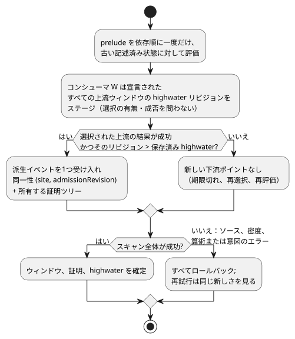
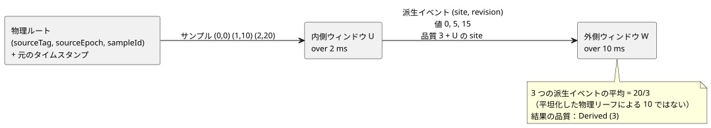

<!-- translation-source: tasks/window-derived-design.md -->
[英語の原文](window-derived-design.md)

# 派生ウィンドウ証拠の提案

**状況：** 測定されたネストウィンドウのコンパイラ/コア/証明/パッケージ経路は実装済みで、batch13 に含まれています。時間/アダプタのリプレイの完全な受け入れは未完了のままです。末尾の実行証拠を参照してください。ネストしたウィンドウは、言語として必須の振る舞いです。

この文書の内容：

- Reference の基準となる事実と、Root が承認した 4 つの意味論上の決定
- 派生イベントの同一性付け、受け入れ（アドミッション）、品質の与え方
- 明示的な証拠マーカーを使えば既存の GFB4 ワイヤで十分な理由
- 有限の容量と、所有する証明ストレージの式
- トランザクション、トレース、リプレイの規則
- 6 つの識別的な受け入れシナリオと、現在の証拠

**派生イベント**とは、上流ウィンドウの 1 つの成功した結果のうち、下流ウィンドウが入力ポイントとして受け入れたものです。**物理的な観測**とは、元のセンササンプルです。

## 基準となる事実と承認された意味論上の決定

[Reference §4.4](../docs/reference/04-sensors-constraints-control.ja.md#44-時間的証拠temporal-evidence)
は次を要求します。

- 元の観測の同一性
- 再送信や再評価による寄与がないこと
- 集約結果の来歴を区別すること
- 変換や分岐を通じて保持されること
- 集約の同一性と物理的な観測を区別する下流ウィンドウ

また、左開のウィンドウ、厳密な `max_age`、故障保持、ソースエポックによる無効化も定めています。既存の[証拠計画](window-evidence-design.ja.md)は明示的な物理密度のファクトを提供します。想定される取得周期は上限を提供しません。

Reference は、次の 3 点を決めて**いません**。

- 上流の期限切れだけによる値の変化が、下流の新しい観測になるかどうか
- どのタイムスタンプが派生観測を識別するか
- 重なり合う集約入力が、それぞれ 1 つの重みを受け取るかどうか

これらの選択は数値結果を変えます。Root は、次の運用に関わらない言語上の決定を承認しました。デバイスの周期、密度、設備の既定値は導入されません。

承認された解釈：

1. **イベントの周期。** **新しい上流の受け入れ**による成功した結果が、派生イベントを生成します。単なる評価、寄与要素の期限切れ、セレクタの変更、故障の変化、状態の変化は、新しい観測を生成しません。`admissionRevision` の既存の意味を維持し、ひそかにスキャンカウンタに変えてはなりません。
2. **タイムスタンプ。** 派生イベントの観測タイムスタンプは、上流の結果の最も新しい寄与要素の観測タイムスタンプであり、実際の証拠から再帰的に継承されます。確定時の評価時刻は `evaluatedAt` として別に保持します。遅れた観測を再計算しても、その測定の新しさを更新してはなりません。どちらの時刻も、作り出された物理的な同一性ではありません。
3. **重み。** 異なる派生イベントはそれぞれ、下流の平均で 1 つの重みを受け取ります。集約の同一性はその層で重複排除します。ネストした平均を平坦化してはならず、算術を行う際に共有された物理リーフを重複排除してもなりません。共有リーフは来歴であり、追加の下流入力ポイントではありません。
4. **エポックによる無効化。** 物理ソースエポックを無効化すると、その古いエポックに証明が依存する、保持中のすべての派生イベントが無効化されます。A+B の混合集約が、A をひそかに取り除きながら古いスカラー値を保持することはできません。その依存イベントは破棄し、独立した B のみのイベントは保持します。これは推移的な依存関係による無効化です。

**却下された代替案。**

- *評価時刻を観測時刻とする。* これは実際にありうる代替案です。最新の測定の新しさではなく、集約の公開の新しさを測るものです。これを採ると、より短い下流の max_age の下でも、遅れた結果が新しいまま保たれます。Reference は評価時刻と元の観測の両方に言及していますが、この下流のタイムスタンプは決めていません。Root は上記の観測時刻の規則を選択しました。
- *期限切れイベントの発行。* 新しい結果世代カウンタ、すべての深さでの期限切れ起因イベントの上限、そしてそのタイムスタンプの定義が必要になります。
- *毎スキャンでの発行。* 物理密度による上限がなく、キャッシュされた証拠に過大な重みを与えます。
- *元のリーフの平坦化。* 関数合成の意味を変えてしまいます。

これらの代替案はいずれも、提案する既定ではありません。

## 実行可能な受け入れと品質

互いに素な 2 つの同一性の名前空間を使います。

| 名前空間 | 同一性 | 併せて運ぶもの |
|---|---|---|
| 物理 | `(sourceTag, sourceEpoch, sampleId)` | 元のタイムスタンプ |
| 派生 | `(site, admissionRevision)`。インストールされたモジュール、選択された戦略、ライブ実行セッションにスコープされる | 別個の観測タイムスタンプ、評価時刻、入力の有界な証明 |

**派生同一性のスコープ。** そのスコープは、ライブの Runtime/アリーナが提供します。固定の時間エポックは連続性の検証に参加しますが、グローバルに一意なセッション ID ではありません。現在のコアのトレースのモジュールフィンガープリントは、暗号学的な成果物の同一性ではありません。永続化されたレコードや外部のレコードは、既存の権威ある成果物/ソースのエンベロープに入れて運ばなければなりません。消費する側の境界は、ローカルの site/revision キーを解決する前にその同一性を検証します。ネストのためにグローバル ID や新しいハッシュ基盤を作り出してはなりません。独立に取得したエンベロープの永続的な復元は、別個の未完了の作業のままです。式から見えるすべての整数は、リビジョンを含めて正確に表現可能なままです。スロットのインデックスは物理ソースタグではありません。

**prelude の評価。** prelude は、スキャンごとに依存順で一度だけ、古い記述済み状態に対して評価します。成功したソースのペイロードは、その証拠が古くても先行評価します。選択された算術故障は、それでもスキャンを拒否しなければなりません。fault/origin は、ソースが成功しなかった場合にのみ評価します。現在のアトミックな prelude トランザクションを保持します。

**Highwater。** すべてのコンシューマは、確定した各スキャンで、選択されていないソースや成功しなかったソースも含め、**宣言されたすべての上流ウィンドウ**の highwater リビジョンを記録します。受け入れるのは、選択された新しい成功イベント 1 つまでです。

- キャッシュされたウィンドウに切り替え直しても、その以前の結果を再導入することはできません。
- ロールバックはこれらの highwater を復元するため、失敗したスキャンを再試行してもイベントは失われません。
- 物理入力は、既存の全ルート highwater の扱いを維持します。
- NotReady を生成する新しい受け入れ（たとえばレートの最初のポイント）は、観測履歴を進めますが、成功イベントは提供しません。

下のフローは、スキャン内での 1 つのコンシューマの受け入れ判断と、確定またはロールバックがそれをどう扱うかを示します。

**Activation、新しさ、再試行。**

- 新規の activation では、すべての上流の highwater はリビジョン 0 から始まります。リビジョン 0 のウィンドウは証拠を受け入れていないため、成功した派生イベントを提供できません。
- 保存された highwater より大きい上流の候補リビジョンは、新しいものです。
- コンシューマは、候補リビジョンが選択されていない場合や、いずれかの Result が成功していない場合でも、それをステージします。
- これらの highwater を確定するのは、完全に成功したスキャンだけです。ソース式、密度、算術、または後続の意図のいずれかのエラーは、すべてのウィンドウ候補とともにそれらを破棄します。再試行は、失敗した試行とまったく同じ新しさを見ます。
- チェックポイントのリプレイは保存された highwater を復元します。履歴を保持したまま 0 に再初期化することはありません。

**順序付け。** リビジョンの順序は、派生観測タイムスタンプの単調性を意味しません。たとえば、以前の最新ルートを無効化すると、より古い有効な証拠が表に出ることがあります。派生エントリは観測時刻と同一性でソートします。物理的な単一ソースのタイムスタンプ逆行ガードを、派生リビジョンの順序に適用してはなりません。

**期限切れだけによる変化。** 上流の現在値は、受け入れリビジョンを変えずに期限切れによって変わることがあります。通常の式はその値を読み取れますが、新しい下流ポイントは生成されません。下流の既存の履歴は、上流が NotReady の間も成功のままでありえます。その上流の故障はトレースに保持します。

**品質。** `quality: measured` は、物理的な Measured の証拠と、リーフが受け入れ可能な Measured 証拠である検証済みの派生証明を受け入れます。その結果は Derived (3) のままであり、決して Measured (1) にはなりません。

- Held (2) と Constructed (0) は、window、map、case、recover、コンストラクタを通過しても受け入れ可能にはなりません。
- 純粋な map/and_then は入ってきた証拠参照を保持し、Result の分岐は 1 つの参照を選択します。
- recover の後に新しいコンストラクタが続く場合、測定の証明はありません。
- 既存の物理式の経路と同様に、変換はイベントの同一性を変えずにペイロードを変えることができます。

## 明示的な証拠マーカーがあれば既存の GFB4 ワイヤで十分

既存の 6 つのソース式、すなわち ok、payload、fault、origin、quality、証拠参照を維持します。6 番目のフィールドの意味を、quality を使って一般化します。

| 品質 | 6 番目のフィールド（証拠参照）の意味 |
|---|---|
| 1 | 現在と同じく、正の物理ルートタグ |
| 3 | 以前のウィンドウの site（別の名前空間） |
| 0 / 2 | 受け入れ可能な証拠なし |

**出力。** 各派生系譜のリーフについて、コンパイラは 5 番目の blob に `(window-read U quality)` を、6 番目の blob に U の site を出力します。分岐はこれらを並行して選択します。定数の純粋な map も、品質の射影を保持します。そのため、quality blob 内の既存の opcode 57 フィールド 7 が、明示的な依存関係マーカーとして機能します。

**デコードと検証。**

- デコーダは、これらのフィールド 7 の参照を、ソート済みで一意な内部依存リストに集めます。それらは以前のスロットでなければならず、これは式の検証がすでに強制しています。
- 分岐条件内での通常のウィンドウの value/ok の読み取りは、証拠マーカーではありません。
- 既存の rootRefs は、推移的な物理ルートの完全な集合になります。各証拠依存のルートがそこに含まれていることを検証します。
- 品質 3 のとき、Runtime は選択された site がそのリストに属することを要求し、その上流の実際の成功した候補証明を要求します。定数の品質 3 だけでは、宣言されていない上流を指定できません。
- 動的な物理ソースタグは、変わらず機能し続けます。

**このマーカーを選ぶ理由。** opcode 57 の読み取りを区別なくすべて集めると、制御の依存関係と証拠とを混同してしまいます。ディスクリプタ表を追加しても同じ宣言を表現できますが、新しいレイアウト/プロファイルが必要になります。品質射影のマーカーは、既存の 6 つの blob のままで必要な静的上限を提供します。Root はこの GFB4 契約を承認しました：新しい opcode もワイヤフィールドもありません。マニフェスト/ソースのメタデータが、対応する以前のウィンドウの証拠バインディングを記録し、正規のリプレイがその選択を厳密にチェックします。静的な状態/ウィンドウ数、モジュール、式、スタックの上限は変わりません。

## 有限の容量と所有する証明ストレージ

**累積ホライズン。** 各ウィンドウ W について、トポロジカル順に、保守的な累積ホライズンを定義します。

`H(W) = over(W) + max({0} ∪ {H(U): U is an evidence dependency of W})`.

**論理容量。** 明示的なルートの上限 `(M_r, I_r)` が与えられたとき、論理入力容量を次のように確保します。

`C(W) = sum over transitive roots r of M_r * ceil(H(W) / I_r)`.

この上限が成り立つ理由：

- 新しく保持される派生ポイントはすべて、選択されたチェーンを通じて受け入れられた新しい物理的な祖先を持ちます。その祖先は、そのポイントの最新の観測タイムスタンプから遡る累積ルックバックの範囲内にあります。
- 各ウィンドウは、確定したスキャンごとに最大 1 つのイベントしか発行しません。全ソースの highwater により、後のセレクタのみ、またはクロックのみのスキャンで、同じ因果的な受け入れについて再び発行することは禁止されます。
- したがって、証明の保持には累積ルックバックが必要であり、評価タイムスタンプに対する密度の上限を仮定する必要はありません。
- 1 回のスキャンでの複数のルート更新は、この容量を過大に見積もるだけです。
- ソースエポックの置き換えは、受け入れの前に古い依存証明を取り除きます。

この証明やチェック済みの上限が成り立たない場合、保持中のイベントをひそかに追い出してはなりません。スキャン/activation 全体を拒否します。

**最新タイムスタンプの重複。** 複数の受け入れが、同じ最新タイムスタンプを共有することがあります。タイムスタンプ 100 のアンカーが最新のままである一方で、遅れて届いた 90 と 95 の別個のサンプルがそれぞれ上流のリビジョンを進めることがあります。これらのリビジョンをタイムスタンプで重複排除してはならず、物理密度を派生タイムスタンプに直接適用してもなりません。別個の因果的なサンプルは、アンカーから遡る上流のルックバックを含む H(W) にわたって有界です。

**所有する証明。** 保持されたペイロードだけでは不十分です。各派生ポイントは、上流のエントリが期限切れになった後も、受け入れ時点での上流集約の完全な証明を保持しなければなりません。単純な最初の実装では、その証明を、事前アロケートされたアリーナ内のフラットな所有ツリーとして格納します。重なり合うサブツリーのコピーは許され、すべて予算に計上されます。非有界な Arc グラフ、ハッシュによる同一性、インターン化サブシステムは必要ありません。

`P(W)` を、物理リーフのコストを 1 として、W の完全な出力証明のノード数の上限とします。

`P(W) = 1 + C(W) * max({1} ∪ {P(U): U is an evidence dependency of W})`.

- 各ツリーノードには、種類、証拠の同一性、タイムスタンプ、ペイロード、有界な子の範囲が含まれます。
- 派生ノードは宣言/演算/評価の同一性を保持し、物理リーフは元の同一性を保持します。
- エッジのペイロードは変換を保持しなければなりません。変換後の数値を JavaScript で再構成してはなりません。
- この漸化式は分岐の多いグラフでは急速に大きくなりえますが、有限でありチェックされます。DAG 共有による最適化は、後で行う任意のものです。計上されないストレージよりも、ターゲット予算による拒否のほうが望ましいです。

**Activation の予算。** activation は、すべての和、積、アロケーションをチェックします。

- `maxRetainedSamples` は、引き続き論理 C(W) の合計です。
- `maxBytes` には、証明のコピー、上流の highwater、候補/確定済みの 2 つのバンク、J+1 個のチェックポイント、J+1 個の独立したトレースツリー、有界なコピー用スクラッチ、リプレイのライブ＋スクラッチのピークが含まれます。
- より大きな十分な予算上限は互換です。トポロジ、プロファイル、アロケーションのジオメトリは、チェックポイントの同一性です。
- 新しい物理密度の設定も、スキャン頻度の既定値もありません。

## トランザクション、トレース、リプレイ

- **証拠の表現。** 派生データを `Observation {source_tag, Identity}` に適合させるのではなく、Rust の内部的な証拠 enum を追加します。物理ソースのエンジンは現在の表現を維持してかまいません。一般化された保持エントリは、物理または派生の同一性と、証明の範囲を運びます。
- **ステージング。** 受け入れ、エポックによる無効化、ソースの highwater は、ウィンドウのペイロードとともにステージされます。後続のソース/意図の失敗があれば、ステージされたすべての変更がロールバックされます。
- **チェックポイントと巻き戻し**には、証明のアリーナ、派生の highwater、イベントの観測タイムスタンプ、評価時刻が含まれます。
- **リプレイ**には、入力/状態のレイアウトに加えて、ディスクリプタのトポロジ、ソースバインディング、固定の時間エポック、密度の証明が一致することが必要です。
- **トレース。** トレースレコードは、Runtime の生存期間とは独立に自身の証明ツリーを所有します。ソースのオブザーバは、平均を計算せずにそれらのファクトを検証/マッピングします。直接の寄与要素と物理リーフを分けて保持します。リーフの数を下流のサンプル数として報告するのは誤りです。
- セッションの置き換えと、時間のホットスワップ移行は、明示的な作業として残ります。

## 6 つの識別的な受け入れシナリオ

シナリオ 1 は、中心となる合成のケースです。図は、外側の平均が平坦化した 10 ではなく 20/3 になる理由を示します。

1. **合成と重なり合うリーフ。** 内側は 2 ms にわたる平均、外側は 10 ms にわたる平均。物理 `(t,value)=(0,0),(1,10),(2,20)`。内側の結果は 0、5、15 です。外側の結果は 20/3 で、派生寄与要素は 3 つです。その一意な物理リーフ集合は 3 つの同一性を持ちます。その平坦化した集合を平均すると、誤って 10 になります。密度はこれらの実際のサンプルを許可しなければなりません。リプレイは同じ同一性と数値を生成します。
2. **スキャン/期限切れによる生成がないこと。** シナリオ 1 を、新しいサンプルなしで t3 まで続けます。内側は期限切れによって 20 になりますが、新しいイベントは発行しません。外側は 20/3、件数 3 のままです。重複したサンプルの配信や、選択された式の再評価も、その件数/リビジョンを変えません。これにより、Root のイベント周期の決定が識別されます。
3. **観測時刻と評価時刻。** タイムスタンプ 0 の内側の観測が、評価時刻 9 で初めて受け入れられます。内側の over/maxAge は 10、外側は over 10/maxAge 2 です。提案する派生観測タイムスタンプ 0 では、外側はただちに NotReady になります。内側の結果は成功で、evaluatedAt は 9 です。代替の公開時刻の規則では、外側は 11 まで新しいまま保たれます。これにより、新しさの更新と、証拠を新しくせずに評価時刻を記録することとが識別されます。
4. **最新タイムスタンプの重複、セレクタ、品質。**
   - 20 ms にわたる内側は、まず now100 で A(ts100, value100) を受け入れ、次に 101 で B(ts90, value0)、次に 102 で B(ts95, value20) を受け入れます。その派生値 100、50、40 はすべて観測タイムスタンプ 100 を持ちます。over/maxAge 5 ms の外側は 3 つすべてを保持し、190/3 になります。プロファイル A=1/1000ms と B=1/5ms はこの並びを許可します。外側ホライズンを直接使った容量 2 では失敗しますが、累積ホライズン 25 ms、容量 6 で十分です。
   - これとは別に、2 つの上流ウィンドウが 1 回のスキャンで A=2 と B=8 を生成し、外側は A を選択します。新しい観測なしにキャッシュされた B に切り替えても、8 を追加してはなりません。後で本当に新しい B の受け入れがあれば、その結果を 1 回だけ追加できます。
   - Held の値を map したり ok を構築したりしても、測定されたリーフは決して生成されません。
5. **エポックによる無効化とレートの同順位。** A+B から派生したポイント 1 つと、別個の B のみのポイントを保持します。A のエポック変更は、依存する混合ポイントだけを破棄します。同じ観測タイムスタンプを持つ異なる派生同一性にわたるレートは NotReady です。t1000 で値 5、t3000 で値 9 の場合、その正規の値は 2/秒です。
6. **証明の予算、ロールバック、ロールオーバー。** 計算した厳密なバイト上限と論理容量の上限で activation します。1 少なければ拒否されます。新しいネストイベントの後、後続のゼロ除算の故障は、スカラー/ウィンドウ/証明/highwater/ジャーナルの状態を変えません。同一の再試行は 1 回だけ受け入れます。J2 では、ロールオーバー後のリプレイが、内側の元のリーフがすでに期限切れになっていても、保持されている最も古いスキャンより前の証明を復元します。同じテストを、ネイティブと両方の WASM アダプタで実行しなければなりません。

Root は、意味論上の決定、推移的な混合証明の無効化、品質射影マーカーの契約を承認しました。ユーザー固有の運用数値は必要ありません。

## 実行証拠と残りの受け入れ

| 領域 | テスト | 結果 / ログ |
|---|---|---|
| ネイティブ Rust コア | `tests/temporal_derived.rs` | 11 件の独立したテストが、6 つのシナリオ、マーカー/ルートの検証、圧縮された終点インデックス、ペイロードの先行評価/故障の遅延評価をカバーします。ユニットのアロケーションテストは、トランザクション、チェックポイント、復元の 200 サイクルをアロケーションなしで実行します。コア全体：136 件成功、`build/temporal-derived-core-final.log`。batch13 でも成功。 |
| コンパイラ/エンコーダ | `tests/window-derived-control.test.mjs` | 物理ウィンドウと GFB のスイートとの集約的な焦点実行：38 件成功。その後 batch13 でも成功。 |
| 実際の両 WASM ホスト経路 | `tests/window-derived-host.test.mjs` | batch13 では当初 6 件成功：20/3 の合成、期限切れによる受け入れなし、元の新しさ、ソースの観測を含む変換後の集約証明値。ゲートの後、遅延故障/同一 ID 再試行のテスト 2 件が追加されました：`build/window-derived-host-retry.log` でホスト 8/8 成功。失敗時に確定済みの公開トレースは変わらず、再試行でリビジョン 3 がちょうど 1 回受け入れられます。 |
| ソースのメタデータ/証明の検証 | `tests/window-derived-provenance.test.mjs` | 5 件成功。不正な所有ツリー/同一性と、正規の依存関係差し替えのケースが、実際の WASM の観測を補完します。 |
| 署名付き JS パッケージ | `tests/window-derived-package.test.mjs` | リーフケース 11 件（親を含めて 12 件）成功。 |
| ネイティブパッケージ検証器 | — | ターゲットローダーの前でのネスト依存の欠落/再バインド/型/インデックスの拒否を含め、28 件成功。ネイティブ検証器は JavaScript のソースを再コンパイルしません。 |

**リプレイとリソースの証拠。** シナリオ 6 のネイティブのチェックポイント/巻き戻しと J2 ロールオーバーのテストは成功します。Batch14 では、実際の J1024 ジャーナルを使い、両方の WASM アダプタを通じた読み取り専用のチェックポイントリプレイを追加しました：元のレコードとの厳密な一致、ネストした 20/3、所有する証明の同一性、遅延故障/再試行、保持されたプレフィックスのロールオーバー、ライブ状態の保持。`tests/temporal-replay-wasm.test.mjs` と `temporal-adapter-replay-design.md` を参照してください。実際の WASM テストと時間リソース計画のスイートは、ターゲット固有の厳密な境界オラクルを証明するようになりました。`build/temporal-resource-plan-wasm-green.log`、`build/scan-frame-wasm-temporal-plan.log`、および `tasks/temporal-resource-plan-design.md` のオラクル値を参照してください。この証拠を、他の時間演算子や永続的な復元に一般化してはなりません。

**残り：** 外部チェックポイントの永続的な復元、時間のホットスワップ、推定証拠は、この測定されたライブセッションの増分の範囲外であり、未完了のままです。
