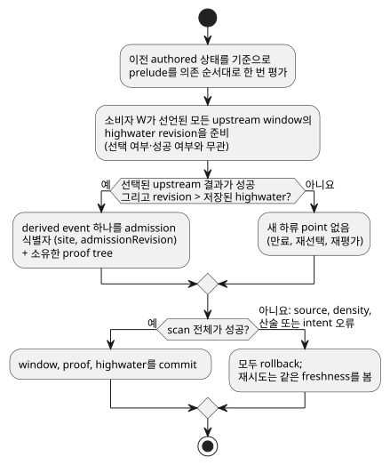
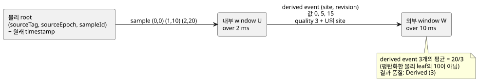

<!-- translation-source: tasks/window-derived-design.md -->
[영문 원문](window-derived-design.md)

# Derived window 증거 제안

**상태:** measured nested-window 컴파일러/core/proof/package 경로가 구현되어
batch13에 포함되었습니다. 전체 temporal/adapter replay 수용은 아직 미결입니다.
마지막의 실행 증거를 참조하십시오. Nested window는 필수 언어 동작입니다.

이 문서의 내용:

- Reference의 기준 사실과 Root가 승인한 의미 결정 네 가지
- derived event를 식별하고, admit하고, 품질을 부여하는 방법
- 명시적 evidence marker를 사용하면 기존 GFB4 wire로 충분한 이유
- 유한 용량과 소유 proof 저장소 공식
- 트랜잭션, trace, replay 규칙
- 구분 가능한 수용 시나리오 여섯 가지와 현재 증거

**derived event**는 상류 window의 성공 결과 하나를 하류 window가 입력 point로
admit한 것입니다. **물리 관측**은 원래의 센서 sample입니다.

## 기준 사실과 승인된 의미 결정

[Reference §4.4](../docs/reference/04-sensors-constraints-control.md#44-temporal-evidence)는
다음을 요구합니다.

- 원래 관측 식별자
- 재전송이나 재평가는 기여하지 않음
- 구분되는 aggregate 결과 provenance
- 변환과 분기를 거쳐도 보존됨
- aggregate 식별자와 물리 관측을 구분하는 하류 window

또한 open-left window, 엄격한 `max_age`, fault 보존, source epoch 무효화를
확정합니다. 기존 [증거 계획](window-evidence-design.ko.md)은 명시적인 물리
density fact를 공급합니다. 예상 수집 cadence는 상한을 공급하지 않습니다.

Reference는 다음 세 가지를 정하지 **않습니다**.

- 상류의 만료로만 생긴 값 변경이 새로운 하류 관측인지
- 어떤 타임스탬프가 derived 관측을 식별하는지
- 겹치는 aggregate 입력이 각각 가중치 하나씩을 받는지

이 선택들은 수치 결과를 바꿉니다. Root는 다음의 비운영 언어 결정을
승인했습니다. 장치 cadence, density, 설비 기본값은 새로 도입하지 않습니다.

승인된 해석:

1. **Event cadence.** **새로운 상류 admission**의 성공 결과가 derived event를
   만듭니다. 단순 평가, contributor 만료, selector 변경, fault 변경, state 변경은
   새 관측을 만들지 않습니다. `admissionRevision`의 기존 의미를 유지하며, 이를
   조용히 scan counter로 바꾸지 않습니다.
2. **타임스탬프.** derived event의 관측 타임스탬프는 상류 결과의 가장 최근
   contributor 관측 타임스탬프이며, 실제 증거에서 재귀적으로 상속됩니다.
   commit된 평가 시각은 `evaluatedAt`으로 별도로 유지합니다. 지연된 관측을
   다시 계산해도 그 측정 freshness가 갱신되어서는 안 됩니다. 어느 시각도 꾸며낸
   물리 식별자가 아닙니다.
3. **가중치.** 서로 다른 derived event는 하류 average에서 각각 가중치 하나를
   받습니다. 그 계층에서 aggregate 식별자를 중복 제거합니다. nested average를
   평탄화하지 않으며, 산술 계산 시 공유된 물리 leaf를 중복 제거하지 않습니다.
   공유 leaf는 provenance일 뿐, 추가적인 하류 입력 point가 아닙니다.
4. **Epoch 무효화.** 물리 source epoch를 무효화하면 proof가 그 이전 epoch에
   의존하는 보존된 derived event가 모두 무효화됩니다. A+B 혼합 aggregate는 A를
   조용히 제거하면서 이전 scalar 값을 유지할 수 없습니다. 그 의존 event는 버리고,
   독립적인 B 전용 event는 보존합니다. 이것이 전이적 의존성 무효화입니다.

**기각된 대안.**

- *평가 시각을 관측 시각으로 사용.* 실제로 가능한 대안입니다. 이는 최신 측정의
  freshness가 아니라 aggregate 게시의 freshness를 측정합니다. 더 짧은 하류
  max_age에서도 늦은 결과를 fresh하게 유지하게 됩니다. Reference는 평가 시각과
  원래 관측을 모두 명명하지만 이 하류 타임스탬프를 확정하지는 않습니다. Root는
  위의 관측 시각 규칙을 선택했습니다.
- *만료 event 생성.* 새로운 result-generation counter, 모든 깊이에서 만료로
  촉발되는 event의 상한, 그 타임스탬프의 정의가 필요합니다.
- *매 scan마다 생성.* 물리 density로 상한을 정할 수 없고 cached 증거에 과도한
  가중치를 줍니다.
- *원래 leaf 평탄화.* 함수 합성의 의미를 바꿉니다.

이 대안 중 어느 것도 제안된 기본값이 아닙니다.

## 실행 가능한 admission과 품질

서로 겹치지 않는 식별자 namespace 두 개를 사용합니다.

| Namespace | 식별자 | 함께 담는 것 |
|---|---|---|
| Physical | `(sourceTag, sourceEpoch, sampleId)` | 원래 타임스탬프 |
| Derived | `(site, admissionRevision)`, 설치된 module, 선택된 strategy, live 실행 session 범위 | 별도의 관측 타임스탬프, 평가 시각, 입력에 대한 제한된 proof |

**Derived 식별자의 범위.** live Runtime/arena가 그 범위를 공급합니다. 고정 time
epoch는 연속성 검증에 참여하지만 전역적으로 고유한 session ID는 아닙니다. 현재
core trace module fingerprint는 암호학적 산출물 식별자가 아닙니다. 영속 기록이나
외부 기록은 기존의 권위 있는 artifact/source envelope에 담아 전달해야 하며,
소비하는 경계는 local site/revision key를 해석하기 전에 그 식별자를 검증합니다.
중첩을 위해 전역 ID나 새로운 hash 인프라를 만들어 내지 마십시오. 독립적으로
획득한 envelope의 영속 restore는 별도의 미완료 작업으로 남아 있습니다. revision을
포함해 식에 노출되는 모든 정수는 정확히 표현 가능해야 합니다. slot index는 물리
source tag가 아닙니다.

**Prelude 평가.** scan마다 이전 authored 상태를 기준으로 prelude를 의존 순서대로
한 번 평가합니다. 성공한 source payload는 그 증거가 오래되었더라도 즉시
평가합니다. 선택된 산술 fault는 여전히 scan을 거부해야 합니다. fault/origin은
source가 실패했을 때에만 평가합니다. 현재의 원자적 prelude 트랜잭션을
보존합니다.

**Highwater.** 모든 소비자는 commit된 scan마다 선택되지 않았거나 실패한 소스를
포함해 **선언된 모든 상류 window**의 highwater revision을 기록합니다. admit하는
것은 최대 하나, 선택된 fresh 성공 event뿐입니다.

- cached window로 다시 전환해도 그 이전 결과를 다시 들여올 수 없습니다.
- rollback은 이 highwater를 복원하므로, 실패한 scan을 재시도해도 event를 잃지
  않습니다.
- 물리 입력은 기존 all-root highwater 처리를 그대로 유지합니다.
- NotReady를 만드는 새 admission(예: rate의 첫 point)은 관측 이력을 전진시키지만
  성공 event를 공급하지는 않습니다.

아래 흐름은 한 scan 안에서 소비자 하나가 내리는 admission 결정과, commit 또는
rollback이 이를 어떻게 처리하는지 보여 줍니다.

**Activation, freshness, 재시도.**

- 새 activation에서 모든 상류 highwater는 revision 0에서 시작합니다. revision 0인
  window는 증거를 admit한 적이 없으므로 성공 derived event를 공급할 수 없습니다.
- 저장된 highwater보다 큰 상류 후보 revision은 fresh입니다.
- 소비자는 후보 revision이 선택되지 않았거나 어느 한쪽 Result가 실패했더라도
  그 revision을 stage합니다.
- 완전히 성공한 scan만 이 highwater를 commit합니다. source-expression, density,
  산술, 이후 intent 오류가 생기면 모든 window 후보와 함께 이를 폐기합니다.
  재시도는 실패한 시도와 정확히 같은 freshness를 봅니다.
- checkpoint replay는 저장된 highwater를 복원합니다. 이력을 유지한 채 이를 0으로
  재초기화하지 않습니다.

**순서.** revision 순서가 derived 관측 타임스탬프의 단조 증가를 뜻하지는
않습니다. 예를 들어 이전의 최신 root를 무효화하면 더 오래된 유효 증거가 드러날 수
있습니다. derived 항목은 관측 시각과 식별자로 정렬합니다. 물리 단일 소스의
역행 타임스탬프 guard를 derived revision 순서에 적용하지 마십시오.

**만료로만 생기는 변경.** 상류 현재 값은 admission revision이 바뀌지 않은 채
만료로 바뀔 수 있습니다. 일반 식은 그 값을 여전히 읽을 수 있지만, 새 하류
point는 생기지 않습니다. 하류의 기존 이력은 상류가 NotReady인 동안에도 성공으로
남을 수 있으며, 그 상류 fault는 trace에 보존합니다.

**품질.** `quality: measured`는 물리 Measured 증거와, leaf가 허용 가능한
Measured 증거인 검증된 derived proof를 받아들입니다. 그 결과는 Derived (3)로
남으며 결코 Measured (1)이 되지 않습니다.

- Held (2)와 Constructed (0)는 window, map, case, recover, constructor를
  통과해도 허용 가능해지지 않습니다.
- 순수 map/and_then은 들어온 evidence 참조를 보존하고, Result 분기는 참조 하나를
  선택합니다.
- recover 뒤에 새 constructor가 오면 측정 proof가 없습니다.
- 기존 physical-expression 경로처럼, 변환은 event의 식별자를 바꾸지 않고
  payload를 바꿀 수 있습니다.

## 명시적 evidence marker가 있으면 기존 GFB4 wire로 충분합니다

기존 source 식 여섯 개, 즉 ok, payload, fault, origin, quality, evidence 참조를
유지합니다. 여섯째 필드의 의미를 quality로 일반화합니다.

| Quality | 여섯째 필드(evidence 참조)의 의미 |
|---|---|
| 1 | 현재처럼 양의 물리 root tag |
| 3 | 별도 namespace의 이전 window site |
| 0 / 2 | 허용 가능한 증거 없음 |

**생성.** derived 계보의 각 leaf마다 컴파일러는 다섯째 blob에
`(window-read U quality)`를, 여섯째 blob에 U의 site를 내보냅니다. 분기는 이를
병렬로 선택합니다. 상수 순수 map도 quality projection을 유지합니다. 따라서
quality blob의 기존 opcode 57 field 7이 명시적 의존성 marker 역할을 합니다.

**Decoding과 검증.**

- decoder는 그 field 7 참조를 정렬된 중복 없는 내부 의존성 목록으로 수집합니다.
  이들은 앞선 slot이어야 하며, 이는 식 검증이 이미 강제합니다.
- 분기 조건 안의 일반 window value/ok 읽기는 evidence marker가 아닙니다.
- 기존 rootRefs는 완전한 전이적 물리 root 집합이 됩니다. 각 evidence 의존성의
  root가 포함되었는지 검증합니다.
- quality 3에서 Runtime은 선택된 site가 그 목록에 속할 것과, 그 상류의 실제 성공
  후보 proof를 요구합니다. 상수 quality 3만으로는 선언되지 않은 상류를 명명할 수
  없습니다.
- 동적 물리 source tag는 변경 없이 계속 동작합니다.

**왜 이 marker인가.** 모든 opcode 57 읽기를 무차별적으로 수집하면 control
의존성과 증거를 혼동하게 됩니다. 별도의 descriptor 표를 추가해도 같은 선언을
표현할 수 있지만, 새로운 layout/profile이 필요합니다. quality-projection
marker는 기존 blob 여섯 개로 필요한 정적 상한을 제공합니다. Root는 이 GFB4
계약을 승인했습니다. 새 opcode나 wire 필드는 없습니다. manifest/source
metadata는 대응하는 이전 window evidence binding을 기록하고, 정본 replay는 그
정확한 선택을 검사합니다. 정적 state/window 수, module, 식, stack 상한은 바뀌지
않습니다.

## 유한 용량과 소유 proof 저장소

**누적 horizon.** 위상 순서에 따라 각 window W에 대해 보수적인 누적 horizon을
정의합니다.

`H(W) = over(W) + max({0} ∪ {H(U): U is an evidence dependency of W})`.

**논리 용량.** 명시적 root 상한 `(M_r, I_r)`가 주어지면 논리 입력 용량을
예약합니다.

`C(W) = sum over transitive roots r of M_r * ceil(H(W) / I_r)`.

이 상한이 성립하는 이유:

- 새로 보존되는 모든 derived point에는 선택된 chain을 통해 admit된 fresh 물리
  조상이 있습니다. 그 조상은 point의 최신 관측 타임스탬프로부터 누적 lookback
  안에 있습니다.
- 각 window는 commit된 scan마다 최대 하나의 event만 내보냅니다. all-source
  highwater는 이후의 selector 전용 또는 clock 전용 scan에서 같은 원인
  admission으로 다시 event를 내보내는 것을 막습니다.
- 따라서 proof 보존에는 평가 타임스탬프에 대한 가정된 density 상한이 아니라 누적
  lookback이 필요합니다.
- 한 scan에서 여러 root가 갱신되면 이 용량을 과대평가할 뿐입니다.
- source epoch 교체는 admission 전에 이전의 의존 proof를 제거합니다.

이 proof나 검사된 상한이 실패하면 보존된 event를 조용히 축출해서는 안 됩니다.
scan/activation 전체를 거부합니다.

**반복되는 최신 타임스탬프.** 여러 admission이 같은 최신 타임스탬프를 공유할 수
있습니다. 타임스탬프 100의 anchor는 최신으로 남아 있는 동안, 지연된 서로 다른
sample 90과 95가 각각 상류 revision을 전진시킬 수 있습니다. 이 revision들을
타임스탬프로 중복 제거하지 말고, 물리 density를 derived 타임스탬프에 직접
적용하지 마십시오. 서로 다른 원인 sample은 anchor 뒤의 상류 lookback을 포함하는
H(W)로 제한됩니다.

**소유 proof.** 보존된 payload만으로는 충분하지 않습니다. 각 derived point는
상류 항목이 만료된 뒤에도 admission 시점 상류 aggregate의 완전한 proof를 유지해야
합니다. 단순한 첫 구현은 그 proof를 미리 할당된 arena에 평탄한 소유 tree로
저장합니다. 겹치는 subtree의 복사는 허용되며 모두 예산에 반영합니다. 무제한 Arc
graph, hash 식별자, interning subsystem은 필요하지 않습니다.

물리 leaf의 비용을 1로 할 때, 완전한 W 출력 proof의 node 수 상한을 `P(W)`라고
합니다.

`P(W) = 1 + C(W) * max({1} ∪ {P(U): U is an evidence dependency of W})`.

- 각 tree node에는 kind, evidence 식별자, 타임스탬프, payload, 제한된 child
  범위가 들어 있습니다.
- derived node는 declaration/operation/evaluation 식별자를 유지하고, 물리 leaf는
  원래 식별자를 유지합니다.
- edge payload는 변환을 보존해야 합니다. 변환된 숫자를 JavaScript에서 다시
  구성하지 마십시오.
- 분기하는 graph에서는 이 점화식이 빠르게 커질 수 있지만 유한하며 검사됩니다.
  DAG 공유 최적화는 이후의 선택 사항이며, 집계되지 않은 저장소보다 대상 예산
  거부가 낫습니다.

**Activation 예산.** activation은 모든 합, 곱, 할당을 검사합니다.

- `maxRetainedSamples`는 논리 C(W)의 합으로 유지됩니다.
- `maxBytes`는 proof 복사본, 상류 highwater, candidate/committed bank 두 개,
  J+1개의 checkpoint, J+1개의 독립 trace tree, 제한된 복사 scratch, replay의
  live+scratch peak를 포함합니다.
- 더 큰 충분한 예산 상한은 호환됩니다. topology, profile, 할당 구성은
  checkpoint 식별자에 속합니다.
- 새로운 물리 density 설정도, scan 빈도 기본값도 없습니다.

## 트랜잭션, trace, replay

- **증거 표현.** derived 데이터를 `Observation {source_tag, Identity}`에 맞춰
  변환하지 말고 Rust 내부 evidence enum을 추가합니다. 물리 source engine은 현재
  표현을 유지할 수 있으며, 일반화된 보존 항목은 physical 또는 derived 식별자와
  proof 범위를 담습니다.
- **Staging.** admission, epoch 무효화, source highwater는 window payload와 함께
  stage됩니다. 이후 source/intent 실패가 생기면 stage된 모든 변경을
  rollback합니다.
- **Checkpoint와 rewind**는 proof arena, derived highwater, event 관측
  타임스탬프, 평가 시각을 포함합니다.
- **Replay**에는 일치하는 input/state layout과 함께 descriptor topology, source
  binding, 고정 time epoch, density proof가 필요합니다.
- **Trace.** trace 기록은 Runtime 수명과 독립적으로 자신의 proof tree를
  소유합니다. source observer는 average를 계산하지 않고 그 fact를
  검증/매핑합니다. 직접 contributor와 물리 leaf를 분리해서 보존하십시오. leaf
  수를 하류 sample 수로 보고하는 것은 잘못입니다.
- session 교체와 temporal hot-swap 이관은 명시적 작업으로 남아 있습니다.

## 구분 가능한 수용 시나리오 여섯 가지

시나리오 1은 핵심 합성 사례입니다. 다이어그램은 외부 average가 평탄화한 10이
아니라 20/3인 이유를 보여 줍니다.

1. **합성과 겹치는 leaf.** 내부 average는 over 2 ms, 외부는 over 10 ms이고,
   물리 `(t,value)=(0,0),(1,10),(2,20)`입니다. 내부 결과는 0, 5, 15이고, 외부
   결과는 derived contributor 3개로 20/3입니다. 고유 물리 leaf 집합에는 식별자가
   3개 있으며, 그 평탄화한 집합을 평균하면 잘못된 값 10이 나옵니다. density는 이
   실제 sample들을 허용해야 합니다. replay는 같은 식별자와 숫자를 냅니다.
2. **Scan/만료로 만들어 내지 않음.** 시나리오 1을 새 sample 없이 t3까지
   계속합니다. 내부는 만료로 20이 되지만 새 event를 내보내지 않습니다. 외부는
   20/3, count 3을 유지합니다. 중복 sample 전달과 선택된 식의 재평가도 그
   count/revision을 바꾸지 않습니다. 이 시나리오는 Root의 event cadence 결정을
   구분합니다.
3. **관측 시각과 평가 시각.** 타임스탬프 0인 내부 관측이 평가 9에서 처음
   admit됩니다. 내부는 over/maxAge 10, 외부는 over 10/maxAge 2입니다. 제안된
   derived 관측 타임스탬프 0이면 외부는 즉시 NotReady가 되고, 내부 결과는 성공이며
   evaluatedAt 9입니다. 대안인 게시 시각 규칙이라면 외부가 11까지 fresh하게
   유지됩니다. 이 시나리오는 freshness 갱신과, 증거를 갱신하지 않고 평가 시각만
   기록하는 것을 구분합니다.
4. **반복되는 최신 타임스탬프, selector, 품질.**
   - over 20 ms인 내부는 now100에서 A(ts100, value100)를, 101에서
     B(ts90, value0)를, 102에서 B(ts95, value20)를 차례로 admit합니다. derived
     값 100, 50, 40은 모두 관측 타임스탬프가 100입니다. over/maxAge 5 ms인
     외부는 3개를 모두 보존해 190/3을 냅니다. profile A=1/1000ms와 B=1/5ms는 이
     순서를 허용합니다. 직접 외부 horizon 용량 2로는 실패하지만, 누적 horizon
     25 ms, 용량 6이면 충분합니다.
   - 별도로, 상류 window 두 개가 한 scan에서 A=2와 B=8을 만들고 외부는 A를
     선택합니다. 새 관측 없이 cached B로 전환해도 8을 더해서는 안 됩니다. 이후
     실제로 새로운 B admission이 생기면 그 결과를 한 번 더할 수 있습니다.
   - Held 값을 map하거나 ok를 생성해도 measured leaf는 결코 생기지 않습니다.
5. **Epoch 무효화와 rate 동률.** A+B에서 파생된 point 하나와 별도의 B 전용 point
   하나를 유지합니다. A epoch가 바뀌면 의존하는 혼합 point만 버립니다. 같은 관측
   타임스탬프를 가진 서로 다른 derived 식별자에 대한 rate는 NotReady입니다.
   t1000의 값 5와 t3000의 값 9가 있으면 정본 값은 2/second입니다.
6. **Proof 예산, rollback, rollover.** 계산된 정확한 byte 및 논리 용량 상한으로
   activate하고, 하나라도 적으면 거부합니다. 새 nested event 뒤 나중의 division
   fault는 scalar/window/proof/highwater/journal 상태를 바꾸지 않으며, 동일한
   재시도는 한 번만 admit합니다. J2에서 rollover 뒤 replay는 내부의 원래 leaf가
   이미 만료되었더라도 가장 오래된 보존 scan 이전의 proof를 복원합니다. 같은
   테스트를 native와 두 WASM adapter 모두에서 실행해야 합니다.

Root는 의미 결정, 전이적 혼합 proof 무효화, quality-projection marker 계약을
승인했습니다. 사용자별 운영 수치는 필요하지 않습니다.

## 실행 증거와 남은 수용

| 영역 | 테스트 | 결과 / log |
|---|---|---|
| Native Rust core | `tests/temporal_derived.rs` | 독립 테스트 11건이 시나리오 6개, marker/root 검증, 압축된 끝점 index, eager payload/lazy fault 평가를 다룹니다. unit 할당 테스트는 트랜잭션, checkpoint, restore cycle 200회를 할당 없이 실행합니다. 전체 core: 136 pass, `build/temporal-derived-core-final.log`; batch13도 통과했습니다. |
| 컴파일러/encoder | `tests/window-derived-control.test.mjs` | 집중 aggregate 실행: 물리 window 및 GFB suite와 함께 38 pass; 이후 batch13 통과. |
| 실제 WASM host 경로 두 개 모두 | `tests/window-derived-host.test.mjs` | batch13에서 처음 6건 pass: 20/3 합성, 만료 admission 없음, 원래 freshness, source 관측을 포함한 변환된 aggregate proof 값. gate 이후 late-fault/same-ID-retry 테스트 2건을 추가: `build/window-derived-host-retry.log`에서 host 8/8 pass. 실패 시 commit된 공개 trace는 바뀌지 않고, 재시도에서 revision 3이 정확히 한 번 admit됩니다. |
| Source metadata/proof 검증 | `tests/window-derived-provenance.test.mjs` | 5건 pass. 잘못된 소유 tree/식별자와 정본 의존성 대체 사례가 실제 WASM 관측을 보완합니다. |
| 서명된 JS package | `tests/window-derived-package.test.mjs` | leaf 사례 11건(상위 포함 12건) pass. |
| Native package verifier | — | 대상 loader 이전의 nested 의존성 누락/재연결/type/index 거부를 포함해 테스트 28건 pass. native verifier는 JavaScript 소스를 재컴파일하지 않습니다. |

**Replay와 자원 증거.** 시나리오 6의 native checkpoint/rewind와 J2 rollover
테스트는 통과합니다. Batch14는 실제 J1024 journal을 사용하는 두 WASM adapter
모두에 읽기 전용 checkpoint replay를 추가합니다. 정확한 원래 기록 동등성, nested
20/3, 소유 proof 식별자, late-fault/retry, 보존 prefix rollover, live 상태
보존을 다룹니다. `tests/temporal-replay-wasm.test.mjs`와
`temporal-adapter-replay-design.md`를 참조하십시오. 실제 WASM 테스트와
temporal resource-plan suite는 이제 정확한 대상별 경계 oracle을 증명합니다.
`build/temporal-resource-plan-wasm-green.log`,
`build/scan-frame-wasm-temporal-plan.log`,
`tasks/temporal-resource-plan-design.md`의 oracle 값을 참조하십시오. 이 증거를
다른 temporal 연산자나 영속 restore로 일반화하지 마십시오.

**남은 작업:** 영속 외부 checkpoint restore, temporal hot-swap, estimated
evidence는 이 measured live-session 증분 밖에 있으며 미완료로 남아 있습니다.
