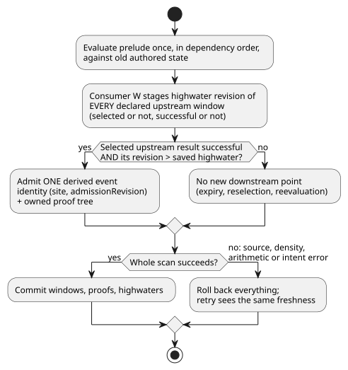
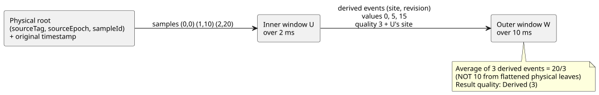

# Derived window evidence proposal

**Status:** the measured nested-window compiler/core/proof/package path is
implemented and included in batch13. Full temporal/adapter replay acceptance
remains open; see the execution evidence at the end. Nested windows are
required language behavior.

In this document:

- the Reference ground truth and the four semantic decisions Root approved;
- how derived events are identified, admitted and given quality;
- why the existing GFB4 wire suffices, using an explicit evidence marker;
- finite capacity and owned proof storage formulas;
- transaction, trace and replay rules;
- six discriminating acceptance scenarios and the current evidence.

A **derived event** is one successful result of an upstream window that a
downstream window admits as an input point. A **physical observation** is an
original sensor sample.

## Ground truth and approved semantic decisions

[Reference §4.4](../docs/reference/04-sensors-constraints-control.md#44-temporal-evidence)
requires:

- original observation identities;
- no contribution for retransmission or reevaluation;
- distinct aggregate-result provenance;
- preservation through transforms and branches;
- downstream windows that distinguish aggregate identities from physical
  observations.

It also fixes the open-left window, strict `max_age`, fault retention and
source-epoch invalidation. The existing
[evidence plan](window-evidence-design.md) supplies explicit physical density
facts; expected acquisition cadence supplies no bound.

The Reference does **not** decide three things:

- whether an upstream expiry-only value change is a new downstream observation;
- which timestamp identifies a derived observation;
- whether overlapping aggregate inputs receive one weight each.

Those choices change numerical results. Root approved the following
non-operational language decisions. No device cadence, density or installation
default is introduced.

Approved interpretation:

1. **Event cadence.** A successful result of a **new upstream admission**
   creates a derived event. Mere evaluation, contributor expiry, selector
   changes, fault changes and state changes do not create a new observation.
   Keep the existing meaning of `admissionRevision`; do not quietly turn it
   into a scan counter.
2. **Timestamp.** A derived event's observation timestamp is the upstream
   result's newest contributor observation timestamp, recursively inherited
   from real evidence. Keep the committed evaluation time separately as
   `evaluatedAt`. Recomputing a delayed observation must not renew its
   measurement freshness. Neither time is a fabricated physical identity.
3. **Weight.** Each distinct derived event receives one weight in a downstream
   average. Deduplicate aggregate identities at that layer. Do not flatten
   nested averages, and do not deduplicate shared physical leaves when doing
   their arithmetic. Shared leaves are provenance, not additional downstream
   input points.
4. **Epoch invalidation.** Invalidating a physical source epoch invalidates any
   retained derived event whose proof depends on that old epoch. A mixed A+B
   aggregate cannot keep its old scalar value while silently removing A. Drop
   that dependent event; preserve independent B-only events. This is
   transitive dependency invalidation.

**Rejected alternatives.**

- *Evaluation time as observation time.* This is a real alternative: it
  measures the freshness of an aggregate publication rather than of its latest
  measurement. It would keep a late result fresh under a shorter downstream
  max_age. The Reference names both evaluation time and original observations
  but does not settle this downstream timestamp. Root selected the
  observation-time rule above.
- *Expiry-event emission.* This would require a new result-generation counter,
  a bound for expiry-triggered events at every depth, and a definition of their
  timestamp.
- *Emission on every scan.* This has no bound from physical density and would
  overweight cached evidence.
- *Flattening original leaves.* This changes the meaning of function
  composition.

None of these alternatives is the proposed default.

## Executable admission and quality

Use two disjoint identity namespaces:

| Namespace | Identity | Also carries |
|---|---|---|
| Physical | `(sourceTag, sourceEpoch, sampleId)` | original timestamp |
| Derived | `(site, admissionRevision)`, scoped to the installed module, selected strategy and live execution session | separate observation timestamp, evaluation time, and a bounded proof of the inputs |

**Scope of derived identities.** The live Runtime/arena supplies that scope.
The fixed time epoch participates in continuity validation but is not a
globally unique session ID. Current core trace module fingerprints are not
cryptographic artifact identities. Persisted or foreign records must be carried
in the existing authoritative artifact/source envelope; the consuming boundary
verifies that identity before resolving local site/revision keys. Do not invent
a global ID or new hash infrastructure for nesting. Durable restore of an
independently acquired envelope remains separate unfinished work. All
expression-facing integers stay exactly representable, including revisions.
Slot indices are not physical source tags.

**Prelude evaluation.** Evaluate the prelude in dependency order once per scan,
against old authored state. Evaluate a successful source payload eagerly even
if its evidence is old; selected arithmetic faults must still reject the scan.
Evaluate fault/origin only when the source is unsuccessful. Preserve the
current atomic prelude transaction.

**Highwaters.** Every consumer records the highwater revision of **every
declared upstream window** on each committed scan, including unselected and
unsuccessful sources. It admits at most the selected fresh successful event.

- Switching back to a cached window cannot reintroduce its prior result.
- Rollback restores these highwaters, so retrying a failed scan does not lose
  the event.
- Physical inputs keep their existing all-root highwater handling.
- A new admission that produces NotReady (for example the first point of a
  rate) advances observation history but supplies no successful event.

The flow below shows one consumer's admission decision within a scan and how
commit or rollback treats it.

**Activation, freshness and retry.**

- At fresh activation, every upstream highwater starts at revision 0. No
  revision-0 window has admitted evidence, so it cannot provide a successful
  derived event.
- An upstream candidate revision greater than its saved highwater is fresh.
- The consumer stages the candidate revision even if it is unselected, or if
  either Result is unsuccessful.
- Only a fully successful scan commits these highwaters. Any
  source-expression, density, arithmetic or later-intent error discards them
  along with all window candidates. Retry sees exactly the same freshness as
  the failed attempt.
- Checkpoint replay restores the saved highwaters; it does not reinitialize
  them to 0 while retaining histories.

**Ordering.** Revision ordering does not imply monotonic derived observation
timestamps. For example, invalidating the previously newest root can expose
older valid evidence. Sort derived entries by observation time and identity; do
not apply the physical single-source backwards-timestamp guard to derived
revision order.

**Expiry-only changes.** The upstream current value may change on expiry
without changing its admission revision. Ordinary expressions can still read
that value, but it creates no new downstream point. The downstream's existing
history may remain successful through an upstream NotReady; retain that
upstream fault in its trace.

**Quality.** `quality: measured` accepts physical Measured evidence and a
verified derived proof whose leaves are admissible Measured evidence. Its
result remains Derived (3), never Measured (1).

- Held (2) and Constructed (0) cannot become admissible by passing through a
  window, map, case, recover or constructor.
- Pure map/and_then preserve the incoming evidence reference; Result branches
  select one reference.
- Recover followed by a new constructor has no measurement proof.
- A transform can change an event's payload without changing its identity, as
  in the existing physical-expression path.

## Existing GFB4 wire is sufficient with an explicit evidence marker

Keep the existing six source expressions: ok, payload, fault, origin, quality
and evidence reference. Generalize the meaning of the sixth field using
quality:

| Quality | Meaning of the sixth field (evidence reference) |
|---|---|
| 1 | positive physical root tag, as today |
| 3 | prior window site, in a separate namespace |
| 0 / 2 | no admissible evidence |

**Emission.** For each derived lineage leaf, the compiler emits
`(window-read U quality)` in the fifth blob and U's site in the sixth blob.
Branches select these in parallel. A constant pure map still retains the
quality projection. The existing opcode 57 field 7 in the quality blob
therefore serves as an explicit dependency marker.

**Decoding and verification.**

- The decoder collects those field-7 references into a sorted, unique internal
  dependency list. They must be prior slots, which expression verification
  already enforces.
- Ordinary window value/ok reads in a branch condition are not evidence
  markers.
- Existing rootRefs become the complete transitive physical-root set; verify
  that each evidence dependency's roots are included.
- On quality 3, the Runtime requires the selected site to belong to that list,
  and requires that upstream's actual successful candidate proof. A constant
  quality 3 alone cannot name an undeclared upstream.
- Dynamic physical source tags continue to work unchanged.

**Why this marker.** Collecting all opcode 57 reads indiscriminately would
confuse control dependencies with evidence. An added descriptor table could
express the same declaration, but would require a new layout/profile. The
quality-projection marker supplies the needed static bound with the existing
six blobs. Root approved this GFB4 contract: no new opcode or wire field.
Manifest/source metadata record the corresponding prior-window evidence
bindings, and canonical replay checks their exact selection. The static
state/window count, module, expression and stack ceilings stay unchanged.

## Finite capacity and owned proof storage

**Accumulated horizon.** For each window W, in topological order, define a
conservative accumulated horizon:

`H(W) = over(W) + max({0} ∪ {H(U): U is an evidence dependency of W})`.

**Logical capacity.** Given explicit root bounds `(M_r, I_r)`, reserve logical
input capacity:

`C(W) = sum over transitive roots r of M_r * ceil(H(W) / I_r)`.

Why this bound holds:

- Every new retained derived point has a fresh physical ancestor, admitted
  through its selected chain. That ancestor lies within the accumulated
  lookback behind the point's newest observation timestamp.
- Each window emits at most one event per committed scan. All-source
  highwaters prohibit emitting again for the same causal admission on a later
  selector-only or clock-only scan.
- Proof retention therefore needs accumulated lookback, not an assumed density
  bound on evaluation timestamps.
- Multiple root updates in one scan only overestimate this capacity.
- Source-epoch replacement removes old dependent proofs before admission.

Retained events must not be silently evicted if this proof or a checked bound
fails: reject the whole scan/activation.

**Repeated newest timestamps.** Several admissions can share the same newest
timestamp. An anchor at timestamp 100 can remain newest while delayed, distinct
samples at 90 and 95 each advance the upstream revision. Do not deduplicate
those revisions by timestamp, and do not apply the physical density directly to
derived timestamps. The distinct causal samples are bounded over H(W), which
includes the upstream lookback behind the anchor.

**Owned proofs.** Retained payloads alone are insufficient. Each derived point
must keep the complete proof of the upstream aggregate at admission, even after
upstream entries expire. A simple first implementation stores that proof as a
flat, owned tree in a preallocated arena; copied overlapping subtrees are
allowed and fully budgeted. It does not require an unbounded Arc graph, hash
identity, or interning subsystem.

Let `P(W)` bound the nodes in a complete W output proof, with a physical leaf
costing 1:

`P(W) = 1 + C(W) * max({1} ∪ {P(U): U is an evidence dependency of W})`.

- Each tree node includes its kind, evidence identity, timestamp, payload and
  a bounded child range.
- Derived nodes retain declaration/operation/evaluation identity; physical
  leaves retain original identity.
- Edge payloads must preserve transforms; never reconstruct transformed numbers
  in JavaScript.
- This recurrence can grow quickly in a branching graph, but it is finite and
  checked. A DAG-sharing optimization is optional later; target-budget
  rejection is preferable to unaccounted storage.

**Activation budget.** Activation checks every sum, product and allocation.

- `maxRetainedSamples` remains the sum of logical C(W).
- `maxBytes` includes proof copies, upstream highwaters, two
  candidate/committed banks, J+1 checkpoints, J+1 independent trace trees,
  bounded copy scratch, and replay's live-plus-scratch peak.
- Larger sufficient budget ceilings are compatible; topology, profile and
  allocation geometry are checkpoint identity.
- There is no new physical density setting and no scan-frequency default.

## Transaction, trace and replay

- **Evidence representation.** Add a Rust internal evidence enum rather than
  adapting derived data into `Observation {source_tag, Identity}`. Physical
  source engines may keep their current representation; generalized retained
  entries carry physical or derived identities and proof ranges.
- **Staging.** Admission, epoch invalidation and source highwaters stage with
  window payloads. All staged changes roll back on any later source/intent
  failure.
- **Checkpoint and rewind** include proof arenas, derived highwaters, event
  observation timestamps and evaluation times.
- **Replay** requires matching input/state layouts plus descriptor topology,
  source bindings, fixed time epoch and density proof.
- **Trace.** Trace records own their proof trees independently of Runtime
  lifetime. The source observer validates/maps those facts without calculating
  an average. Preserve separate immediate contributors and physical leaves;
  reporting the leaf count as the downstream sample count is wrong.
- Session replacement and temporal hot-swap migration remain explicit work.

## Six discriminatory acceptance scenarios

Scenario 1 is the core composition case. The diagram shows why the outer
average is 20/3 rather than the flattened 10.

1. **Composition and overlapping leaves.** Inner average over 2 ms, outer over
   10 ms; physical `(t,value)=(0,0),(1,10),(2,20)`. Inner results are 0, 5, 15;
   the outer result is 20/3 with 3 derived contributors. Its unique physical
   leaf set has 3 identities; averaging that flattened set would incorrectly
   produce 10. Density must permit these actual samples. Replay yields the same
   identities and numbers.
2. **No scan/expiry manufacture.** Continue scenario 1 at t3 with no new
   sample. Inner becomes 20 by expiry, but emits no new event. Outer remains
   20/3, count 3. Duplicate sample delivery and selected-expression
   reevaluation also leave its count/revision unchanged. This distinguishes
   the root's event-cadence decision.
3. **Observation time versus evaluation time.** An inner observation with
   timestamp 0 is first admitted at evaluation 9; inner over/maxAge 10; outer
   over 10/maxAge 2. The proposed derived observation timestamp 0 makes the
   outer NotReady immediately; the inner result is successful, evaluatedAt 9.
   The alternative publication-time rule would keep the outer fresh until 11.
   This distinguishes a freshness renewal from recording evaluation time
   without refreshing evidence.
4. **Repeated newest timestamp, selectors and quality.**
   - Inner over 20 ms first admits A(ts100, value100) at now100, then
     B(ts90, value0) at 101, then B(ts95, value20) at 102. Its derived values
     100, 50, 40 all have observation timestamp 100. Outer over/maxAge 5 ms
     retains all 3, giving 190/3. Profiles A=1/1000ms and B=1/5ms permit this
     sequence: direct outer-horizon capacity 2 would fail; accumulated horizon
     25 ms, capacity 6, suffices.
   - Separately, two upstream windows produce A=2 and B=8 in one scan; the
     outer selects A. Switching to cached B without a new observation must not
     add 8. A subsequent genuinely new B admission may add its result once.
   - Mapping a Held value or constructing ok never creates a measured leaf.
5. **Epoch invalidation and rate ties.** Keep one A+B-derived point and a
   separate B-only point. An A epoch change drops only the dependent mixed
   point. A rate over distinct derived identities with the same observation
   timestamp is NotReady; with values 5 at t1000 and 9 at t3000 its canonical
   value is 2/second.
6. **Proof budgets, rollback and rollover.** Activate at the calculated exact
   byte and logical-capacity bounds; one less rejects. After a new nested
   event, a later division fault leaves scalar/window/proof/highwater/journal
   state unchanged; an identical retry admits once. With J2, replay after
   rollover restores the proof before the oldest retained scan, even when the
   inner's original leaves have already expired. The same test must execute
   native and both WASM adapters.

Root approved the semantic decisions, the transitive mixed-proof invalidation
and the quality-projection marker contract. No user-specific operating number
is needed.

## Execution evidence and remaining acceptance

| Area | Test(s) | Result / log |
|---|---|---|
| Native Rust core | `tests/temporal_derived.rs` | Eleven independent tests cover the six scenarios, marker/root verification, compacted endpoint indices and eager payload/lazy fault evaluation. The unit allocation test runs 200 transaction, checkpoint and restore cycles without allocations. Full core: 136 pass, `build/temporal-derived-core-final.log`; also passed batch13. |
| Compiler/encoder | `tests/window-derived-control.test.mjs` | Focused aggregate run: 38 pass with the physical window and GFB suites; then passed batch13. |
| Both actual WASM host paths | `tests/window-derived-host.test.mjs` | Initially six pass in batch13: 20/3 composition, no expiry admission, original freshness and transformed aggregate proof values, including source observation. After the gate, two late-fault/same-ID-retry tests were added: host eight/eight pass in `build/window-derived-host-retry.log`. The committed public trace stays unchanged on failure, and revision 3 is admitted exactly once on retry. |
| Source metadata/proof validation | `tests/window-derived-provenance.test.mjs` | Five pass. Malformed owned tree/identity and canonical dependency substitution cases supplement the actual WASM observations. |
| Signed JS packages | `tests/window-derived-package.test.mjs` | Eleven leaf cases (twelve including parent) pass. |
| Native package verifier | — | 28 tests pass, including nested dependency omission/rebinding/type/index rejection before the target loader. The native verifier does not recompile JavaScript source. |

**Replay and resource evidence.** Scenario 6's native checkpoint/rewind and J2
rollover tests pass. Batch14 adds read-only checkpoint replay through both WASM
adapters with their actual J1024 journals: exact original-record equality,
nested 20/3, owned proof identity, late-fault/retry, retained-prefix rollover
and live state preservation. See `tests/temporal-replay-wasm.test.mjs` and
`temporal-adapter-replay-design.md`. The actual WASM tests and temporal
resource-plan suites now prove the exact target-specific boundary oracle. See
`build/temporal-resource-plan-wasm-green.log`,
`build/scan-frame-wasm-temporal-plan.log`, and the oracle values in
`tasks/temporal-resource-plan-design.md`. Do not generalize this evidence to
other temporal operators or to durable restore.

**Remaining:** durable foreign checkpoint restore, temporal hot-swap and
estimated evidence remain outside this measured live-session increment and
remain unfinished.
