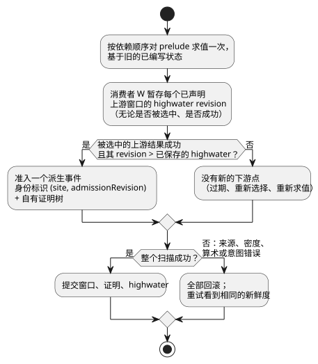
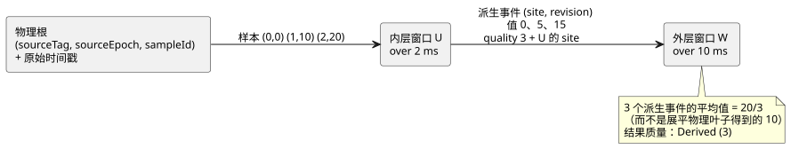

<!-- translation-source: tasks/window-derived-design.md -->
[英文原文](window-derived-design.md)

# 派生窗口证据提案

**状态：** 测量型嵌套窗口的编译器/core/证明/包路径已经实现，并包含在 batch13 中。完整的
时间/适配器重放验收仍未完成；见文末的执行证据。嵌套窗口是语言必需的行为。

本文内容：

- 参考手册的基本事实，以及 Root 批准的四项语义决定；
- 派生事件如何被标识、准入并赋予质量；
- 为什么现有的 GFB4 传输线格式借助一个显式的证据标记就已足够；
- 有限容量与自有证明存储的公式；
- 事务、追踪和重放规则；
- 六个可区分的验收场景以及当前证据。

**派生事件**是上游窗口的一个成功结果，由下游窗口作为输入点准入。**物理观测**是原始的
传感器样本。

## 基本事实与已批准的语义决定

[参考手册 §4.4](../docs/reference/04-sensors-constraints-control.zh.md)
要求：

- 原始观测的身份标识；
- 重传或重新求值不产生贡献；
- 聚合结果具有独立的来源（provenance）；
- 经过变换和分支时保持不变；
- 下游窗口要区分聚合身份标识与物理观测。

它还确定了左开窗口、严格的 `max_age`、故障保留和来源 epoch 失效。现有的
[证据计划](window-evidence-design.zh.md)提供显式的物理密度事实；预期采集节拍不提供任何
上界。

参考手册**没有**决定以下三件事：

- 上游仅因过期而发生的值变化是否算作新的下游观测；
- 用哪个时间戳来标识派生观测；
- 重叠的聚合输入是否各自获得一份权重。

这些选择会改变数值结果。Root 批准了以下非运行层面的语言决定。没有引入任何设备节拍、密度
或安装默认值。

已批准的解释：

1. **事件节拍。** **新的上游准入**的成功结果会产生一个派生事件。单纯的求值、贡献项过期、
   选择器变化、故障变化和状态变化都不会产生新的观测。保持 `admissionRevision` 的现有含义；
   不要悄悄把它变成扫描计数器。
2. **时间戳。** 派生事件的观测时间戳是上游结果中最新贡献项的观测时间戳，从真实证据递归
   继承。将已提交的求值时间单独保存为 `evaluatedAt`。重新计算一个延迟的观测不得刷新其测量
   新鲜度。这两个时间都不是伪造的物理身份标识。
3. **权重。** 每个不同的派生事件在下游平均值中获得一份权重。在该层对聚合身份标识去重。
   不要展平嵌套平均值，在计算时也不要对共享的物理叶子去重。共享叶子是来源信息，而不是额外
   的下游输入点。
4. **Epoch 失效。** 使一个物理来源 epoch 失效，会使任何其证明依赖于该旧 epoch 的已保留派生
   事件失效。一个混合 A+B 的聚合不能在悄悄移除 A 的同时保留其旧的标量值。丢弃该依赖事件；
   保留独立的仅 B 事件。这是传递性的依赖失效。

**被否决的备选方案。**

- *以求值时间作为观测时间。* 这是一个真实存在的备选方案：它衡量的是聚合发布的新鲜度，
  而不是其最新测量的新鲜度。在更短的下游 max_age 下，它会让迟到的结果保持新鲜。参考手册
  同时提到了求值时间和原始观测，但没有确定这个下游时间戳。Root 选择了上面的观测时间规则。
- *过期事件发射。* 这需要一个新的结果生成计数器、在每一层深度上对过期触发事件的上界，以及
  对其时间戳的定义。
- *每次扫描都发射。* 这没有来自物理密度的上界，并且会使缓存的证据权重过高。
- *展平原始叶子。* 这会改变函数组合的含义。

这些备选方案都不是所提议的默认值。

## 可执行的准入与质量

使用两个互不相交的身份标识命名空间：

| 命名空间 | 身份标识 | 同时携带 |
|---|---|---|
| 物理 | `(sourceTag, sourceEpoch, sampleId)` | 原始时间戳 |
| 派生 | `(site, admissionRevision)`，作用域为已安装模块、所选策略和实时执行会话 | 独立的观测时间戳、求值时间，以及输入的有界证明 |

**派生身份标识的作用域。** 实时 Runtime/arena 提供该作用域。固定的时间 epoch 参与连续性
验证，但不是全局唯一的会话 ID。当前 core 追踪中的模块指纹不是密码学意义上的产物身份标识。
持久化的或外来的记录必须封装在现有的权威产物/来源信封中；消费边界在解析本地 site/revision
键之前验证该身份标识。不要为嵌套发明全局 ID 或新的哈希基础设施。对独立获取的信封进行持久
恢复仍是另一项未完成的工作。所有面向表达式的整数（包括修订版）都保持可精确表示。slot 索引
不是物理来源标签。

**Prelude 求值。** 每次扫描按依赖顺序对 prelude 求值一次，基于旧的已编写状态。即使证据已
陈旧，也要对成功来源的载荷进行急切求值；被选中的算术故障仍必须拒绝本次扫描。仅当来源不成功
时才对 fault/origin 求值。保持当前的原子 prelude 事务。

**高水位（highwater）。** 每个消费者在每次已提交的扫描中记录**每个已声明上游窗口**的
高水位修订版，包括未被选中和不成功的来源。它最多准入被选中的那个新鲜成功事件。

- 切换回缓存的窗口不能重新引入其之前的结果。
- 回滚会恢复这些高水位，因此重试失败的扫描不会丢失该事件。
- 物理输入保持现有的全根高水位处理方式。
- 产生 NotReady 的新准入（例如速率的第一个点）会推进观测历史，但不提供成功事件。

下面的流程展示了一个消费者在一次扫描中的准入决定，以及提交或回滚如何处理它。

**激活、新鲜度与重试。**

- 全新激活时，每个上游高水位都从修订版 0 开始。修订版为 0 的窗口还没有准入任何证据，因此
  不能提供成功的派生事件。
- 上游候选修订版大于其已保存的高水位时，即为新鲜。
- 即使候选修订版未被选中，或任一 Result 不成功，消费者也会暂存该候选修订版。
- 只有完全成功的扫描才会提交这些高水位。任何来源表达式、密度、算术或后续意图错误都会将它们
  连同所有窗口候选一起丢弃。重试看到的新鲜度与失败的那次尝试完全相同。
- 检查点重放会恢复已保存的高水位；它不会在保留历史的同时把它们重新初始化为 0。

**排序。** 修订版顺序并不意味着派生观测时间戳单调。例如，使之前最新的根失效可能会暴露出更旧
的有效证据。按观测时间和身份标识对派生条目排序；不要对派生修订版顺序应用物理单一来源的
时间戳倒退保护。

**仅过期的变化。** 上游当前值可能在过期时发生变化而其准入修订版不变。普通表达式仍然可以读取
该值，但它不会产生新的下游点。在上游 NotReady 期间，下游现有的历史可以保持成功；在其追踪中
保留该上游故障。

**质量。** `quality: measured` 接受物理 Measured 证据，以及其叶子均为可准入 Measured 证据的
已验证派生证明。其结果仍为 Derived (3)，永远不会是 Measured (1)。

- Held (2) 和 Constructed (0) 不会因为经过窗口、map、case、recover 或构造器而变得可准入。
- 纯 map/and_then 保留传入的证据引用；Result 分支选择一个引用。
- recover 之后接新的构造器不具有测量证明。
- 变换可以改变事件的载荷而不改变其身份标识，与现有的物理表达式路径一样。

## 借助显式证据标记，现有 GFB4 传输线格式已足够

保留现有的六个来源表达式：ok、payload、fault、origin、quality 和证据引用。借助 quality
推广第六个字段的含义：

| 质量 | 第六个字段（证据引用）的含义 |
|---|---|
| 1 | 正的物理根标签，与现在相同 |
| 3 | 之前的窗口 site，位于独立的命名空间 |
| 0 / 2 | 没有可准入的证据 |

**发射。** 对每个派生谱系叶子，编译器在第五个 blob 中发射 `(window-read U quality)`，并在
第六个 blob 中发射 U 的 site。分支并行地选择它们。常量纯 map 仍会保留质量投影。因此，质量
blob 中现有的操作码 57 字段 7 充当一个显式的依赖标记。

**解码与验证。**

- 解码器将这些字段 7 引用收集为一个已排序、唯一的内部依赖列表。它们必须是之前的 slot，
  表达式验证已经强制保证了这一点。
- 分支条件中普通的窗口 value/ok 读取不是证据标记。
- 现有的 rootRefs 成为完整的传递物理根集合；验证每个证据依赖的根都包含在其中。
- 在质量为 3 时，Runtime 要求被选中的 site 属于该列表，并要求该上游实际的成功候选证明。仅凭
  一个常量质量 3 不能指向未声明的上游。
- 动态物理来源标签继续保持原有工作方式。

**为什么使用这个标记。** 不加区分地收集所有操作码 57 读取，会把控制依赖与证据混淆。增加一个
描述符表也能表达同样的声明，但需要新的布局/profile。质量投影标记利用现有的六个 blob 就提供
了所需的静态上界。Root 批准了这一 GFB4 契约：不增加新的操作码或传输线字段。manifest/源元
数据记录相应的先前窗口证据绑定，规范重放检查其确切选择。静态的状态/窗口数量、模块、表达式
和栈上限保持不变。

## 有限容量与自有证明存储

**累积视野。** 对每个窗口 W，按拓扑顺序定义一个保守的累积视野：

`H(W) = over(W) + max({0} ∪ {H(U): U is an evidence dependency of W})`。

**逻辑容量。** 给定显式的根上界 `(M_r, I_r)`，预留逻辑输入容量：

`C(W) = sum over transitive roots r of M_r * ceil(H(W) / I_r)`。

这个上界成立的原因：

- 每个新保留的派生点都有一个新鲜的物理祖先，经由其被选中的链准入。该祖先位于该点最新观测
  时间戳之前的累积回溯范围内。
- 每个窗口在每次已提交的扫描中最多发射一个事件。全来源高水位禁止在之后仅选择器变化或仅时钟
  触发的扫描中，针对同一因果准入再次发射。
- 因此，证明保留需要的是累积回溯，而不是对求值时间戳假设一个密度上界。
- 一次扫描中多个根的更新只会高估这个容量。
- 来源 epoch 替换会在准入之前移除旧的依赖证明。

如果这一证明或某个已检查的上界失败，不得悄悄驱逐已保留的事件：拒绝整个扫描/激活。

**重复的最新时间戳。** 多个准入可以共享同一个最新时间戳。时间戳为 100 的锚点可以一直保持
最新，而时间戳为 90 和 95 的延迟且互不相同的样本各自推进上游修订版。不要按时间戳对这些修订版
去重，也不要把物理密度直接应用于派生时间戳。不同的因果样本在 H(W) 上有界，而 H(W) 包含了锚点
之前的上游回溯。

**自有证明。** 仅保留载荷是不够的。每个派生点必须保存准入时上游聚合的完整证明，即使上游条目
已经过期。一个简单的初步实现将该证明存储为预分配 arena 中扁平的、自有的树；允许复制重叠的
子树，并完整计入预算。它不需要无界的 Arc 图、哈希身份标识或驻留（interning）子系统。

令 `P(W)` 为 W 的一个完整输出证明中节点数的上界，物理叶子计为 1：

`P(W) = 1 + C(W) * max({1} ∪ {P(U): U is an evidence dependency of W})`。

- 每个树节点包括其种类、证据身份标识、时间戳、载荷和一个有界的子节点范围。
- 派生节点保留声明/操作/求值身份标识；物理叶子保留原始身份标识。
- 边上的载荷必须保留变换；绝不在 JavaScript 中重建变换后的数值。
- 在分支较多的图中，这个递推式可能增长很快，但它是有限且经过检查的。之后可以选择进行 DAG
  共享优化；按目标预算拒绝优于未核算的存储。

**激活预算。** 激活会检查每一个和、积以及分配。

- `maxRetainedSamples` 仍为逻辑 C(W) 之和。
- `maxBytes` 包括证明副本、上游高水位、候选/已提交两个存储库、J+1 个检查点、J+1 棵独立的
  追踪树、有界的复制暂存空间，以及重放时实时数据加暂存空间的峰值。
- 更大的充足预算上限是兼容的；拓扑、profile 和分配几何结构属于检查点身份标识。
- 没有新的物理密度设置，也没有扫描频率默认值。

## 事务、追踪与重放

- **证据表示。** 添加一个 Rust 内部证据枚举，而不是把派生数据适配为
  `Observation {source_tag, Identity}`。物理来源引擎可以保持其当前表示；通用化后的保留条目
  携带物理或派生身份标识以及证明范围。
- **暂存。** 准入、epoch 失效和来源高水位与窗口载荷一起暂存。任何之后的来源/意图失败都会回滚
  所有已暂存的变更。
- **检查点与倒带**包括证明 arena、派生高水位、事件观测时间戳和求值时间。
- **重放**要求输入/状态布局匹配，并且描述符拓扑、来源绑定、固定的时间 epoch 和密度证明也必须
  匹配。
- **追踪。** 追踪记录独立于 Runtime 生命周期拥有自己的证明树。源观察器验证/映射这些事实，而
  不计算平均值。分别保留直接贡献项和物理叶子；把叶子数量报告为下游样本数是错误的。
- 会话替换和时间热替换迁移仍是需要显式完成的工作。

## 六个可区分的验收场景

场景 1 是核心的组合用例。下图说明了为什么外层平均值是 20/3，而不是展平后的 10。

1. **组合与重叠叶子。** 内层在 2 ms 上求平均，外层在 10 ms 上求平均；物理
   `(t,value)=(0,0),(1,10),(2,20)`。内层结果为 0、5、15；外层结果为 20/3，有 3 个派生贡献项。
   其唯一的物理叶子集合有 3 个身份标识；对这个展平的集合求平均会错误地得到 10。密度必须允许
   这些实际样本。重放产生相同的身份标识和数值。
2. **不因扫描/过期而制造事件。** 在 t3 继续场景 1，没有新样本。内层因过期变为 20，但不发射
   新事件。外层保持 20/3，计数为 3。重复的样本投递和被选中表达式的重新求值同样不改变其计数/
   修订版。这验证了 Root 的事件节拍决定。
3. **观测时间与求值时间。** 一个时间戳为 0 的内层观测在求值时间 9 时首次被准入；内层
   over/maxAge 为 10；外层 over 为 10、maxAge 为 2。按所提议的派生观测时间戳 0，外层立即变为
   NotReady；内层结果成功，evaluatedAt 为 9。另一种发布时间规则会让外层一直保持新鲜直到 11。
   这区分了刷新新鲜度与在不刷新证据的情况下记录求值时间。
4. **重复的最新时间戳、选择器与质量。**
   - 内层 over 为 20 ms，先在 now100 准入 A(ts100, value100)，然后在 101 准入
     B(ts90, value0)，再在 102 准入 B(ts95, value20)。其派生值 100、50、40 的观测时间戳都是
     100。外层 over/maxAge 为 5 ms，保留全部 3 个，得到 190/3。profile A=1/1000ms 和
     B=1/5ms 允许这一序列：直接按外层视野计算的容量 2 会失败；累积视野 25 ms、容量 6 则足够。
   - 另外，两个上游窗口在一次扫描中产生 A=2 和 B=8；外层选择 A。在没有新观测的情况下切换到
     缓存的 B，不得加入 8。之后一个真正新的 B 准入可以把其结果加入一次。
   - 对 Held 值做映射或构造 ok，永远不会产生测量叶子。
5. **Epoch 失效与速率并列。** 保留一个 A+B 派生点和一个独立的仅 B 点。A 的 epoch 变化只丢弃
   依赖它的混合点。对观测时间戳相同的不同派生身份标识计算的速率为 NotReady；当值为 t1000 时 5、
   t3000 时 9 时，其规范值为 2/秒。
6. **证明预算、回滚与翻转。** 在计算出的精确字节上界和逻辑容量上界处激活；少一则拒绝。在一个
   新的嵌套事件之后，后续的除法故障使标量/窗口/证明/高水位/日志（journal）状态保持不变；相同的
   重试只准入一次。在 J2 下，翻转之后的重放会恢复最旧保留扫描之前的证明，即使内层的原始叶子已经
   过期。同一测试必须在原生和两个 WASM 适配器上执行。

Root 批准了这些语义决定、传递性的混合证明失效以及质量投影标记契约。不需要任何特定于用户的
运行数值。

## 执行证据与剩余验收

| 领域 | 测试 | 结果 / 日志 |
|---|---|---|
| 原生 Rust core | `tests/temporal_derived.rs` | 十一个独立测试覆盖六个场景、标记/根验证、压缩的端点索引以及急切载荷/惰性故障求值。单元分配测试运行 200 次事务、检查点和恢复循环而无任何分配。完整 core：136 通过，`build/temporal-derived-core-final.log`；也在 batch13 中通过。 |
| 编译器/编码器 | `tests/window-derived-control.test.mjs` | 与物理窗口和 GFB 套件一起的聚焦汇总运行：38 通过；之后在 batch13 中通过。 |
| 两条实际 WASM 宿主路径 | `tests/window-derived-host.test.mjs` | 最初在 batch13 中六个通过：20/3 组合、无过期准入、原始新鲜度以及变换后的聚合证明值（包括源观测）。门禁之后新增了两个后续故障/相同 ID 重试测试：宿主八/八通过，见 `build/window-derived-host-retry.log`。已提交的公开追踪在失败时保持不变，修订版 3 在重试时恰好被准入一次。 |
| 源元数据/证明验证 | `tests/window-derived-provenance.test.mjs` | 五个通过。格式错误的自有树/身份标识以及规范依赖替换用例补充了实际的 WASM 观测。 |
| 已签名 JS 包 | `tests/window-derived-package.test.mjs` | 十一个叶子用例（含父用例共十二个）通过。 |
| 原生包验证器 | — | 28 个测试通过，包括在目标加载器之前拒绝嵌套依赖的遗漏/重新绑定/类型/索引。原生验证器不会重新编译 JavaScript 源码。 |

**重放与资源证据。** 场景 6 的原生检查点/倒带和 J2 翻转测试通过。Batch14 增加了通过两个
WASM 适配器及其实际 J1024 日志进行的只读检查点重放：与原始记录完全相等、嵌套 20/3、自有证明
身份标识、后续故障/重试、保留前缀翻转以及实时状态保留。参见
`tests/temporal-replay-wasm.test.mjs` 和 `temporal-adapter-replay-design.md`。实际的 WASM
测试和时间资源计划套件现在证明了确切的、特定于目标的边界 oracle。参见
`build/temporal-resource-plan-wasm-green.log`、`build/scan-frame-wasm-temporal-plan.log`，
以及 `tasks/temporal-resource-plan-design.md` 中的 oracle 值。不要把这些证据推广到其他时间
运算符或持久恢复。

**剩余：** 持久的外来检查点恢复、时间热替换和估计证据都不在这个测量型实时会话增量的范围内，
仍未完成。
