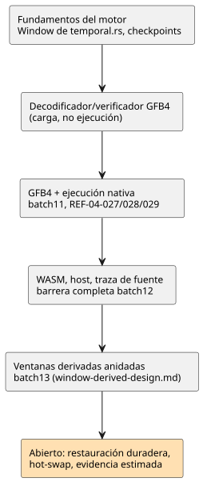

<!-- translation-source: tasks/window-evidence-design.md -->
[Original en inglés](window-evidence-design.md)

# Agregación de ventanas con marca de tiempo: traspaso de integración

**Estado actual:** la integración de compilador/GFB/núcleo/host/prueba para
ventanas físicas y anidadas medidas está incluida en batch13. Consulte
`window-derived-design.md` para ver la evidencia real y los límites pendientes
de replay de adaptadores y durabilidad. El traspaso inicial del motor que
aparece abajo es contexto histórico; **no** es el estado actual de
finalización.

Este documento registra, en orden: la regla de almacenamiento de la evidencia
de ventanas, el motor tal como se traspasó al principio, los requisitos de
integración y los puntos de control fechados que luego reemplazaron el estado
anterior. El diagrama resume esa progresión.

## Evidencia y almacenamiento finito

La opción `sample` del sensor de origen describe la cadencia **esperada**. No
acota las ráfagas ni prohíbe observaciones distintas con la misma marca de
tiempo.

Por eso, la activación debe recibir dos entradas explícitas:

- la garantía de densidad `{maxObservations, intervalMs}` de cada raíz física;
- un presupuesto objetivo de muestras/memoria.

No se inventa ningún valor de instalación.

Para una ventana `overMs`, la capacidad retenida es la suma comprobada, sobre
las raíces físicas, de:

`maxObservations * ceil(overMs / intervalMs)`.

Reglas de almacenamiento:

- Se usa el `overMs` completo, no `min(overMs, maxAgeMs)`: un nuevo punto
  fresco puede volver utilizables contribuciones retenidas más antiguas.
- Los historiales de densidad también requieren almacenamiento acotado,
  incluidas las observaciones que no son elegibles para la agregación.
- Tanto el banco consolidado como el banco candidato cuentan contra la
  memoria.
- Las violaciones de capacidad/densidad rechazan la etapa de forma atómica; no
  desalojan muestras que siguen siendo admisibles.
- La asignación de memoria ocurre en la activación, no en cada escaneo.

## Motor actual

`crates/ghostflow-core/src/temporal.rs` expone `Window::new`, `stage`,
`commit`, `rollback`, los contribuyentes consolidados/preparados y los
resultados. `RootDensity`, `TargetBudget` y `TimeContext { epoch, now_ms }` son
entradas explícitas.

- **Pertenencia y frescura.** La pertenencia es `(now-over, now]`; la frescura
  exige que la edad más reciente sea `< max_age`.
- **Identidad.** La identidad incluye la etiqueta de fuente, la época de
  fuente, el ID y la marca de tiempo original.
- **Duplicados y empates.** Las observaciones duplicadas no crean
  contribuciones. Los empates de marca de tiempo se ordenan por
  `(timestamp, source_tag, epoch, id)`; la tasa necesita marcas de tiempo
  distintas.
- **Aritmética.** El promedio/mínimo/máximo y la tasa por segundo usan
  mediciones finitas reales. El desbordamiento numérico rechaza la etapa en
  lugar de producir un valor exitoso infinito.
- **Fallos y épocas de fuente.** Un fallo ordinario aguas arriba conserva el
  historial admisible y se registra en el resultado. Un cambio de época de una
  raíz invalida solo las contribuciones de esa raíz.
- **Épocas de tiempo.** Un retroceso del tiempo dentro de la misma época de
  tiempo se rechaza. Una época de tiempo de reemplazo borra el historial de
  ventana y de densidad, conserva las highwaters de ID de fuente y borra el
  ordenamiento de marcas de tiempo del dominio anterior. Una observación en
  caché no puede sembrar la nueva época de tiempo.
- **Revisión.** La revisión del resultado avanza solo con una observación
  recién admitida. Un agregado derivado tiene evidencia de
  contribuyentes/revisión, no un ID de muestra física inventado.

Las reglas de retención de fallos y de evidencia derivada necesitan una
aclaración explícita de la Reference §4.4 antes de la integración en el
producto. No deben heredar por accidente la regla separada del filtro de
sensores en bruto según la cual un fallo borra el historial.

**Evidencia de los fundamentos:** `build/temporal-foundation-unit.log`
(7 pruebas unitarias) y `build/temporal-conformance.log` (6 pruebas
independientes de oráculo del motor público). La suite unitaria incluye una
comprobación del recuento de asignaciones en 200 operaciones preparadas. La
siguiente barrera completa del host complementa estos resultados focalizados.

### Fundamentos aceptados posteriormente

- **Checkpoints.** El `WindowCheckpoint` opaco captura el historial
  consolidado, las colas de densidad, las identidades, la procedencia de los
  fallos, la revisión y el tiempo. La copia y la restauración reutilizan los
  búferes asignados y exigen geometría/configuración coincidentes, no techos de
  presupuesto idénticos. Evidencia focalizada, en `build/`:
  `temporal-checkpoint-final.log` (10 pruebas unitarias) y
  `temporal-checkpoint-conformance.log` (6 pruebas de oráculo).
- **Requisitos/decodificador/verificador GFB4.** Pasan doce casos públicos del
  cargador, incluidos blobs mal formados, vinculaciones exactas de reloj,
  tipado de proyecciones, orden de dependencias, truncamiento y límites
  existentes. La ejecución completa del núcleo pasó 108 pruebas:
  `build/temporal-module-core-green.log`. Esto demuestra la carga y la
  verificación, no la ejecución. La integración en el runtime avanza según
  [el contrato explícito de wire y activación](window-gfb4-design.es.md).
- **Barrera del host.** `tests/window-control.test.mjs` está registrado en la
  barrera del host. Sus casos de aceptación de fuente siguen en RED hasta que
  se implemente el lowering real. El informe de la barrera completa de batch10
  es anterior a estos cambios y no certifica esta revisión.

## Integración requerida

1. Introducir una facilidad real y acotada de operaciones con estado en la
   ejecución GFB/Rust. Desenrollar el estado escalar o usar un motor de
   agregación en JavaScript no cumple el requisito. Conservar los presupuestos
   existentes hasta que se justifique un cambio de perfil concreto.
2. Bajar (lower) expresiones Result soportadas arbitrarias a un preludio
   ordenado por dependencias que se ejecute una vez por tick. Producir
   proyecciones Result transitorias tipadas. La compilación solo de fuente
   registra requisitos de activación sin suponer hechos del dispositivo.
3. Incluir las arenas de ventanas en la misma frontera de
   consolidación/reversión del escaneo y de replay/checkpoint que el estado del
   núcleo y los acondicionadores físicos. La restauración duradera exige
   evidencia de continuidad de fuente/tiempo.
4. Añadir conjuntamente: descriptores de fuente, ambos adaptadores WASM/nativo,
   contratos de activación del objetivo, procedencia de contribuyentes y
   validación de paquetes.
5. Conservar sin cambios las expectativas de aceptación de la CLI
   REF-04-027/028/029 y añadir comprobaciones absolutas de oráculo en el
   runtime para todos los backends de ejecución. La tasa admite Temperature y
   las magnitudes físicas lineales de la Reference, no todos los tipos
   numéricos.

La evidencia de calidad estimada y la elección de continuidad de `true_for`,
que depende del usuario, siguen siendo contratos separados sin resolver. Este
diseño no aporta sus valores predeterminados.

## Punto de control de GFB4 y ejecución nativa (2026-09-23)

El estado RED de fuente anterior queda reemplazado. La codificación GFB4, el
lowering del compilador, la decodificación en Rust y la activación temporal
explícita ahora ejecutan ventanas de raíces físicas.

| Suite | Resultado |
|---|---|
| Suite focalizada final del núcleo | 124 pass (`build/temporal-runtime-core-final.log`) |
| Suite de fuente/codificador | 32 pass |
| Regresiones de paquetes JS firmados | 56 pass |
| Codificación en navegador | pass |

Batch11 reconstruyó los artefactos nativos y WASM. REF-04-027/028/029 ahora
pasan la comprobación/compilación real de la CLI. Se corrigió la expectativa de
mensaje de error de una prueba para ajustarla al contrato existente de
`division by zero`. Después de eso, la suite nativa de fuente a Rust pasó las
tres pruebas (`build/window-native-green.log`): requisitos de activación,
rechazo por capacidad, promedios/mínimos/máximos/tasas exactos, trazas de
contribuyentes y reintento atómico tras un fallo tardío de expresión. No se
cambió ningún comportamiento del runtime por esa corrección del fixture.

Esto no terminó la funcionalidad. En batch11, la activación temporal
WASM/host y las dependencias de traza de fuente seguían abiertas; el siguiente
punto de control reemplaza ese estado. La integración nativa de paquetes
firmados, las fuentes de ventanas derivadas y la migración duradera de
continuidad/reemplazo en caliente siguen sin terminar. El adaptador virtual de
la CLI exige época/densidad/presupuestos explícitos; no aporta valores
predeterminados de dispositivo.

## Punto de control de WASM, host y traza de fuente (2026-09-23)

- **La activación GFTA compartida** se valida de forma independiente en
  JavaScript y en Rust. Ambos adaptadores WASM ejecutan el núcleo existente con
  densidad/presupuesto/época explícitos. `build/window-wasm-green.log`: 30/30;
  pruebas de la ABI de Rust: 5/5.
- **Ejecución en el host.** `build/window-host-green.log`: 16/16. Cubre la
  ejecución real en host heredado/por tramas, resultados exactos de las cuatro
  operaciones, vencimiento, fallo dinámico y reintento con la misma muestra,
  época inmutable y rechazo de perfiles y descriptores mal formados.
- **Procedencia.** `build/window-provenance-available-green.log`: 6/6. El
  replay canónico fija windowSites y dependencias, incluidos los consumidores.
  Las sustituciones refirmadas fallan antes de la carga. Los registros nativos
  reales proyectan calidad Derived y fallos aguas arriba separados. Se
  rechazan: identidades mal formadas, dominios Int, muestras futuras/vencidas,
  evidencia de éxito vacía/obsoleta y tasas exitosas subdeterminadas.
- **Regresiones.** `build/window-provenance-green.log`: 63 regresiones previas
  relevantes pasaron antes de las adiciones finales al dominio del observador.
  La evidencia de la barrera completa se registra por separado en `plan.md`;
  estos recuentos focalizados no implican el cumplimiento total de la
  Reference.

Root corrigió supuestos iniciales de las pruebas del host sobre campos
públicos de observación, etiquetas de fuente de sensores y selección de fallos
de tasa. Esas correcciones de fixtures no son defectos de producción. Astra
revisó el manejo de perfil/época del host y las correcciones finales de
identidad/dominio del observador. Siguen abiertas la integración nativa de
CLI/paquetes por tramas, la evidencia derivada anidada, la evidencia estimada
y la migración duradera.

**La barrera completa de batch12** incluyó estos cambios: Node 2,014 =
1,822 pass, 28 fail, 164 TODO, 0 skip.

- Persisten los 27 fallos de la Reference.
- El único otro fallo fue un mock existente de prueba de protección de
  asignaciones al que le faltaba la nueva exportación de activación requerida.
  Su mock no-op se corrigió sin cambiar sus aserciones de rechazo/asignación,
  y la prueba focalizada pasó 1/1.
- Los pasos previos de Rust/nativo/WASM pasaron; el tutorial no se ejecutó.
- El informe completo se conserva como fallido. La revisión de hashes de
  fuente confirmó que, después de la barrera, solo cambió ese fixture de
  prueba, no el código de producción.

Consulte `build/compiler-runtime-batch12-verification.json` y
`build/scan-frame-wrapper-focused.log`.
