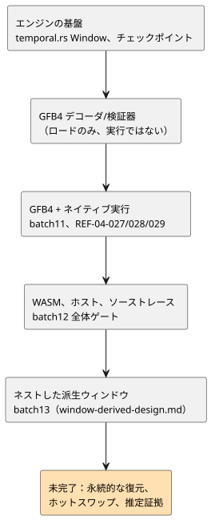

<!-- translation-source: tasks/window-evidence-design.md -->
[英語の原文](window-evidence-design.md)

# タイムスタンプ付きウィンドウ集約：統合の引き継ぎ

**現在の状況：** 測定された物理ウィンドウとネストしたウィンドウの、コンパイラ/GFB/コア/ホスト/証明の統合は batch13 に含まれています。実際の証拠と、残っているアダプタのリプレイ/永続性の境界については `window-derived-design.md` を参照してください。以下の最初のエンジン引き継ぎは歴史的な文脈であり、現在の完了状況では**ありません**。

この文書は、ウィンドウの証拠のストレージ規則、最初に引き継がれた時点のエンジン、統合の要件、そして以前の状況を後から置き換えた日付付きのチェックポイントを、順に記録します。図はその進行をまとめたものです。

## 証拠と有限のストレージ

ソースセンサの `sample` オプションは、**想定される**周期を記述します。バーストを制限するものではなく、同じタイムスタンプでの別個の観測を禁止するものでもありません。

したがって、activation は 2 つの明示的な入力を受け取らなければなりません。

- 各物理ルートの `{maxObservations, intervalMs}` 密度保証
- ターゲットのサンプル/メモリ予算

設備の値を勝手に作り出すことはありません。

ウィンドウ `overMs` について、保持容量は物理ルート全体にわたる次の値の、チェック付きの合計です。

`maxObservations * ceil(overMs / intervalMs)`.

ストレージ規則：

- `min(overMs, maxAgeMs)` ではなく、`overMs` 全体を使います。新しい新鮮なポイントによって、保持されていた古い寄与が再び使えるようになることがあるためです。
- 密度の履歴にも、集約の対象外となる観測を含めて、有界なストレージが必要です。
- 確定済みと候補の両方のバンクがメモリに計上されます。
- 容量/密度の違反はステージをアトミックに拒否します。まだ受け入れ可能なサンプルを追い出すことはしません。
- アロケーションはスキャンごとではなく、activation 時に行います。

## 現在のエンジン

`crates/ghostflow-core/src/temporal.rs` は、`Window::new`、`stage`、`commit`、`rollback`、確定済み/ステージ済みの寄与要素と結果を公開します。`RootDensity`、`TargetBudget`、`TimeContext { epoch, now_ms }` は明示的な入力です。

- **メンバーシップと新しさ。** メンバーシップは `(now-over, now]` です。新しさには、最新の経過時間が `< max_age` であることが必要です。
- **同一性。** 同一性には、ソースタグ、ソースエポック、ID、元のタイムスタンプが含まれます。
- **重複と同順位。** 重複した観測は寄与を生みません。同じタイムスタンプは `(timestamp, source_tag, epoch, id)` で順序付けられます。レートには異なるタイムスタンプが必要です。
- **算術。** 平均/最小/最大と秒あたりのレートは、実際の有限な測定値を使います。数値オーバーフローは、無限大の成功値を生成するのではなく、ステージを拒否します。
- **故障とソースエポック。** 通常の上流の故障は、受け入れ可能な履歴を保持し、結果に記録されます。ルートのエポック変更は、そのルートの寄与だけを無効にします。
- **時間エポック。** 同じ時間エポック内で時間が逆行すると拒否されます。置き換えの時間エポックは、ウィンドウと密度の履歴をクリアし、ソース ID の highwater を保持し、古い領域のタイムスタンプ順序をクリアします。キャッシュされた観測を新しい時間エポックの種にすることはできません。
- **リビジョン。** 結果のリビジョンは、新しく受け入れられた観測に対してのみ進みます。派生集約は、寄与要素/リビジョンの証拠を持ち、作り出された物理サンプル ID は持ちません。

故障保持と派生証拠の規則は、プロダクト統合の前に Reference §4.4 での明示的な明確化が必要です。生のセンサフィルタの、故障で履歴をクリアするという別個の規則を誤って継承してはなりません。

**基盤の証拠：** `build/temporal-foundation-unit.log`（ユニットテスト 7 件）と `build/temporal-conformance.log`（独立した公開エンジンのオラクルテスト 6 件）。ユニットスイートには、200 回のステージ操作にわたるアロケーション回数のチェックが含まれます。次の完全なホストゲートが、これらの焦点を絞った結果を補完します。

### その後に受け入れられた基盤

- **チェックポイント。** 不透明な `WindowCheckpoint` は、確定済みの履歴、密度キュー、同一性、故障の来歴、リビジョン、時刻を取り込みます。コピーと復元はアロケート済みのバッファを再利用し、一致するジオメトリ/設定を要求しますが、予算の上限が同一であることは要求しません。焦点を絞った証拠（`build/` 配下）：`temporal-checkpoint-final.log`（ユニットテスト 10 件）と `temporal-checkpoint-conformance.log`（オラクルテスト 6 件）。
- **GFB4 の要件/デコーダ/検証器。** 不正な blob、厳密なクロックバインディング、射影の型付け、依存順序、切り詰め、既存の上限を含む、12 件の公開ローダーケースが成功します。コアの完全な実行では 108 件のテストが成功しました：`build/temporal-module-core-green.log`。これはロードと検証を証明するものであり、実行を証明するものではありません。ランタイムの統合は、[明示的なワイヤと activation の契約](window-gfb4-design.ja.md)の下で進みます。
- **ホストゲート。** `tests/window-control.test.mjs` はホストゲートに登録されています。そのソース受け入れケースは、実際の lowering が実装されるまで RED のままです。batch10 の全体ゲートのレポートはこれらの変更より前のものであり、このリビジョンを保証しません。

## 必要な統合

1. GFB/Rust の実行に、実際の有界な状態付き演算の仕組みを導入します。スカラー状態の展開や JavaScript の集約エンジンでは要件を満たしません。具体的なプロファイル変更が正当化されるまで、既存の予算を維持します。
2. サポートされる任意の Result 式を、依存順で tick ごとに 1 回評価される prelude へ lowering します。型付きの一時的な Result 射影を生成します。ソースのみのコンパイルは、デバイスのファクトを仮定せずに activation の要件を記録します。
3. ウィンドウのアリーナを、コアの状態や物理コンディショナと同じスキャンの確定/ロールバック境界、およびリプレイ/チェックポイント境界に含めます。永続的な復元には、ソース/時間の連続性の証拠が必要です。
4. ソースディスクリプタ、WASM/ネイティブ両方のアダプタ、ターゲットの activation 契約、寄与要素の来歴、パッケージ検証を一緒に追加します。
5. 変更されていない CLI 受け入れの期待値 REF-04-027/028/029 を維持し、すべての実行バックエンドで絶対的なランタイムのオラクルチェックを追加します。レートは Temperature と Reference の線形な物理量を許可しますが、すべての数値型を許可するわけではありません。

推定品質の証拠と、ユーザーに依存する `true_for` の連続性の選択は、別個の未解決の契約のままです。この設計はそれらの既定値を提供しません。

## GFB4 とネイティブ実行のチェックポイント（2026-09-23）

上記の以前のソース RED の状況は置き換えられました。GFB4 のエンコーディング、コンパイラの lowering、Rust のデコード、明示的な時間 activation により、物理ルートのウィンドウが実行されるようになりました。

| スイート | 結果 |
|---|---|
| コアの最終的な焦点スイート | 124 件成功（`build/temporal-runtime-core-final.log`） |
| ソース/エンコーダのスイート | 32 件成功 |
| 署名付き JS パッケージの回帰 | 56 件成功 |
| ブラウザのエンコーディング | 成功 |

Batch11 でネイティブと WASM の成果物を再ビルドしました。REF-04-027/028/029 は、実際の CLI の check/build で成功するようになりました。1 つのテストのエラーメッセージの期待値が、既存の `division by zero` 契約に合わせて修正されました。その後、ネイティブのソースから Rust へのスイートは 3 件のテストすべてに成功しました（`build/window-native-green.log`）：activation の要件、容量の拒否、厳密な平均/最小/最大/レート、寄与要素のトレース、遅れて発生した式の故障後のアトミックな再試行。このフィクスチャの修正のためにランタイムの振る舞いは変更されていません。

これで機能が完成したわけではありません。batch11 の時点では、WASM/ホストの時間 activation とソーストレースの依存関係はまだ未完了でした。下の次のチェックポイントがその状況を置き換えます。ネイティブの署名付きパッケージの統合、派生ウィンドウのソース、永続的な連続性/ホットスワップの移行は未完了のままです。仮想 CLI アダプタは、明示的なエポック/密度/予算を必要とし、デバイスの既定値は提供しません。

## WASM、ホスト、ソーストレースのチェックポイント（2026-09-23）

- **共有の GFTA activation** は、JavaScript と Rust によって独立に検証されます。両方の WASM アダプタは、明示的な密度/予算/エポックで既存のコアを実行します。`build/window-wasm-green.log`：30/30、Rust の ABI テスト：5/5。
- **ホストでの実行。** `build/window-host-green.log`：16/16。実際のレガシー/フレーム化されたホストでの実行、厳密な 4 演算の結果、期限切れ、動的な故障と同一サンプルでの再試行、不変のエポック、不正なプロファイルとディスクリプタの拒否をカバーします。
- **来歴。** `build/window-provenance-available-green.log`：6/6。正規のリプレイは、コンシューマを含め windowSites と依存関係を固定します。再署名による差し替えは、ロードの前に失敗します。実際のネイティブレコードは、Derived 品質と分離された上流の故障を射影します。次のものは拒否されます：不正な同一性、Int 領域、未来/期限切れのサンプル、空/古い成功の証拠、そして決定不能な成功レート。
- **回帰。** `build/window-provenance-green.log`：最終的なオブザーバ領域の追加の前に、関連する以前の回帰テスト 63 件が成功しました。ゲート全体の証拠は `plan.md` に別途記録されています。これらの焦点を絞った件数は、Reference への完全な準拠を意味するものではありません。

Root は、公開の観測フィールド、センサのソースタグ、レートの故障選択についての、ホストテストの初期の想定を修正しました。これらのフィクスチャの修正はプロダクトの欠陥ではありません。Astra は、ホストのプロファイル/エポックの扱いと、最終的なオブザーバの同一性/領域の修正をレビューしました。ネイティブのフレーム化された CLI/パッケージの統合、ネストした派生証拠、推定証拠、永続的な移行は未完了のままです。

**Batch12 の全体ゲート**にはこれらの変更が含まれていました：Node 2,014 = 成功 1,822、失敗 28、TODO 164、skip 0。

- 27 件の Reference の失敗は残っています。
- それ以外の唯一の失敗は、新しく必須になった activation のエクスポートが欠けていた、既存のアロケーションガードテストのモックでした。その no-op モックは、拒否/アロケーションのアサーションを変更せずに修正され、焦点を絞ったテストは 1/1 で成功しました。
- Rust/ネイティブ/WASM の事前ステップは成功しました。チュートリアルは実行されませんでした。
- 完全なレポートは失敗として保存されています。ソースハッシュのレビューにより、ゲートの後に変更されたのはそのテストフィクスチャだけで、プロダクションコードではないことが確認されました。

`build/compiler-runtime-batch12-verification.json` と `build/scan-frame-wrapper-focused.log` を参照してください。
