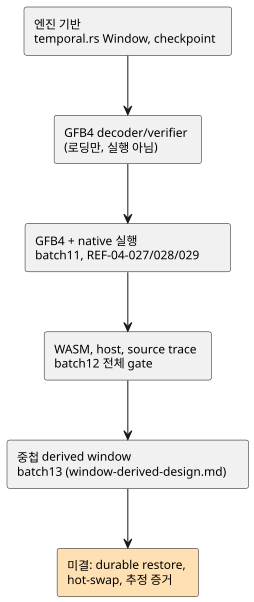

<!-- translation-source: tasks/window-evidence-design.md -->
[영문 원문](window-evidence-design.md)

# 타임스탬프 window 집계: 통합 인계

**현재 상태:** measured 물리 window와 nested window의
컴파일러/GFB/core/host/proof 통합이 batch13에 포함되었습니다. 실제 증거와 남은
adapter replay/영속성 경계는 `window-derived-design.md`를 참조하십시오. 아래의
최초 engine 인계는 과거 맥락이며, 현재 완료 상태가 **아닙니다**.

이 문서는 다음을 순서대로 기록합니다. window 증거의 저장 규칙, 처음 인계된
engine, 통합 요구 사항, 그리고 이전 상태를 나중에 대체한 날짜별 checkpoint입니다.
다이어그램은 그 진행 과정을 요약합니다.

## 증거와 유한 저장소

소스 센서의 `sample` 옵션은 **예상** cadence를 설명합니다. 이는 burst를
제한하지 않으며, 같은 타임스탬프의 서로 다른 관측을 금지하지도 않습니다.

따라서 activation은 명시적 입력 두 가지를 받아야 합니다.

- 각 물리 root의 `{maxObservations, intervalMs}` density 보장
- 대상 sample/메모리 예산

설비 값을 지어내지 않습니다.

window `overMs`의 보존 용량은 물리 root별로 다음 값을 검사하며 합한 것입니다.

`maxObservations * ceil(overMs / intervalMs)`.

저장 규칙:

- `min(overMs, maxAgeMs)`가 아니라 전체 `overMs`를 사용합니다. 새 fresh point가
  더 오래된 보존 기여를 다시 사용 가능하게 만들 수 있기 때문입니다.
- density 이력에도 제한된 저장소가 필요하며, 여기에는 집계에 부적격한 관측도
  포함됩니다.
- committed bank와 candidate bank 모두 메모리에 집계됩니다.
- 용량/density 위반은 stage를 원자적으로 거부하며, 아직 허용 가능한 sample을
  축출하지 않습니다.
- 할당은 scan마다가 아니라 activation 시점에 일어납니다.

## 현재 engine

`crates/ghostflow-core/src/temporal.rs`는 `Window::new`, `stage`, `commit`,
`rollback`, committed/staged contributor와 outcome을 공개합니다. `RootDensity`,
`TargetBudget`, `TimeContext { epoch, now_ms }`는 명시적 입력입니다.

- **포함과 freshness.** 포함 구간은 `(now-over, now]`입니다. freshness에는 최신
  age `< max_age`가 필요합니다.
- **식별자.** 식별자는 source tag, source epoch, ID, 원래 타임스탬프를
  포함합니다.
- **중복과 동률.** 중복 관측은 기여를 만들지 않습니다. 타임스탬프 동률은
  `(timestamp, source_tag, epoch, id)`로 정렬합니다. rate에는 서로 다른
  타임스탬프가 필요합니다.
- **산술.** average/min/max와 초당 rate는 실제 유한 측정값을 사용합니다. 수치
  overflow는 무한대의 성공 값을 내는 대신 stage를 거부합니다.
- **Fault와 source epoch.** 일반 상류 fault는 허용 가능한 이력을 보존하며
  outcome에 기록됩니다. root epoch 변경은 그 root의 기여만 무효화합니다.
- **Time epoch.** 같은 time epoch 안에서 시간이 역행하면 거부합니다. time epoch가
  교체되면 window와 density 이력을 비우고, source ID highwater는 유지하며, 이전
  영역의 타임스탬프 순서를 비웁니다. cached 관측은 새 time epoch의 시작점이 될 수
  없습니다.
- **Revision.** outcome revision은 새로 admit된 관측이 있을 때에만 전진합니다.
  derived aggregate는 지어낸 물리 sample ID가 아니라 contributor/revision 증거를
  갖습니다.

fault 보존과 derived 증거 규칙은 제품 통합 전에 §4.4 Reference의 명시적 명확화가
필요합니다. raw 센서 filter의 별도 fault-clears-history 규칙을 실수로 상속해서는
안 됩니다.

**기반 증거:** `build/temporal-foundation-unit.log`(unit 테스트 7건)와
`build/temporal-conformance.log`(독립 공개 engine oracle 테스트 6건). unit
suite에는 stage 연산 200회에 걸친 allocation-count 검사가 포함됩니다. 다음의
완전한 host gate가 이 집중 결과를 보완합니다.

### 이후 수용된 기반

- **Checkpoint.** 불투명한 `WindowCheckpoint`는 commit된 이력, density queue,
  식별자, fault provenance, revision, 시간을 capture합니다. copy와 restore는
  할당된 buffer를 재사용하며, 동일한 예산 상한이 아니라 일치하는
  구성(geometry)/설정을 요구합니다. 집중 증거(`build/` 아래):
  `temporal-checkpoint-final.log`(unit 테스트 10건)와
  `temporal-checkpoint-conformance.log`(oracle 테스트 6건).
- **GFB4 requirements/decoder/verifier.** 공개 loader 사례 12건이 통과합니다.
  잘못된 blob, 정확한 clock binding, projection typing, 의존 순서, 잘림, 기존
  한계를 포함합니다. 전체 core 실행은 108건 통과했습니다:
  `build/temporal-module-core-green.log`. 이는 로딩과 검증을 증명할 뿐 실행을
  증명하지는 않습니다. runtime 통합은
  [명시적 wire 및 activation 계약](window-gfb4-design.ko.md)에 따라 진행됩니다.
- **Host gate.** `tests/window-control.test.mjs`는 host gate에 등록되어
  있습니다. 그 source 수용 사례는 실제 lowering이 구현될 때까지 RED로 남습니다.
  batch10 전체 gate 보고는 이 변경 이전의 것이며 이 revision을 인증하지
  않습니다.

## 필수 통합

1. GFB/Rust 실행에 실제로 제한된 stateful 연산 기능을 도입합니다. scalar state
   unrolling과 JavaScript 집계 engine으로는 요구 사항을 충족하지 못합니다.
   구체적인 profile 변경이 정당화될 때까지 기존 예산을 보존합니다.
2. 지원되는 임의의 Result 식을 의존 순서대로 tick당 한 번 실행되는 prelude로
   lowering합니다. 타입이 지정된 transient Result projection을 생성합니다. source
   전용 컴파일은 장치 fact를 가정하지 않고 activation 요구 사항을 기록합니다.
3. window arena를 core 상태 및 물리 conditioner와 같은 scan commit/rollback,
   replay/checkpoint 경계에 포함합니다. 영속 restore에는 source/time 연속성
   증거가 필요합니다.
4. source descriptor, 두 WASM/native adapter, 대상 activation 계약, contributor
   provenance, package 검증을 함께 추가합니다.
5. 변경되지 않은 CLI 수용 기대값 REF-04-027/028/029를 보존하고, 모든 실행
   backend에 절대 runtime oracle 검사를 추가합니다. rate는 모든 수치 타입이 아니라
   Temperature와 Reference의 선형 물리량을 허용합니다.

estimated 품질 증거와 사용자에 따라 달라지는 `true_for` 연속성 선택은 별도의
미결 계약으로 남아 있습니다. 이 설계는 그 기본값을 공급하지 않습니다.

## GFB4와 native 실행 checkpoint (2026-09-23)

위의 이전 source RED 상태는 대체되었습니다. GFB4 encoding, 컴파일러 lowering,
Rust decoding, 명시적 temporal activation이 이제 물리 root window를 실행합니다.

| Suite | 결과 |
|---|---|
| Core 최종 집중 suite | 124 pass (`build/temporal-runtime-core-final.log`) |
| Source/encoder suite | 32 pass |
| 서명된 JS package 회귀 | 56 pass |
| Browser encoding | pass |

Batch11은 native와 WASM 산출물을 다시 빌드했습니다. REF-04-027/028/029는 이제
실제 CLI check/build를 통과합니다. 한 테스트의 오류 메시지 기대값을 기존
`division by zero` 계약에 맞게 수정했습니다. 그 뒤 native source-to-Rust suite는
테스트 3건을 모두 통과했습니다(`build/window-native-green.log`). activation
요구 사항, 용량 거부, 정확한 average/minimum/maximum/rate, contributor trace,
뒤늦은 식 fault 이후의 원자적 재시도를 다룹니다. 그 fixture 수정 때문에 runtime
동작이 바뀌지는 않았습니다.

이것으로 기능이 완성된 것은 아닙니다. batch11 시점에는 WASM/host temporal
activation과 source-trace 의존성이 아직 미결이었으며, 아래의 다음 checkpoint가 그
상태를 대체합니다. native 서명 package 통합, derived window source, 영속
연속성/hot-swap 이관은 미완료로 남아 있습니다. 가상 CLI adapter에는 명시적
epoch/density/budget이 필요하며, 장치 기본값을 공급하지 않습니다.

## WASM, host, source-trace checkpoint (2026-09-23)

- **공유 GFTA activation**은 JavaScript와 Rust가 독립적으로 검증합니다. 두 WASM
  adapter 모두 명시적 density/budget/epoch로 기존 core를 실행합니다.
  `build/window-wasm-green.log`: 30/30; Rust ABI 테스트: 5/5.
- **Host 실행.** `build/window-host-green.log`: 16/16. 실제 legacy/framed host
  실행, 정확한 네 연산 결과, 만료, 동적 fault와 동일 sample 재시도, 불변 epoch,
  잘못된 profile 및 descriptor 거부를 다룹니다.
- **Provenance.** `build/window-provenance-available-green.log`: 6/6. 정본
  replay는 소비자를 포함한 windowSites와 의존성을 고정합니다. 다시 서명한 대체는
  로딩 전에 실패합니다. 실제 native 기록은 Derived 품질과 별도의 상류 fault를
  투영합니다. 다음은 거부됩니다: 잘못된 식별자, Int 영역, 미래/만료 sample,
  비어 있거나 stale인 성공 증거, 충분히 결정되지 않은 성공 rate.
- **회귀.** `build/window-provenance-green.log`: 최종 observer 영역 추가 전에
  관련 이전 회귀 63건이 통과했습니다. 전체 gate 증거는 `plan.md`에 별도로
  기록되어 있으며, 이 집중 수치가 전체 Reference 준수를 뜻하지는 않습니다.

Root는 공개 관측 필드, 센서 source tag, rate-fault 선택에 관한 최초 host 테스트
가정을 수정했습니다. 이 fixture 수정은 production 결함이 아닙니다. Astra는 host
profile/epoch 처리와 최종 observer 식별자/영역 수정을 검토했습니다. native framed
CLI/package 통합, nested derived 증거, estimated 증거, 영속 이관은 미결로 남아
있습니다.

**Batch12 전체 gate**에는 이 변경이 포함되었습니다: Node 2,014 = 1,822 pass,
28 fail, 164 TODO, 0 skip.

- Reference 실패 27건은 그대로 남아 있습니다.
- 유일한 다른 실패는 새로 필수가 된 activation export가 빠진 기존
  allocation-guard 테스트 mock이었습니다. 거부/할당 assertion은 바꾸지 않고 그
  no-op mock을 수정했으며, 집중 테스트는 1/1 통과했습니다.
- Rust/native/WASM 선행 단계는 통과했고, 튜토리얼은 실행되지 않았습니다.
- 전체 보고는 실패로 보존합니다. source-hash 검토를 통해 gate 이후 production
  코드가 아니라 그 테스트 fixture만 바뀌었음을 확인했습니다.

`build/compiler-runtime-batch12-verification.json`과
`build/scan-frame-wrapper-focused.log`를 참조하십시오.
