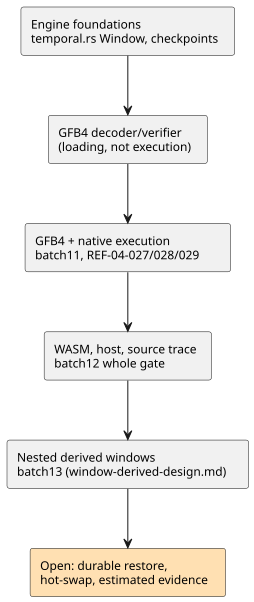

# Timestamped window aggregation: integration handoff

**Current status:** measured physical and nested window
compiler/GFB/core/host/proof integration is included in batch13. See
`window-derived-design.md` for the actual evidence and the remaining adapter
replay/durability boundaries. The initial engine handoff below is historical
context; it is **not** the current completion status.

This document records, in order: the storage rule for window evidence, the
engine as first handed off, the integration requirements, and the dated
checkpoints that later superseded earlier status. The diagram summarizes that
progression.

## Evidence and finite storage

The source sensor `sample` option describes **expected** cadence. It does not
bound bursts, and it does not prohibit distinct observations at the same
timestamp.

Activation must therefore receive two explicit inputs:

- each physical root's `{maxObservations, intervalMs}` density guarantee;
- a target sample/memory budget.

No installation values are invented.

For a window `overMs`, the retained capacity is the checked sum over physical
roots of:

`maxObservations * ceil(overMs / intervalMs)`.

Storage rules:

- Use the full `overMs`, not `min(overMs, maxAgeMs)`: a new fresh point can
  make older retained contributions usable again.
- Density histories also require bounded storage, including observations that
  are ineligible for aggregation.
- Both the committed and the candidate banks count against memory.
- Capacity/density violations reject the stage atomically; they do not evict
  still-admissible samples.
- Allocation occurs at activation, not per scan.

## Current engine

`crates/ghostflow-core/src/temporal.rs` exposes `Window::new`, `stage`,
`commit`, `rollback`, committed/staged contributors and outcomes. `RootDensity`,
`TargetBudget`, and `TimeContext { epoch, now_ms }` are explicit inputs.

- **Membership and freshness.** Membership is `(now-over, now]`; freshness
  requires latest age `< max_age`.
- **Identity.** Identity includes source tag, source epoch, ID and original
  timestamp.
- **Duplicates and ties.** Duplicate observations do not create contributions.
  Timestamp ties are ordered by `(timestamp, source_tag, epoch, id)`; rate
  needs distinct timestamps.
- **Arithmetic.** Average/min/max and per-second rate use actual finite
  measurements. Numeric overflow rejects the stage rather than producing an
  infinite successful value.
- **Faults and source epochs.** An ordinary upstream fault retains admissible
  history and is recorded in the outcome. A root epoch change invalidates only
  that root's contributions.
- **Time epochs.** Backwards time within the same time epoch rejects. A
  replacement time epoch clears window and density history, retains source ID
  highwaters, and clears old-domain timestamp ordering. A cached observation
  cannot seed the new time epoch.
- **Revision.** The outcome revision advances only for a newly admitted
  observation. A derived aggregate has contributor/revision evidence, not an
  invented physical sample ID.

The fault-retention and derived-evidence rules need an explicit §4.4 Reference
clarification before product integration. They must not accidentally inherit
the raw sensor filter's separate fault-clears-history rule.

**Foundation evidence:** `build/temporal-foundation-unit.log` (7 unit tests)
and `build/temporal-conformance.log` (6 independent public-engine oracle
tests). The unit suite includes an allocation-count check across 200 staged
operations. The next complete host gate supplements these focused results.

### Subsequent accepted foundations

- **Checkpoints.** Opaque `WindowCheckpoint` captures committed history,
  density queues, identities, fault provenance, revision and time. Copy and
  restore reuse allocated buffers and require matching geometry/configuration,
  not identical budget ceilings. Focused evidence, under `build/`:
  `temporal-checkpoint-final.log` (10 unit tests) and
  `temporal-checkpoint-conformance.log` (6 oracle tests).
- **GFB4 requirements/decoder/verifier.** Twelve public loader cases pass,
  including malformed blobs, exact clock bindings, projection typing,
  dependency order, truncation and existing limits. The complete core run
  passed 108 tests: `build/temporal-module-core-green.log`. This proves loading
  and verification, not execution. Runtime integration proceeds under
  [the explicit wire and activation contract](window-gfb4-design.md).
- **Host gate.** `tests/window-control.test.mjs` is registered in the host
  gate. Its source acceptance cases stay RED until real lowering is
  implemented. The batch10 full-gate report predates these changes and does
  not certify this revision.

## Required integration

1. Introduce a real, bounded stateful-operation facility in GFB/Rust
   execution. Scalar state unrolling and a JavaScript aggregation engine do not
   meet the requirement. Preserve existing budgets until a concrete profile
   change is justified.
2. Lower arbitrary supported Result expressions into a dependency-ordered,
   once-per-tick prelude. Produce typed transient Result projections.
   Source-only compilation records activation requirements without assuming
   device facts.
3. Include window arenas in the same scan commit/rollback and
   replay/checkpoint boundary as core state and physical conditioners. Durable
   restore requires source/time continuity evidence.
4. Add, together: source descriptors, both WASM/native adapters, target
   activation contracts, contributor provenance and package validation.
5. Preserve the unchanged CLI accept expectations REF-04-027/028/029 and add
   absolute runtime oracle checks on all execution backends. Rate permits
   Temperature and the Reference's linear physical quantities, not every
   numeric type.

Estimated-quality evidence and the user-dependent `true_for` continuity choice
remain separate unresolved contracts. This design does not supply their
defaults.

## GFB4 and native execution checkpoint (2026-09-23)

The earlier source RED status above is superseded. GFB4 encoding, compiler
lowering, Rust decoding and explicit temporal activation now execute physical
root windows.

| Suite | Result |
|---|---|
| Core final focused suite | 124 pass (`build/temporal-runtime-core-final.log`) |
| Source/encoder suite | 32 pass |
| Signed JS package regressions | 56 pass |
| Browser encoding | pass |

Batch11 rebuilt the native and WASM artifacts. REF-04-027/028/029 now pass
actual CLI check/build. One test's error-message expectation was corrected to
the existing `division by zero` contract. After that, the native source-to-Rust
suite passed all three tests (`build/window-native-green.log`): activation
requirements, capacity rejection, exact averages/minima/maxima/rates,
contributor traces, and atomic retry after a late expression fault. No runtime
behavior was changed for that fixture correction.

This did not finish the feature. At batch11, WASM/host temporal activation and
source-trace dependencies were still open; the next checkpoint below supersedes
that status. Native signed-package integration, derived window sources and
durable continuity/hot-swap migration remain unfinished. The virtual CLI
adapter requires explicit epoch/density/budgets; it supplies no device
defaults.

## WASM, host and source-trace checkpoint (2026-09-23)

- **Shared GFTA activation** is independently validated by JavaScript and Rust.
  Both WASM adapters execute the existing core with explicit
  density/budget/epoch. `build/window-wasm-green.log`: 30/30; Rust ABI tests:
  5/5.
- **Host execution.** `build/window-host-green.log`: 16/16. Covers actual
  legacy/framed host execution, exact four-operation results, expiry, dynamic
  fault and same-sample retry, immutable epoch, and malformed profile and
  descriptor rejection.
- **Provenance.** `build/window-provenance-available-green.log`: 6/6.
  Canonical replay pins windowSites and dependencies, including consumers.
  Re-signed substitutions fail before loading. Real native records project
  Derived quality and separate upstream faults. These reject: malformed
  identities, Int domains, future/expired samples, empty/stale success evidence
  and underdetermined successful rates.
- **Regressions.** `build/window-provenance-green.log`: 63 relevant prior
  regressions passed before the final observer domain additions. Whole-gate
  evidence is recorded separately in `plan.md`; these focused counts do not
  imply full Reference compliance.

Root corrected initial host test assumptions about public observation fields,
sensor source tags and rate-fault selection. Those fixture corrections are not
production defects. Astra reviewed host profile/epoch handling and the final
observer identity/domain corrections. Native framed CLI/package integration,
nested derived evidence, estimated evidence and durable migration remain open.

**Batch12 whole gate** included these changes: Node 2,014 = 1,822 pass,
28 fail, 164 TODO, 0 skip.

- The 27 Reference failures remain.
- The sole other failure was an existing allocation-guard test mock that lacked
  the new required activation export. Its no-op mock was corrected without
  changing its rejection/allocation assertions, and the focused test passed
  1/1.
- Rust/native/WASM presteps passed; the tutorial did not run.
- The full report is preserved as failed. Source-hash review confirmed that
  only that test fixture changed after the gate, not production code.

See `build/compiler-runtime-batch12-verification.json` and
`build/scan-frame-wrapper-focused.log`.
