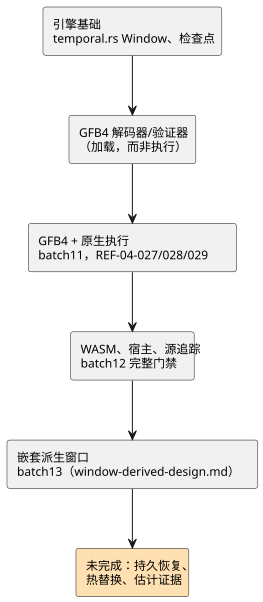

<!-- translation-source: tasks/window-evidence-design.md -->
[英文原文](window-evidence-design.md)

# 带时间戳的窗口聚合：集成交接

**当前状态：** 测量型物理窗口与嵌套窗口的编译器/GFB/core/宿主/证明集成已包含在 batch13
中。实际证据以及剩余的适配器重放/持久性边界见 `window-derived-design.md`。下文最初的引擎
交接是历史背景；它**不是**当前的完成状态。

本文依次记录：窗口证据的存储规则、最初交接时的引擎、集成要求，以及后来取代早期状态的
带日期的检查点。下图概括了这一演进过程。

## 证据与有限存储

来源传感器的 `sample` 选项描述的是**预期**节拍。它不限制突发，也不禁止在同一时间戳上出现
不同的观测。

因此，激活必须接收两个显式输入：

- 每个物理根的 `{maxObservations, intervalMs}` 密度保证；
- 一个目标样本/内存预算。

不会凭空设定任何安装值。

对于窗口 `overMs`，保留容量是对所有物理根求和（带溢出检查）的结果：

`maxObservations * ceil(overMs / intervalMs)`。

存储规则：

- 使用完整的 `overMs`，而不是 `min(overMs, maxAgeMs)`：一个新的新鲜点可以让较旧的保留
  贡献重新变得可用。
- 密度历史同样需要有界存储，包括那些不符合聚合条件的观测。
- 已提交和候选两个存储库都计入内存。
- 容量/密度违规会原子地拒绝本次暂存；它们不会驱逐仍可准入的样本。
- 分配发生在激活时，而不是每次扫描时。

## 当前引擎

`crates/ghostflow-core/src/temporal.rs` 暴露 `Window::new`、`stage`、`commit`、
`rollback`，以及已提交/已暂存的贡献项和结果。`RootDensity`、`TargetBudget` 和
`TimeContext { epoch, now_ms }` 是显式输入。

- **成员资格与新鲜度。** 成员资格为 `(now-over, now]`；新鲜度要求最新年龄 `< max_age`。
- **身份标识。** 身份标识包括来源标签、来源 epoch、ID 和原始时间戳。
- **重复与并列。** 重复的观测不会产生贡献。时间戳并列按 `(timestamp, source_tag, epoch, id)`
  排序；速率需要不同的时间戳。
- **算术。** 平均值/最小值/最大值和每秒速率使用实际的有限测量值。数值溢出会拒绝本次暂存，
  而不是产生一个无穷大的成功值。
- **故障与来源 epoch。** 普通的上游故障会保留可准入的历史，并记录在结果中。根 epoch 变化
  只会使该根的贡献失效。
- **时间 epoch。** 在同一时间 epoch 内时间倒退会被拒绝。替换时间 epoch 会清除窗口和密度
  历史，保留来源 ID 的高水位（highwater），并清除旧时间域的时间戳排序。缓存的观测不能为
  新的时间 epoch 提供初始值。
- **修订版。** 结果的修订版仅在准入新观测时前进。派生聚合拥有贡献项/修订版证据，而不是
  虚构的物理样本 ID。

故障保留规则和派生证据规则需要在产品集成之前于参考手册 §4.4 中作出明确澄清。它们绝不能
意外继承原始传感器滤波中另一条“故障清除历史”的规则。

**基础证据：** `build/temporal-foundation-unit.log`（7 个单元测试）和
`build/temporal-conformance.log`（6 个独立的公开引擎 oracle 测试）。单元测试套件包括一项
覆盖 200 次暂存操作的分配计数检查。下一次完整的宿主门禁会补充这些聚焦结果。

### 之后被接受的基础

- **检查点。** 不透明的 `WindowCheckpoint` 捕获已提交历史、密度队列、身份标识、故障来源、
  修订版和时间。复制和恢复会复用已分配的缓冲区，并要求几何结构/配置匹配，但不要求预算
  上限相同。聚焦证据位于 `build/` 下：`temporal-checkpoint-final.log`（10 个单元测试）和
  `temporal-checkpoint-conformance.log`（6 个 oracle 测试）。
- **GFB4 需求/解码器/验证器。** 十二个公开加载器用例通过，包括格式错误的 blob、精确的时钟
  绑定、投影类型、依赖顺序、截断以及现有限制。完整的 core 运行通过了 108 个测试：
  `build/temporal-module-core-green.log`。这证明的是加载和验证，而不是执行。运行时集成在
  [显式的传输线格式与激活契约](window-gfb4-design.zh.md)下推进。
- **宿主门禁。** `tests/window-control.test.mjs` 已在宿主门禁中注册。在真正的 lowering
  实现之前，其源验收用例保持 RED。batch10 完整门禁报告早于这些变更，不能为这个修订版提供
  证明。

## 必需的集成

1. 在 GFB/Rust 执行中引入真正的、有界的有状态操作设施。标量状态展开和 JavaScript 聚合
   引擎都不满足该要求。在有具体理由修改 profile 之前，保持现有预算不变。
2. 将任意受支持的 Result 表达式 lowering 为按依赖排序、每个 tick 执行一次的 prelude。生成
   带类型的临时 Result 投影。仅源码编译只记录激活需求，而不假设任何设备事实。
3. 将窗口 arena 纳入与 core 状态和物理调理器相同的扫描提交/回滚以及重放/检查点边界。持久
   恢复需要来源/时间连续性证据。
4. 一并添加：来源描述符、WASM/原生两种适配器、目标激活契约、贡献项来源以及包验证。
5. 保持 REF-04-027/028/029 的 CLI 接受预期不变，并在所有执行后端上添加绝对的运行时 oracle
   检查。速率允许 Temperature 以及参考手册中的线性物理量，而不是所有数值类型。

估计质量证据以及依赖用户选择的 `true_for` 连续性，仍是独立的未决契约。本设计不提供它们的
默认值。

## GFB4 与原生执行检查点（2026-09-23）

上文较早的源 RED 状态已被取代。GFB4 编码、编译器 lowering、Rust 解码和显式的时间激活现在
可以执行物理根窗口。

| 套件 | 结果 |
|---|---|
| Core 最终聚焦套件 | 124 通过（`build/temporal-runtime-core-final.log`） |
| 源/编码器套件 | 32 通过 |
| 已签名 JS 包回归测试 | 56 通过 |
| 浏览器编码 | 通过 |

Batch11 重新构建了原生和 WASM 产物。REF-04-027/028/029 现在通过实际的 CLI check/build。
有一个测试的错误消息预期被修正为现有的 `division by zero` 契约。此后，原生从源码到 Rust
的套件三个测试全部通过（`build/window-native-green.log`）：激活需求、容量拒绝、精确的
平均值/最小值/最大值/速率、贡献项追踪，以及在后续表达式故障后的原子重试。这次夹具修正
没有改变任何运行时行为。

这并没有完成该功能。在 batch11 时，WASM/宿主时间激活以及源追踪依赖仍未完成；下面的检查点
取代了该状态。原生已签名包集成、派生窗口来源以及持久连续性/热替换迁移仍未完成。虚拟 CLI
适配器需要显式的 epoch/密度/预算；它不提供任何设备默认值。

## WASM、宿主与源追踪检查点（2026-09-23）

- **共享的 GFTA 激活**由 JavaScript 和 Rust 各自独立验证。两个 WASM 适配器都使用显式的
  密度/预算/epoch 执行现有的 core。`build/window-wasm-green.log`：30/30；Rust ABI
  测试：5/5。
- **宿主执行。** `build/window-host-green.log`：16/16。覆盖实际的旧式/带帧宿主执行、
  四种操作的精确结果、过期、动态故障与同一样本重试、不可变的 epoch，以及对格式错误的
  profile 和描述符的拒绝。
- **来源（provenance）。** `build/window-provenance-available-green.log`：6/6。规范重放
  固定了 windowSites 和依赖关系，包括消费者。重新签名的替换在加载之前失败。真实的原生记录
  投影出 Derived 质量，并分离上游故障。以下情况会被拒绝：格式错误的身份标识、Int 域、
  未来/过期的样本、空的/陈旧的成功证据，以及欠定的成功速率。
- **回归测试。** `build/window-provenance-green.log`：在最终的观察器域补充之前，63 个相关
  的既有回归测试通过。完整门禁证据另行记录在 `plan.md` 中；这些聚焦计数并不意味着完全符合
  参考手册。

Root 修正了最初宿主测试中关于公开观测字段、传感器来源标签和速率故障选择的假设。这些夹具
修正不是生产缺陷。Astra 审查了宿主 profile/epoch 处理，以及最终的观察器身份标识/域修正。
原生带帧 CLI/包集成、嵌套派生证据、估计证据和持久迁移仍未完成。

**Batch12 完整门禁**包含了这些变更：Node 2,014 = 1,822 通过、28 失败、164 TODO、
0 跳过。

- 27 个参考手册失败仍然存在。
- 唯一的其他失败是一个既有的分配守卫测试 mock，它缺少新增的必需激活导出。该空操作 mock
  已被修正，且未改变其拒绝/分配断言，聚焦测试通过 1/1。
- Rust/原生/WASM 前置步骤通过；教程没有运行。
- 完整报告按失败状态保留。源哈希审查确认，门禁之后只有那个测试夹具发生了变化，生产代码
  没有变化。

参见 `build/compiler-runtime-batch12-verification.json` 和
`build/scan-frame-wrapper-focused.log`。
