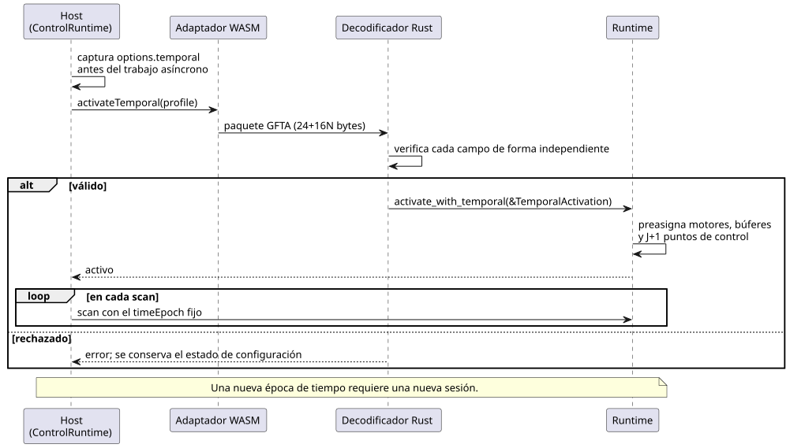
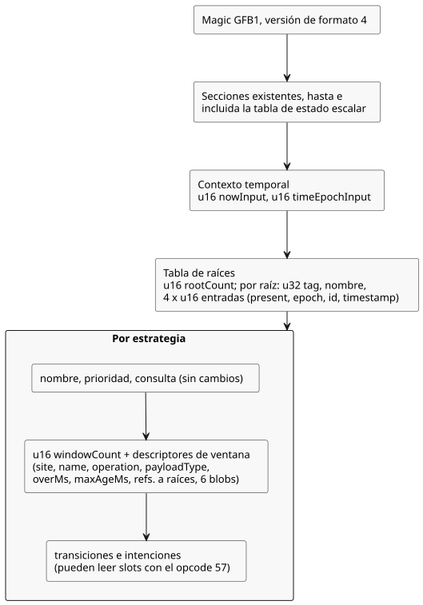
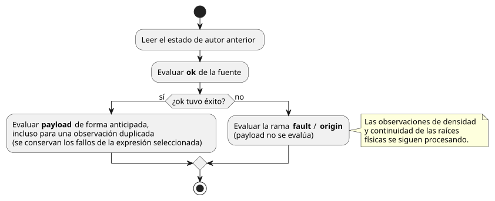

<!-- translation-source: tasks/window-gfb4-design.md -->
[Original en inglés](window-gfb4-design.md)

# Contrato de integración de ventanas en GFB4

> **Estado:** Este es un plan de implementación. No afirma que el
> lenguaje o el runtime admitan las ventanas por completo.
>
> Documento complementario: [diseño de evidencia de ventanas](window-evidence-design.es.md).

En este documento:

- **Interfaz de activación del host**: cómo un host proporciona el perfil
  temporal y el paquete de activación `GFTA` exacto.
- **Disposición verificada del módulo**: la disposición binaria del formato 4
  de GFB y el opcode 57.
- **Formas internas del compilador**: las formas de codificación internas a las
  que el compilador hace el *lowering*.
- **Contrato de ejecución y activación**: reglas del manifiesto, de la
  procedencia y de las transacciones del runtime.
- **Diseño aceptado de la API de Runtime**: la API `Runtime` de Rust y la forma
  del registro `windowTrace`.
- **Aceptación de la integración**: qué está implementado y qué sigue pendiente.

Términos que se usan en todo el documento:

- Una **ventana** (*window*) es un agregado temporal (promedio, mínimo, máximo o
  tasa) sobre observaciones con marca de tiempo.
- Una **raíz física** (*physical root*) es una fuente de sensor con su propia
  etiqueta (*tag*) y sus propias entradas de identidad.
- La **época de tiempo** (*time epoch*) identifica el dominio de reloj. Todas
  las marcas de tiempo de una sesión pertenecen a una sola época.

## Interfaz de activación del host

Ambos adaptadores WASM de bajo nivel exponen `activateTemporal(profile)`. Los
dos reciben el mismo perfil explícito:

`{timeEpoch, rootDensity: [{sourceTag, maxObservations,
intervalMs}], budget: {maxRetainedSamples, maxBytes}}`

ControlRuntime recibe este perfil como `options.temporal`. Captura el perfil
antes de cualquier trabajo asíncrono y proporciona la época fija en cada scan.

- Una nueva época de tiempo requiere una nueva sesión.
- No se infiere ningún perfil a partir de la cadencia del sensor ni de la
  duración de la ventana de una fuente.

La secuencia siguiente muestra cómo fluye la activación desde el host hasta el
runtime y qué ocurre cuando el paquete se rechaza.



El paquete de activación acotado es *little-endian*. Sus campos, en orden:

| Parte | Campos |
|---|---|
| Encabezado | magic `GFTA`, u16 versión 1, u16 número de raíces, u64 época, u32 presupuesto de muestras, u32 presupuesto de bytes |
| Cada raíz | u32 etiqueta, u32 máximo de observaciones, u64 intervalo en milisegundos |

Reglas del paquete:

- El tamaño exacto es de 24+16N bytes.
- N está en 1..31. Es el límite existente de 128 entradas menos dos relojes,
  dividido entre cuatro entradas por raíz.
- La época y los intervalos son enteros exactos seguros en JS.
- Los intervalos, la densidad y los presupuestos son positivos.
- Las etiquetas son positivas, únicas y ascendentes.
- El decodificador de Rust verifica cada campo de forma independiente.
- Una activación rechazada conserva el estado de configuración.

La validación del manifiesto en el host comprueba los dominios de los
descriptores de ventana, los slots, las vinculaciones de fuentes y el
emparejamiento de formatos. **No** comprueba la equivalencia canónica de los
descriptores de fuente/nominales; eso es responsabilidad de la cadena de
herramientas y del verificador de paquetes firmados. Un digest de bytecode que
coincide no basta, por sí solo, para autenticar un manifiesto proporcionado por
quien llama.

## Disposición verificada del módulo

Los módulos que contienen una ventana usan el magic GFB1 existente con la
versión de formato 4. Los módulos sin ventanas conservan su selección de formato
existente.

Los presupuestos existentes no cambian:

| Presupuesto | Límite |
|---|---|
| Módulo | 1 MiB |
| Expresión/consulta | 4096 bytes |
| Pila | 128 |
| Entrada | 128 |
| Estrategia | 32 |
| Estado escalar | presupuesto existente |

Para cada estrategia, el número de estados escalares más el número de ventanas
no debe superar 128.

El diagrama resume dónde se ubican las nuevas secciones en un módulo GFB4. Las
reglas detalladas vienen a continuación.



Después de la tabla de estado escalar existente, se codifica:

- `u16 nowInput`, `u16 timeEpochInput`; vinculan entradas Number llamadas
  `__gf_now_ms` y `__gf_time_epoch`, respectivamente.
- `u16 rootCount` y, a continuación, cada raíz: `u32 tag`, nombre como cadena y
  cuatro índices de entrada `u16` para presencia (Bool), época, id y marca de
  tiempo (Number).
- Las raíces tienen nombres distintos, etiquetas positivas estrictamente
  crecientes y vinculaciones de entrada distintas, que además deben estar
  separadas de las dos entradas de reloj.

Cada estrategia conserva su nombre, su prioridad y su consulta existentes.
Después agrega `u16 windowCount` y los descriptores siguientes, colocados antes
de las transiciones y las intenciones:

1. `u32 site`, nombre como cadena (sitios únicos distintos de cero y nombres
   únicos por estrategia).
2. `u8 operation`: 0 promedio, 1 mínimo, 2 máximo, 3 tasa.
3. `u8 payloadType`: tipo de máquina Number/Int existente. El promedio y la tasa
   usan Number; el promedio convierte explícitamente a Number los valores de
   fuente Int.
4. `u64 overMs`, `u64 maxAgeMs`, ambos en 1..2^53-1, inclusive.
5. `u16 rootRefCount` e índices `u16` únicos y estrictamente crecientes de la
   tabla de raíces.
6. Seis blobs de expresión existentes con prefijo de longitud, en orden: ok
   (Bool), payload (payloadType), fault, origin, quality y sourceTag (los cuatro
   Number).

Reglas a nivel de módulo:

- Un módulo GFB4 tiene al menos una raíz y al menos una ventana entre todas sus
  estrategias.
- Los blobs de fuente no pueden leer el estado siguiente. Pueden hacer
  referencia a slots de ventana anteriores.
- Las transiciones y las intenciones pueden leer todos los slots de su propia
  estrategia.
- El formato 4 incluye las operaciones de expresión existentes del formato 3.

El opcode 57 lee un slot de ventana. Su codificación es `[57, u16 slot, u8 field]`:

| Campo | Significado | Tipo |
|---|---|---|
| 0 | ok | Bool |
| 1 | value | payloadType |
| 2 | fault | Number |
| 3 | origin | Number |
| 4 | admissionRevision | Number |
| 5 | newestTimestamp | Number |
| 6 | count | Number |
| 7 | quality | Number |

Un agregado exitoso tiene calidad 3, no la calidad física medida 1. La calidad
no disponible es 0. Los formatos 1–3 y las consultas de dispositivos rechazan
este opcode.

## Formas internas del compilador

Estas son formas de codificación internas. **No** son sintaxis adicional que el
autor escriba en el lenguaje:

```text
(temporal-context __gf_now_ms __gf_time_epoch)
(temporal-root TAG NAME PRESENT_INPUT EPOCH_INPUT ID_INPUT TIMESTAMP_INPUT)
(strategy NAME PRIORITY
  (device QUERY)
  (window SITE NAME OPERATION PAYLOAD_TYPE OVER_MS MAX_AGE_MS
    (roots TAG ...)
    (source OK PAYLOAD FAULT ORIGIN QUALITY SOURCE_TAG))
  (next ...)
  (intent ...))
(window-read SLOT FIELD)
```

Valores permitidos:

- OPERATION es `average`, `min`, `max` o `rate`.
- PAYLOAD_TYPE es `number` o `int`.
- FIELD es `ok`, `value`, `fault`, `origin`, `revision`, `timestamp`,
  `count` o `quality`.

Reglas de orden:

- Las ventanas preceden a las transiciones/intenciones.
- Las declaraciones de raíces y las referencias a ellas ya están en orden
  ascendente de etiqueta. Se rechaza cualquier orden no canónico.

## Contrato de ejecución y activación

### Manifiesto de la fuente y procedencia

Se usa el sobre de manifiesto existente. Una declaración de ventana es una
entrada de `signals` con estos campos:

- `kind: "window"`, `name`, `site`, `slot` basado en cero
- `operation` (`average|min|max|rate`), `payloadType`
- `errorType: "SensorFault"`, `quality: "measured"`
- `overMs`, `maxAgeMs`
- `clockInput: "__gf_now_ms"`, `timeEpochInput: "__gf_time_epoch"`
- `sources: [{name, tag}, ...]`: las raíces físicas ordenadas que usa la
  expresión de fuente.

Reglas de payload y de formato:

- El payload de tasa se escribe `Rate<Q>`, con Q tomado de la lista blanca de la
  Referencia. Los demás tipos de payload usan los nombres de tipo canónicos
  existentes.
- No se escribe en el manifiesto ninguna densidad ni ningún presupuesto
  objetivo.
- Un módulo con ventanas usa `GhostFlow/control-v4`. Los contratos del host y
  del paquete deben permitir explícitamente su emparejamiento con el formato 4
  de GFB.

Los Result de agregados tras el *lowering* llevan un descriptor separado de
evidencia derivada. No se debe falsificar un ID de muestra física en la
estructura física `sample` existente.

Las entradas temporales generadas y las expresiones de fuente del preludio
cuentan para los límites existentes del compilador en entradas, estado y
expresión/pila. Que una fuente compile correctamente no demuestra, por sí solo,
la activación, la validación del host ni la aceptación del paquete.

### Transacción del runtime

La carga verifica los requisitos sin inventar una densidad, un presupuesto ni
una época de tiempo. Por eso, los módulos temporales requieren una activación
explícita con esos datos. La activación normal y el reemplazo en caliente los
rechazan; la migración en el reemplazo en caliente sigue sin terminarse.

La evaluación del preludio sigue estas reglas:

- Usa el estado de autor anterior.
- Primero se evalúa ok de la fuente.
- Si tiene éxito, payload se evalúa de forma anticipada, incluso para una
  observación duplicada. Así se conservan los fallos que genera la expresión
  seleccionada.
- Si la fuente falla, se evalúa la rama fault/origin y payload no se evalúa.
- Las observaciones de densidad/continuidad de las raíces físicas se siguen
  procesando cuando la fuente seleccionada tiene un fallo.



La activación proporciona los datos de densidad, los presupuestos de muestras y
de bytes, y una época de tiempo. El contrato de reloj monotónico existente del
runtime sigue vigente. Cambiar la época de tiempo requiere una nueva sesión de
ejecución explícita. Nunca se debe restablecer en silencio el estado de autor
ni reutilizar el historial temporal después de reemplazar el dominio de reloj.

El commit/rollback de ventanas, la procedencia independiente de TickRecord, el
historial acotado de puntos de control, el rebobinado y la reproducción deben
integrarse en conjunto. La contabilidad de memoria debe incluir:

- ambos bancos de ventanas,
- J+1 puntos de control retenidos,
- los contribuyentes de los registros, y
- la memoria de trabajo de la reproducción.

El motor de ventanas en sí no realiza asignaciones de memoria, pero eso no
implica ninguna garantía global sobre asignaciones.

Las fuentes de agregados anidados necesitan tres cosas: identidad derivada,
propiedad de los contribuyentes y una prueba conservadora de capacidad de
retrospección acumulada. El formato de transmisión y el decodificador de raíces
físicas no bastan, por sí solos, para establecer ese soporte. Esto se mantiene
como trabajo requerido; no se deben cambiar las expectativas de la Referencia
para excluirlo de forma permanente.

## Diseño aceptado de la API de Runtime

- `Runtime::activate_with_temporal(&TemporalActivation)` recibe
  `root_density: Vec<RootDensity>`, `budget: TargetBudget` y `time_epoch: u64`.
  Los datos de densidad deben coincidir exactamente con la unión de raíces
  físicas de la estrategia seleccionada.
- `Runtime::temporal_memory_bytes()` informa del almacenamiento temporal
  contabilizado.
  - `max_retained_samples` limita la suma de las capacidades lógicas de las
    ventanas.
  - El límite de bytes también cuenta el almacenamiento duplicado en los puntos
    de control y en las listas de contribuyentes de las trazas.
- Todos los motores, los búferes de raíces/proyecciones y los J+1 puntos de
  control se asignan antes de cambiar el estado de activación. La evidencia de
  traza independiente se acota a J registros retenidos más un registro
  candidato/transitorio.
  - Cubiertos por este límite exclusivamente temporal: la arena de ventanas, el
    historial y los arreglos de trazas.
  - No cubiertos: la contabilidad interna del asignador, los mapas escalares
    existentes, las cadenas JSON y los clones propiedad de quien llama.
- `Runtime::replay_with_temporal(module, caps, count, &activation,
  max_peak_temporal_bytes)` contabiliza en conjunto el runtime vivo retenido y
  la ejecución de trabajo.
  - La ejecución de trabajo se inicializa desde el punto de control
    inmediatamente anterior a la entrada retenida más antigua.
  - Los registros devueltos se mueven en lugar de clonarse en profundidad.
  - El `replay` ordinario requiere este presupuesto explícito para la ejecución
    temporal.
- El TickRecord de Rust es propietario de sus entradas de traza de ventanas y de
  sus contribuyentes.
  - El JSON incluye `windowTrace` en los registros temporales. El JSON no
    temporal no gana un campo vacío.
  - La copia de traza propia del adaptador con marcos (*framed*) también debe
    contarse al validar el pico de ese adaptador. No debe tratarse en silencio
    como un clon de quien llama.
- El reemplazo en caliente temporal simple sigue rechazándose mientras la
  migración no esté terminada. Una activación repetida no puede restablecer en
  silencio el historial temporal. Esta restricción es una carencia de la
  implementación, no un requisito final de la Referencia reducido.

Cada entrada de `windowTrace` lleva estos campos, y las entradas siguen el orden
de los slots:

| Campo | Contenido |
|---|---|
| `site` | Sitio de la ventana |
| `payloadType` | Tipo de payload de máquina (`number\|int`) |
| `operation` | Operación de agregado |
| `value` | Number o null |
| `quality` | 3 o 0 |
| `count` | Número de contribuyentes |
| `admissionRevision` | Revisión de admisión |
| `timeEpoch` | Época de tiempo |
| `nowMs` | Hora actual en milisegundos |
| `first`, `last` | Un contribuyente o null |
| `contributors` | Lista de contribuyentes |
| `upstreamFault` | null o `{origin, faultCode}` |

- Un contribuyente es `{sourceTag, epoch, id, timestampMs, value}`.
- `faultCode` es el ordinal del lenguaje (Disconnected=0, Stale=1, Invalid=2,
  NotReady=3), no un discriminante de enum de Rust.
- El registro sigue siendo legible de forma independiente después de liberar el
  Runtime.

## Aceptación de la integración

- Implementado: compilador canónico de fuentes y comparaciones nominales de
  Rate; todos los casos de aceptación de ventanas de la Referencia, sin cambios,
  más oráculos independientes del runtime.
- Implementado: activación, rollback, traza, rotación del registro (*journal*),
  rebobinado y reproducción en el núcleo compartido.
- Implementado: WASM heredado/con marcos y la CLI nativa virtual transportan
  densidad/presupuesto/época explícitos.
- Implementado: la validación del manifiesto en el host reconoce las señales de
  ventana y la época de tiempo generada; ningún host calcula agregados ni elige
  la admisión.
- Implementado: la observación de la fuente asigna las trazas de ventana de Rust
  a los nodos de fuente/contribuyentes exactos. La restauración canónica
  verifica los descriptores de ventana generados y sus dependencias.
- La verificación de paquetes firmados en JS valida las vinculaciones de
  ventanas de fuente/manifiesto/bytecode; las pruebas de rechazo vuelven a
  firmar los payloads mutados para llegar a la protección semántica. La
  integración nativa de paquetes firmados y el perfil de la CLI nativa con
  marcos siguen **pendientes**.
- La migración duradera, la evidencia de agregados anidados y la evidencia de
  calidad estimada conservan cada una un **trabajo de aceptación separado**.
  Ninguna queda certificada por las pruebas del cargador de GFB4.

La integración de trazas de fuente abarca tanto la observación como las
dependencias:

- **Vinculación.** La tabla canónica windowSites vincula los sitios de señal
  analizados con sus descriptores.
- **Dependencias.** Incluyen las expresiones de fuente, las identidades de las
  raíces, ambos relojes y las lecturas de ventana posteriores.
- **Restauración.** La restauración compara tanto las entradas de ventana como
  las dependencias de los consumidores con un *lowering* nuevo.
- **Observación.** La observación verifica los valores i32 con signo, la
  unicidad y el orden de las identidades, los límites de retención abiertos por
  la izquierda y la evidencia/frescura de los resultados disponibles. No vuelve
  a calcular los agregados en JavaScript.

Consulte `window-evidence-design.md` para ver la evidencia de pruebas específica
y los límites de la integración actual.
