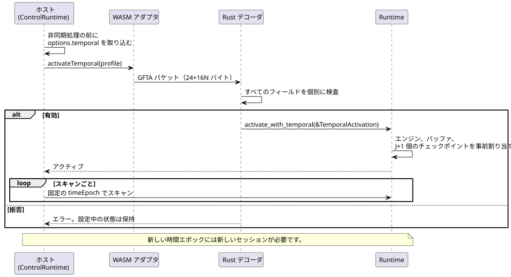
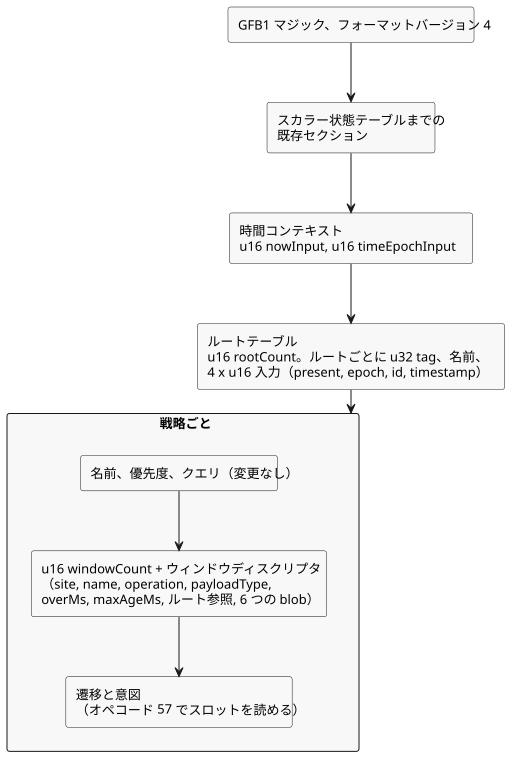
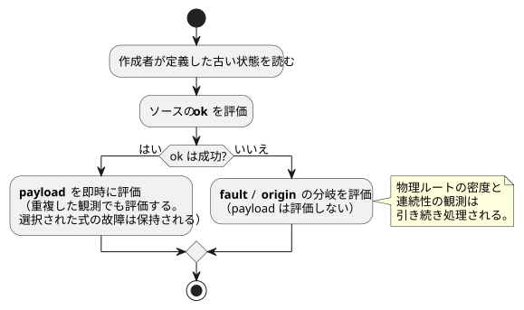

<!-- translation-source: tasks/window-gfb4-design.md -->
[英語の原文](window-gfb4-design.md)

# GFB4 ウィンドウ統合契約

> **状態：** これは実装計画です。言語やランタイムがウィンドウを完全にサポートしていると
> 主張するものではありません。
>
> 関連文書：[ウィンドウ証拠の設計](window-evidence-design.ja.md)。

この文書の内容：

- **ホストのアクティベーションインターフェイス** — ホストが時間プロファイルと、
  厳密な `GFTA` アクティベーションパケットをどのように供給するか。
- **検証済みモジュールのレイアウト** — GFB フォーマット 4 のバイナリレイアウトとオペコード 57。
- **コンパイラ内部形式** — コンパイラが下げる（lowering する）先の内部エンコーディング形式。
- **実行とアクティベーションの契約** — マニフェスト、来歴（provenance）、ランタイムの
  トランザクション規則。
- **採用された Runtime API 設計** — Rust の `Runtime` API と `windowTrace` レコードの形。
- **統合の受け入れ状況** — 実装済みの項目と未解決の項目。

全体を通して使う用語：

- **ウィンドウ**は、タイムスタンプ付きの観測に対する時間集約（平均、最小、最大、
  変化率）です。
- **物理ルート**は、固有のタグと同一性入力を持つセンサのソースです。
- **時間エポック**はクロック領域を識別します。1 つのセッション内のすべてのタイムスタンプは
  1 つのエポックに属します。

## ホストのアクティベーションインターフェイス

低レベルの WASM アダプタはどちらも `activateTemporal(profile)` を公開しています。
どちらも同じ明示的なプロファイルを受け取ります：

`{timeEpoch, rootDensity: [{sourceTag, maxObservations,
intervalMs}], budget: {maxRetainedSamples, maxBytes}}`

ControlRuntime はこのプロファイルを `options.temporal` として受け取ります。非同期処理を
始める前にプロファイルを取り込み、すべてのスキャンで固定のエポックを供給します。

- 新しい時間エポックには新しいセッションが必要です。
- センサの周期やソースウィンドウの長さからプロファイルを推測することはありません。

次のシーケンスは、アクティベーションがホストからランタイムへどのように流れるか、
そしてパケットが拒否されたときに何が起きるかを示しています。



上限付きのアクティベーションパケットはリトルエンディアンです。フィールドは順に次のとおりです：

| 部分 | フィールド |
|---|---|
| ヘッダー | `GFTA` マジック、u16 バージョン 1、u16 ルート数、u64 エポック、u32 サンプル予算、u32 バイト予算 |
| 各ルート | u32 タグ、u32 最大観測数、u64 間隔ミリ秒 |

パケットの規則：

- 厳密なサイズは 24+16N バイトです。
- N は 1..31 です。これは既存の 128 入力の上限から 2 つのクロックを引き、ルートあたりの
  4 入力で割った値です。
- エポックと間隔は、JS で安全に扱える厳密な整数です。
- 間隔、密度、予算は正の値です。
- タグは正の値で、一意かつ昇順です。
- Rust のデコーダはすべてのフィールドを個別に検査します。
- 拒否されたアクティベーションは、設定中の状態を保持します。

ホストのマニフェスト検証では、ウィンドウのディスクリプタのドメイン、スロット、
ソースのバインディング、フォーマットの組み合わせを検査します。正準ソースと名目上の
ディスクリプタの等価性は検査**しません**。それはツールチェーンと署名付きパッケージの
検証器の責任です。バイトコードのダイジェストが一致するだけでは、呼び出し側が
供給したマニフェストは認証されません。

## 検証済みモジュールのレイアウト

ウィンドウを含むモジュールは、既存の GFB1 マジックとフォーマットバージョン 4 を使います。
ウィンドウを含まないモジュールは、既存のフォーマット選択をそのまま使います。

既存の予算は変わりません：

| 予算 | 上限 |
|---|---|
| モジュール | 1 MiB |
| 式/クエリ | 4,096 バイト |
| スタック | 128 |
| 入力 | 128 |
| 戦略 | 32 |
| スカラー状態 | 既存の予算 |

各戦略について、スカラー状態の数とウィンドウの数の合計は 128 を超えてはなりません。

次の図は、GFB4 モジュールのどこに新しいセクションが置かれるかをまとめたものです。
詳細な規則はその後に続きます。



既存のスカラー状態テーブルの後に、次をエンコードします：

- `u16 nowInput`、`u16 timeEpochInput`。それぞれ `__gf_now_ms` と `__gf_time_epoch` という
  名前の Number 入力にバインドします。
- `u16 rootCount`、続いて各ルートについて `u32 tag`、文字列の名前、そして present（Bool）、
  epoch、id、timestamp（Number）を表す 4 つの `u16` 入力インデックス。
- ルートの名前は互いに異なり、タグは正の値で狭義単調増加し、入力バインディングも
  互いに異なります。両方のクロック入力とも重複してはなりません。

各戦略は既存の名前、優先度、クエリを保持します。そのうえで `u16
windowCount` と次のディスクリプタを追加し、遷移と意図の前に配置します：

1. `u32 site`、文字列の名前（サイトは 0 以外で一意、名前は戦略ごとに一意）。
2. `u8 operation`：0 平均、1 最小、2 最大、3 変化率。
3. `u8 payloadType`：既存の Number/Int マシン型。平均と変化率は Number を使います。
   平均では Int のソース値を明示的に Number へ変換します。
4. `u64 overMs`、`u64 maxAgeMs`。どちらも 1..2^53-1（両端を含む）です。
5. `u16 rootRefCount` と、狭義単調増加で一意な `u16` のルートテーブルインデックス。
6. 長さプレフィックス付きの既存の式 blob 6 つを、次の順に配置します：ok（Bool）、
   payload（payloadType）、fault、origin、quality、sourceTag（この 4 つはすべて Number）。

モジュール単位の規則：

- GFB4 モジュールは、少なくとも 1 つのルートと、全戦略を通じて少なくとも 1 つのウィンドウを持ちます。
- ソース blob は次状態を読めません。それより前のウィンドウスロットは参照できます。
- 遷移と意図は、自身の戦略内のすべてのスロットを読めます。
- フォーマット 4 には、既存のフォーマット 3 の式演算が含まれます。

オペコード 57 はウィンドウスロットを読み取ります。エンコーディングは `[57, u16 slot, u8 field]` です：

| フィールド | 意味 | 型 |
|---|---|---|
| 0 | ok | Bool |
| 1 | value | payloadType |
| 2 | fault | Number |
| 3 | origin | Number |
| 4 | admissionRevision | Number |
| 5 | newestTimestamp | Number |
| 6 | count | Number |
| 7 | quality | Number |

成功した集約の品質は 3 であり、物理的な測定値の品質 1 ではありません。利用できない場合の
品質は 0 です。フォーマット 1〜3 とデバイス照会はこのオペコードを拒否します。

## コンパイラ内部形式

これらは内部のエンコーディング形式です。作成者が書く追加の言語構文では**ありません**：

```text
(temporal-context __gf_now_ms __gf_time_epoch)
(temporal-root TAG NAME PRESENT_INPUT EPOCH_INPUT ID_INPUT TIMESTAMP_INPUT)
(strategy NAME PRIORITY
  (device QUERY)
  (window SITE NAME OPERATION PAYLOAD_TYPE OVER_MS MAX_AGE_MS
    (roots TAG ...)
    (source OK PAYLOAD FAULT ORIGIN QUALITY SOURCE_TAG))
  (next ...)
  (intent ...))
(window-read SLOT FIELD)
```

許可される値：

- OPERATION は `average`、`min`、`max`、`rate` のいずれかです。
- PAYLOAD_TYPE は `number` または `int` です。
- FIELD は `ok`、`value`、`fault`、`origin`、`revision`、`timestamp`、
  `count`、`quality` のいずれかです。

順序の規則：

- ウィンドウは遷移/意図より前に置きます。
- ルートの宣言と参照は、すでにタグの昇順になっています。正準でない順序は
  拒否します。

## 実行とアクティベーションの契約

### ソースのマニフェストと来歴

既存のマニフェストのエンベロープを使います。ウィンドウ宣言は、次のフィールドを持つ
`signals` エントリです：

- `kind: "window"`、`name`、`site`、0 始まりの `slot`
- `operation`（`average|min|max|rate`）、`payloadType`
- `errorType: "SensorFault"`、`quality: "measured"`
- `overMs`、`maxAgeMs`
- `clockInput: "__gf_now_ms"`、`timeEpochInput: "__gf_time_epoch"`
- `sources: [{name, tag}, ...]` — ソース式が使う、ソート済みの物理ルート。

ペイロードとフォーマットの規則：

- Rate のペイロードは `Rate<Q>` と表記し、Q は Reference のホワイトリストから選びます。
  その他のペイロード型は既存の正準な型名を使います。
- 密度やターゲット予算はマニフェストに書き込みません。
- ウィンドウモジュールは `GhostFlow/control-v4` を使います。ホストとパッケージの契約は、
  GFB フォーマット 4 との組み合わせを明示的に許可しなければなりません。

下げられた（lowered）集約の Result は、別個の派生証拠ディスクリプタを持ちます。既存の
物理 `sample` 構造の中に、物理サンプルの ID を偽造してはなりません。

生成された時間入力とプレリュードのソース式は、既存のコンパイラの入力、状態、
式/スタックの上限に算入されます。ソースのコンパイルが成功しただけでは、
アクティベーション、ホストの検証、パッケージの受け入れは証明されません。

### ランタイムのトランザクション

ロード時には、密度、予算、時間エポックを勝手に作り出すことなく要件を検証します。
そのため、時間モジュールにはそれらの事実を伴う明示的なアクティベーションが必要です。
通常のアクティベーションとホットスワップはこれらを拒否します。ホットスワップの移行は未完成のままです。

プレリュードの評価は次の規則に従います：

- 作成者が定義した古い状態を使います。
- まずソースの ok を評価します。
- 成功した場合、重複した観測であっても payload を即時に評価します。
  これにより、選択された式が発生させた故障が保持されます。
- ソースが失敗した場合、fault/origin の分岐を評価し、payload は評価しません。
- 選択されたソースが故障している場合でも、物理ルートの密度/連続性の観測は処理されます。



アクティベーションは、密度の事実、サンプル予算とバイト予算、そして 1 つの時間エポックを
供給します。既存のランタイムの単調クロック契約は引き続き有効です。時間エポックを
変更するには、明示的に新しい実行セッションが必要です。クロック領域が置き換えられた後に、
作成者が定義した状態を黙ってリセットしたり、時間の履歴を再利用したりしてはなりません。

ウィンドウの確定/ロールバック、独立した TickRecord の来歴、上限付きのチェックポイント履歴、
巻き戻し、リプレイは、まとめて統合しなければなりません。メモリの計上には次を含める
必要があります：

- 両方のウィンドウバンク
- 保持される J+1 個のチェックポイント
- レコードの寄与要素（contributor）
- リプレイ用のスクラッチメモリ

ウィンドウエンジン自体はアロケーションを行いませんが、それはグローバルなアロケーションの
保証を意味するものではありません。

入れ子になった集約ソースには、派生した同一性、寄与要素の所有権、そして累積したルックバック容量の
保守的な証明の 3 つが必要です。物理ルートのワイヤーフォーマットとデコーダだけでは、
そのサポートは成立しません。これは必要な作業として残しておき、Reference の期待内容を
変更して恒久的に除外してはなりません。

## 採用された Runtime API 設計

- `Runtime::activate_with_temporal(&TemporalActivation)` は
  `root_density: Vec<RootDensity>`、`budget: TargetBudget`、`time_epoch: u64` を受け取ります。
  密度の事実は、選択された戦略の物理ルートの和集合と厳密に一致しなければなりません。
- `Runtime::temporal_memory_bytes()` は、計上された時間ストレージを報告します。
  - `max_retained_samples` は、論理的なウィンドウ容量の合計を制限します。
  - バイト上限には、チェックポイント内およびトレースの寄与要素リスト内の重複した
    ストレージも算入されます。
- アクティベーション状態を変更する前に、すべてのエンジン、ルート/射影バッファ、J+1 個の
  チェックポイントを割り当てます。独立したトレース証拠は、保持される J 個のレコードと、
  1 つの候補/一時レコードの分に制限します。
  - この時間専用の上限の対象：ウィンドウのアリーナ、履歴、トレースの配列。
  - 対象外：アロケータの管理情報、既存のスカラーマップ、JSON 文字列、
    呼び出し側が所有するクローン。
- `Runtime::replay_with_temporal(module, caps, count, &activation,
  max_peak_temporal_bytes)` は、保持されているライブランタイムとスクラッチ実行を
  合わせて計上します。
  - スクラッチ実行は、保持されている最古の入力の直前のチェックポイントから開始します。
  - 返されたレコードはディープクローンせずにムーブします。
  - 通常の `replay` で時間実行を行うには、この明示的な予算が必要です。
- Rust の TickRecord は、自身のウィンドウトレースエントリとその寄与要素を所有します。
  - 時間レコードの JSON には `windowTrace` が含まれます。時間以外の JSON に空の
    フィールドが追加されることはありません。
  - フレーム付きアダプタが所有するトレースのコピーも、そのアダプタのピークを検証する際に
    算入しなければなりません。それを黙って呼び出し側のクローンとして扱ってはなりません。
- 移行が未完成である間、単純な時間ホットスワップは引き続き拒否されます。
  アクティベーションを繰り返しても、時間の履歴を黙ってリセットすることはできません。この制限は
  実装上のギャップであり、Reference の最終要件を狭めたものではありません。

各 `windowTrace` エントリは次のフィールドを持ち、エントリはスロット順に並びます：

| フィールド | 内容 |
|---|---|
| `site` | ウィンドウのサイト |
| `payloadType` | マシンのペイロード型（`number\|int`） |
| `operation` | 集約演算 |
| `value` | Number または null |
| `quality` | 3 または 0 |
| `count` | 寄与要素の数 |
| `admissionRevision` | 受け入れ（アドミッション）のリビジョン |
| `timeEpoch` | 時間エポック |
| `nowMs` | ミリ秒単位の現在時刻 |
| `first`, `last` | 寄与要素または null |
| `contributors` | 寄与要素のリスト |
| `upstreamFault` | null または `{origin, faultCode}` |

- 寄与要素は `{sourceTag, epoch, id, timestampMs, value}` です。
- `faultCode` は言語上の序数（Disconnected=0、Stale=1、Invalid=2、
  NotReady=3）であり、Rust の enum の判別値ではありません。
- Runtime が破棄された後も、レコードは単独で読み取れます。

## 統合の受け入れ状況

- 実装済み：正準ソースのコンパイラと、名目上の Rate の比較。変更されていない Reference の
  ウィンドウ受け入れケースすべてと、独立したランタイムのオラクル。
- 実装済み：共有コアのアクティベーション、ロールバック、トレース、ジャーナルのロールオーバー、巻き戻し、リプレイ。
- 実装済み：レガシー/フレーム付きの WASM と仮想ネイティブ CLI は、明示的な密度/予算/エポックを受け渡します。
- 実装済み：ホストのマニフェスト検証は、ウィンドウ信号と生成された時間エポックを認識します。
  集約を計算したり受け入れを選んだりするホストはありません。
- 実装済み：ソース観測は、Rust のウィンドウトレースを厳密なソースノード/寄与要素に対応付けます。
  正準復元は、生成されたウィンドウディスクリプタと依存関係を検証します。
- JS の署名付きパッケージ検証は、ソース/マニフェスト/バイトコードのウィンドウバインディングを
  検証します。拒否テストでは、改変したペイロードを再署名して意味上のガードに到達させます。
  ネイティブの署名付きパッケージ統合と、フレーム付きネイティブ CLI のプロファイルは**未解決**です。
- 永続的な移行、入れ子の集約の証拠、推定品質の証拠には、それぞれ**個別の受け入れ作業**が
  残っています。いずれも GFB4 ローダーのテストでは認定されません。

ソーストレースの統合は、観測と依存関係の両方をカバーします：

- **バインディング。** 正準の windowSites テーブルが、解析された信号のサイトと
  ディスクリプタをバインドします。
- **依存関係。** ソース式、ルートの同一性、両方のクロック、下流のウィンドウ読み取りが
  含まれます。
- **復元。** 復元では、ウィンドウのエントリと消費側の依存関係の両方を、新たに行った
  lowering の結果と比較します。
- **観測。** 観測では、符号付き i32 の値、同一性の一意性と順序、左開区間の保持範囲、
  そして利用可能な結果の証拠/鮮度を検査します。JavaScript で集約を再計算することは
  ありません。

焦点を絞ったテストの証拠と、現在の統合の限界については `window-evidence-design.md` を参照してください。
