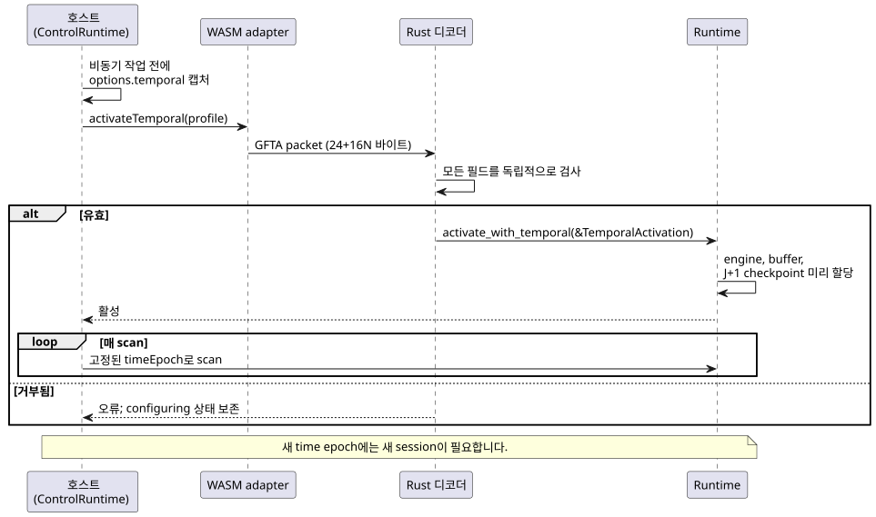
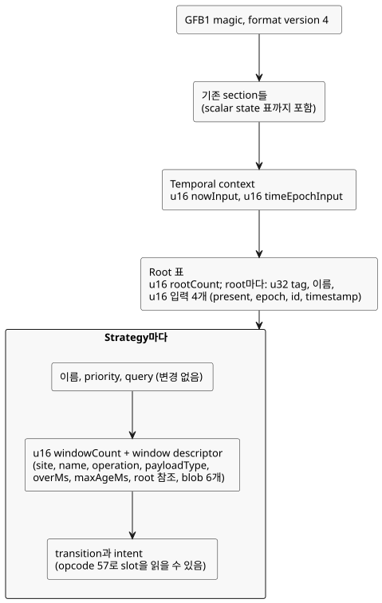
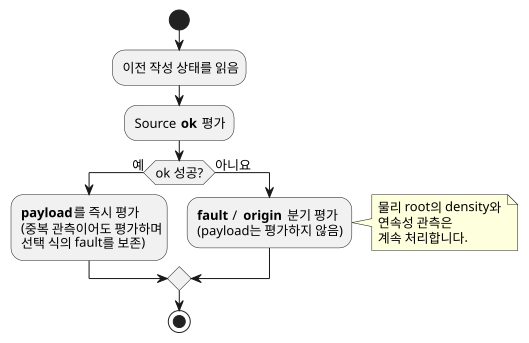

<!-- translation-source: tasks/window-gfb4-design.md -->

[영문 원문](window-gfb4-design.md)

# GFB4 window 통합 계약

> **상태:** 이 문서는 구현 계획입니다. 언어나 runtime이 window를 완전히
> 지원한다고 주장하지 않습니다.
>
> 관련 문서: [window 근거 설계](window-evidence-design.ko.md).

이 문서에서 다루는 내용:

- **호스트 활성화 인터페이스** — 호스트가 temporal profile과 정확한 `GFTA`
  activation packet을 공급하는 방법.
- **검증된 module 배치** — GFB format 4 바이너리 배치와 opcode 57.
- **컴파일러 내부 형태** — 컴파일러가 lowering하는 내부 encoding 형태.
- **실행과 activation 계약** — manifest, provenance, runtime 트랜잭션 규칙.
- **수용된 Runtime API 설계** — Rust `Runtime` API와 `windowTrace` 기록 형태.
- **통합 수용** — 구현된 것과 아직 남은 것.

문서 전체에서 쓰는 용어:

- **window**는 timestamp가 붙은 관측에 대한 시간 집계(평균, 최솟값, 최댓값,
  변화율)입니다.
- **물리 root**는 자체 tag와 식별 입력을 가진 센서 source입니다.
- **time epoch**는 시계 영역을 식별합니다. 한 session의 모든 timestamp는 하나의
  epoch에 속합니다.

## 호스트 활성화 인터페이스

두 저수준 WASM adapter는 모두 `activateTemporal(profile)`을 공개합니다. 두
adapter는 같은 명시적 profile을 받습니다.

`{timeEpoch, rootDensity: [{sourceTag, maxObservations,
intervalMs}], budget: {maxRetainedSamples, maxBytes}}`

ControlRuntime은 이 profile을 `options.temporal`로 받습니다. 비동기 작업을
시작하기 전에 profile을 캡처하고, 매 scan에 고정된 epoch를 공급합니다.

- 새 time epoch에는 새 session이 필요합니다.
- 센서 주기나 source window의 지속 시간에서 profile을 추론하지 않습니다.

아래 시퀀스는 activation이 호스트에서 runtime으로 흐르는 과정과 packet이
거부될 때 일어나는 일을 보여 줍니다.



제한된 activation packet은 little-endian입니다. 필드 순서는 다음과 같습니다.

| 부분 | 필드 |
|---|---|
| 헤더 | `GFTA` magic, u16 version 1, u16 root 수, u64 epoch, u32 sample 예산, u32 byte 예산 |
| 각 root | u32 tag, u32 최대 관측 수, u64 interval 밀리초 |

Packet 규칙:

- 정확한 크기는 24+16N 바이트입니다.
- N은 1..31입니다. 기존 입력 128개 상한에서 clock 2개를 빼고 root당 입력
  4개로 나눈 값입니다.
- Epoch와 interval은 정확한 JS-safe 정수입니다.
- Interval, density, 예산은 양수입니다.
- Tag는 양수이고 고유하며 오름차순입니다.
- Rust 디코더는 모든 필드를 독립적으로 검사합니다.
- 거부된 activation은 configuring 상태를 보존합니다.

호스트 manifest 검증은 window descriptor 영역, slot, source binding, format
조합을 검사합니다. 정본 source/nominal descriptor 동등성은 검사하지
**않습니다**. 그것은 toolchain과 서명 package verifier의 책임입니다. Bytecode
digest가 일치한다는 사실만으로는 호출자가 제공한 manifest가 인증되지 않습니다.

## 검증된 module 배치

Window를 담은 module은 기존 GFB1 magic과 format version 4를 사용합니다.
Window가 없는 module은 기존 format 선택을 그대로 유지합니다.

기존 예산은 변경하지 않습니다.

| 예산 | 한도 |
|---|---|
| Module | 1 MiB |
| Expression/query | 4,096바이트 |
| Stack | 128 |
| Input | 128 |
| Strategy | 32 |
| Scalar state | 기존 예산 |

각 strategy에서 scalar state 수와 window 수의 합은 128을 넘어서는 안 됩니다.

다음 다이어그램은 GFB4 module 안에서 새 section이 놓이는 위치를 요약합니다.
자세한 규칙은 그 뒤에 이어집니다.



기존 scalar state 표 뒤에 다음을 encoding합니다.

- `u16 nowInput`, `u16 timeEpochInput`: 각각 `__gf_now_ms`와
  `__gf_time_epoch`라는 이름의 Number 입력에 연결합니다.
- `u16 rootCount`, 그 뒤 각 root마다 `u32 tag`, 문자열 이름, 그리고
  present(Bool), epoch, id, timestamp(Number)에 대한 `u16` 입력 index 4개.
- Root는 서로 다른 이름, 엄격하게 증가하는 양의 tag, 서로 다른 입력 binding을
  가져야 하며, 입력 binding은 두 clock 입력과도 분리되어야 합니다.

각 strategy는 기존 이름, priority, query를 유지합니다. 그 뒤 `u16
windowCount`와 다음 descriptor를 transition과 intent 앞에 추가합니다.

1. `u32 site`, 문자열 이름(strategy마다 0이 아닌 고유 site와 고유 이름).
2. `u8 operation`: 0 average, 1 minimum, 2 maximum, 3 rate.
3. `u8 payloadType`: 기존 Number/Int 기계 타입. Average와 rate는 Number를
   사용하며, average는 Int source 값을 Number로 명시적으로 변환합니다.
4. `u64 overMs`, `u64 maxAgeMs`: 둘 다 1..2^53-1(양 끝 포함).
5. `u16 rootRefCount`와 엄격하게 증가하는 고유한 `u16` root 표 index.
6. 기존 길이 prefix 식 blob 6개. 순서대로 ok(Bool), payload(payloadType),
   fault, origin, quality, sourceTag(마지막 4개는 모두 Number)입니다.

Module 수준 규칙:

- GFB4 module은 모든 strategy를 통틀어 root를 하나 이상, window를 하나 이상
  가집니다.
- Source blob은 next state를 읽을 수 없습니다. 앞선 window slot은 참조할 수
  있습니다.
- Transition과 intent는 자기 strategy의 모든 slot을 읽을 수 있습니다.
- Format 4는 기존 format 3 식 연산을 포함합니다.

Opcode 57은 window slot을 읽습니다. Encoding은 `[57, u16 slot, u8 field]`입니다.

| Field | 의미 | 타입 |
|---|---|---|
| 0 | ok | Bool |
| 1 | value | payloadType |
| 2 | fault | Number |
| 3 | origin | Number |
| 4 | admissionRevision | Number |
| 5 | newestTimestamp | Number |
| 6 | count | Number |
| 7 | quality | Number |

성공한 aggregate의 quality는 물리 measured 품질인 1이 아니라 3입니다.
Unavailable 품질은 0입니다. Format 1–3과 device query는 이 opcode를 거부합니다.

## 컴파일러 내부 형태

다음은 내부 encoding 형태입니다. 작성자가 쓰는 언어 문법이 추가되는 것이
**아닙니다**.

```text
(temporal-context __gf_now_ms __gf_time_epoch)
(temporal-root TAG NAME PRESENT_INPUT EPOCH_INPUT ID_INPUT TIMESTAMP_INPUT)
(strategy NAME PRIORITY
  (device QUERY)
  (window SITE NAME OPERATION PAYLOAD_TYPE OVER_MS MAX_AGE_MS
    (roots TAG ...)
    (source OK PAYLOAD FAULT ORIGIN QUALITY SOURCE_TAG))
  (next ...)
  (intent ...))
(window-read SLOT FIELD)
```

허용되는 값:

- OPERATION은 `average`, `min`, `max`, `rate` 중 하나입니다.
- PAYLOAD_TYPE은 `number` 또는 `int`입니다.
- FIELD는 `ok`, `value`, `fault`, `origin`, `revision`, `timestamp`,
  `count`, `quality` 중 하나입니다.

순서 규칙:

- Window는 transition/intent보다 앞에 옵니다.
- Root 선언과 참조는 이미 tag 오름차순으로 되어 있습니다. 정본이 아닌 순서는
  모두 거부합니다.

## 실행과 activation 계약

### Source manifest와 provenance

기존 manifest envelope를 사용합니다. Window 선언은 다음 필드를 가진 `signals`
항목입니다.

- `kind: "window"`, `name`, `site`, 0부터 시작하는 `slot`
- `operation`(`average|min|max|rate`), `payloadType`
- `errorType: "SensorFault"`, `quality: "measured"`
- `overMs`, `maxAgeMs`
- `clockInput: "__gf_now_ms"`, `timeEpochInput: "__gf_time_epoch"`
- `sources: [{name, tag}, ...]` — source 식이 사용하는 물리 root를 정렬한
  목록.

Payload와 format 규칙:

- Rate payload는 `Rate<Q>`로 표기하며, Q는 Reference whitelist에 속합니다.
  다른 payload 타입은 기존 정본 타입 이름을 사용합니다.
- Manifest에는 density나 대상 예산을 작성하지 않습니다.
- Window module은 `GhostFlow/control-v4`를 사용합니다. 호스트와 package 계약은
  GFB format 4와의 조합을 명시적으로 허용해야 합니다.

Lowering된 aggregate Result는 별도의 derived-evidence descriptor를 담습니다.
기존 물리 `sample` 구조에 물리 sample ID를 위조해 넣지 마십시오.

생성된 temporal 입력과 prelude source 식은 기존 컴파일러의 input, state,
expression/stack 한도에 포함되어 집계됩니다. Source 컴파일이 성공했다는
사실만으로는 activation, 호스트 검증, package 수용이 증명되지 않습니다.

### Runtime 트랜잭션

로딩은 density, 예산, time epoch를 지어내지 않고 요구 사항을 검증합니다.
따라서 temporal module에는 그 사실들을 담은 명시적 activation이 필요합니다.
일반 activation과 hot swap은 temporal module을 거부합니다. Hot-swap 이관은
아직 완료되지 않았습니다.

Prelude 평가는 다음 규칙을 따릅니다.

- 이전 작성 상태를 사용합니다.
- Source ok를 먼저 평가합니다.
- 성공하면 중복 관측이어도 payload를 즉시 평가합니다. 이렇게 해서 선택된 식이
  일으킨 fault를 보존합니다.
- Source가 실패하면 fault/origin 분기를 평가하고 payload는 평가하지 않습니다.
- 선택된 source가 fault 상태여도 물리 root의 density/연속성 관측은 계속
  처리합니다.



Activation은 density 사실, sample/byte 예산, time epoch 하나를 공급합니다.
기존 runtime 단조 시계 계약은 그대로 유효합니다. Time epoch를 바꾸려면
명시적인 새 실행 session이 필요합니다. 시계 영역이 교체된 뒤 작성 상태를
조용히 초기화하거나 temporal 이력을 재사용해서는 절대 안 됩니다.

Window commit/rollback, 독립적인 TickRecord provenance, 제한된 checkpoint
이력, rewind와 replay는 함께 통합해야 합니다. 메모리 집계에는 다음이 포함되어야
합니다.

- 두 window bank,
- 보존된 checkpoint J+1개,
- 기록 contributor,
- replay scratch 메모리.

Window engine 자체는 할당을 하지 않지만(allocation-free), 그렇다고 전역적인
할당 보장을 뜻하지는 않습니다.

중첩된 aggregate source에는 세 가지가 필요합니다. derived 식별자, contributor
소유권, 그리고 보수적인 누적 lookback 용량 증명입니다. 물리 root wire 형식과
디코더만으로는 그 지원이 확립되지 않습니다. 이를 필수 작업으로 유지하고,
Reference 기대값을 바꿔 영구히 제외하지 마십시오.

## 수용된 Runtime API 설계

- `Runtime::activate_with_temporal(&TemporalActivation)`은
  `root_density: Vec<RootDensity>`, `budget: TargetBudget`, `time_epoch: u64`를
  받습니다. Density 사실은 선택된 strategy의 물리 root 합집합과 정확히
  일치해야 합니다.
- `Runtime::temporal_memory_bytes()`는 집계된 temporal 저장량을 보고합니다.
  - `max_retained_samples`는 논리 window 용량의 합을 제한합니다.
  - Byte 한도는 checkpoint와 trace contributor 목록 안의 중복 저장도 셉니다.
- Activation 상태를 바꾸기 전에 모든 engine, root/projection buffer, J+1
  checkpoint를 할당합니다. 독립적인 trace 근거는 보존 기록 J개와 후보/임시
  기록 1개 분량으로 제한합니다.
  - 이 temporal 전용 한도에 포함되는 것: window arena, 이력, trace 배열.
  - 포함되지 않는 것: allocator 관리 정보, 기존 scalar map, JSON 문자열,
    호출자가 소유한 clone.
- `Runtime::replay_with_temporal(module, caps, count, &activation,
  max_peak_temporal_bytes)`는 보존된 live runtime과 scratch 실행을 함께
  집계합니다.
  - 가장 오래된 보존 입력 바로 앞의 checkpoint에서 scratch 실행을 시작합니다.
  - 반환하는 기록은 deep clone하지 않고 move합니다.
  - 일반 `replay`도 temporal 실행에는 이 명시적 예산을 요구합니다.
- Rust TickRecord는 자신의 window trace 항목과 그 contributor를 소유합니다.
  - Temporal 기록의 JSON에는 `windowTrace`가 포함됩니다. Non-temporal JSON에는
    빈 필드가 추가되지 않습니다.
  - Framed adapter가 소유한 trace 복사본도 그 adapter의 peak를 검증할 때 집계해야
    합니다. 이를 조용히 호출자 clone으로 취급해서는 안 됩니다.
- 이관이 완료되지 않은 동안 일반 temporal hot swap은 계속 거부됩니다. 반복
  activation이 temporal 이력을 조용히 초기화할 수는 없습니다. 이 제한은 구현
  공백이며, 최종 Reference 요구 사항을 좁힌 것이 아닙니다.

각 `windowTrace` 항목은 다음 필드를 담으며, 항목은 slot 순서를 따릅니다.

| 필드 | 내용 |
|---|---|
| `site` | Window site |
| `payloadType` | 기계 payload 타입(`number\|int`) |
| `operation` | 집계 연산 |
| `value` | Number 또는 null |
| `quality` | 3 또는 0 |
| `count` | Contributor 수 |
| `admissionRevision` | Admission revision |
| `timeEpoch` | Time epoch |
| `nowMs` | 현재 시각(밀리초) |
| `first`, `last` | Contributor 또는 null |
| `contributors` | Contributor 목록 |
| `upstreamFault` | null 또는 `{origin, faultCode}` |

- Contributor는 `{sourceTag, epoch, id, timestampMs, value}`입니다.
- `faultCode`는 Rust enum discriminant가 아니라 언어 순번(Disconnected=0,
  Stale=1, Invalid=2, NotReady=3)입니다.
- Runtime이 dispose된 뒤에도 기록은 독립적으로 읽을 수 있습니다.

## 통합 수용

- 구현됨: 정본 source 컴파일러와 nominal Rate 비교, 변경하지 않은 모든
  Reference window 수용 사례와 독립 runtime oracle.
- 구현됨: 공유 core의 activation, rollback, trace, journal rollover, rewind,
  replay.
- 구현됨: legacy/framed WASM과 가상 native CLI가 명시적 density/budget/epoch를
  전달합니다.
- 구현됨: 호스트 manifest 검증이 window signal과 생성된 time epoch를 인식합니다.
  어떤 호스트도 aggregate를 계산하거나 admission을 선택하지 않습니다.
- 구현됨: source 관측이 Rust window trace를 정확한 source node/contributor에
  매핑합니다. 정본 restore는 생성된 window descriptor와 의존성을 검증합니다.
- JS 서명 package 검증은 source/manifest/bytecode의 window binding을
  검증합니다. 거부 테스트는 semantic guard에 도달하도록 변조한 payload를 다시
  서명합니다. Native 서명 package 통합과 framed native CLI profile은 아직
  **미결**입니다.
- 영속 이관, 중첩 aggregate 근거, estimated-quality 근거는 각각 **별도의 수용
  작업**으로 남아 있습니다. 어느 것도 GFB4 loader 테스트로 인증되지 않습니다.

Source-trace 통합은 관측과 의존성을 모두 다룹니다.

- **Binding.** 정본 windowSites 표는 파싱된 signal site와 descriptor를
  연결합니다.
- **의존성.** Source 식, root 식별자, 두 clock, 하류 window 읽기가 포함됩니다.
- **Restore.** Restore는 window 항목과 소비자 의존성을 모두 새로 수행한
  lowering 결과와 비교합니다.
- **관측.** 관측은 signed-i32 값, 식별자의 고유성과 순서, open-left 보존 상한,
  가용 결과의 근거/freshness를 검사합니다. JavaScript에서 aggregate를 다시
  계산하지는 않습니다.

집중 테스트 근거와 현재 통합의 한계는 `window-evidence-design.md`를
참조하십시오.
