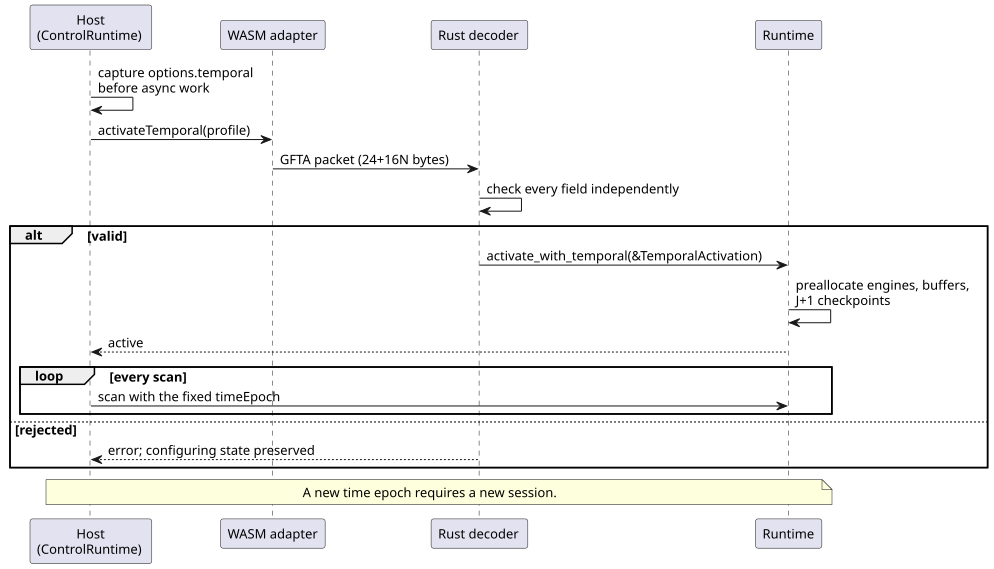
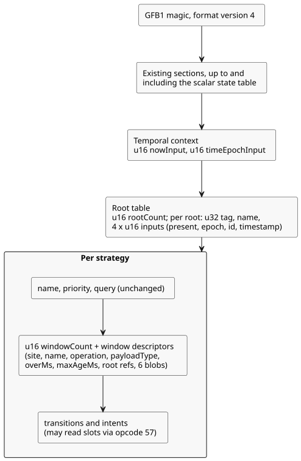
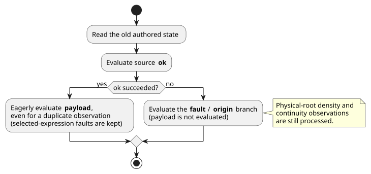

# GFB4 window integration contract

> **Status:** This is an implementation plan. It does not claim that the
> language or runtime fully supports windows.
>
> Companion document: [window evidence design](window-evidence-design.md).

In this document:

- **Host activation interface** — how a host supplies the temporal profile and
  the exact `GFTA` activation packet.
- **Verified module layout** — the GFB format 4 binary layout and opcode 57.
- **Compiler-internal forms** — the internal encoding forms the compiler lowers to.
- **Execution and activation contract** — manifest, provenance and runtime
  transaction rules.
- **Accepted Runtime API design** — the Rust `Runtime` API and the
  `windowTrace` record shape.
- **Integration acceptance** — what is implemented and what remains open.

Terms used throughout:

- A **window** is a temporal aggregate (average, minimum, maximum or rate) over
  timestamped observations.
- A **physical root** is a sensor source with its own tag and identity inputs.
- The **time epoch** identifies the clock domain. All timestamps in one session
  belong to one epoch.

## Host activation interface

Both low-level WASM adapters expose `activateTemporal(profile)`. They take the
same explicit profile:

`{timeEpoch, rootDensity: [{sourceTag, maxObservations,
intervalMs}], budget: {maxRetainedSamples, maxBytes}}`

ControlRuntime receives this profile as `options.temporal`. It captures the
profile before any asynchronous work and supplies the fixed epoch on every scan.

- A new time epoch requires a new session.
- No profile is inferred from sensor cadence or from a source window's duration.

The sequence below shows how activation flows from the host to the runtime and
what happens when the packet is rejected.



The bounded activation packet is little-endian. Its fields, in order:

| Part | Fields |
|---|---|
| Header | `GFTA` magic, u16 version 1, u16 root count, u64 epoch, u32 sample budget, u32 byte budget |
| Each root | u32 tag, u32 maximum observations, u64 interval milliseconds |

Packet rules:

- The exact size is 24+16N bytes.
- N is 1..31. This is the existing 128-input bound minus two clocks, divided by
  four inputs per root.
- Epoch and intervals are exact JS-safe integers.
- Intervals, density and budgets are positive.
- Tags are positive, unique and ascending.
- The Rust decoder checks every field independently.
- A rejected activation preserves the configuring state.

Host manifest validation checks window descriptor domains, slots, source
bindings and format pairing. It does **not** check canonical source/nominal
descriptor equivalence; that is the responsibility of the toolchain and the
signed-package verifier. A matching bytecode digest alone does not authenticate
a manifest supplied by the caller.

## Verified module layout

Modules that contain a window use the existing GFB1 magic with format version 4.
Modules without a window keep their existing format selection.

Existing budgets stay unchanged:

| Budget | Limit |
|---|---|
| Module | 1 MiB |
| Expression/query | 4,096 bytes |
| Stack | 128 |
| Input | 128 |
| Strategy | 32 |
| Scalar state | existing budget |

For each strategy, the scalar state count plus the window count must not exceed 128.

The diagram summarizes where the new sections sit in a GFB4 module. The detailed
rules follow.



After the existing scalar state table, encode:

- `u16 nowInput`, `u16 timeEpochInput`; these bind Number inputs named
  `__gf_now_ms` and `__gf_time_epoch` respectively.
- `u16 rootCount`, then each root: `u32 tag`, string name, four `u16` input
  indices for present (Bool), epoch, id and timestamp (Number).
- Roots have distinct names, strictly increasing positive tags and distinct
  input bindings, including separation from both clock inputs.

Each strategy keeps its existing name, priority and query. It then adds `u16
windowCount` and the following descriptors, placed before transitions and intents:

1. `u32 site`, string name (unique nonzero sites and unique names per strategy).
2. `u8 operation`: 0 average, 1 minimum, 2 maximum, 3 rate.
3. `u8 payloadType`: existing Number/Int machine type. Average and rate use
   Number; average explicitly converts Int source values to Number.
4. `u64 overMs`, `u64 maxAgeMs`, both 1..2^53-1 inclusive.
5. `u16 rootRefCount` and strictly increasing unique `u16` root table indices.
6. Six existing length-prefixed expression blobs, in order: ok (Bool), payload
   (payloadType), fault, origin, quality and sourceTag (all four Number).

Module-level rules:

- A GFB4 module has at least one root and at least one window across all strategies.
- Source blobs cannot read next state. They may reference prior window slots.
- Transitions and intents may read all slots in their own strategy.
- Format 4 includes the existing format 3 expression operations.

Opcode 57 reads a window slot. Its encoding is `[57, u16 slot, u8 field]`:

| Field | Meaning | Type |
|---|---|---|
| 0 | ok | Bool |
| 1 | value | payloadType |
| 2 | fault | Number |
| 3 | origin | Number |
| 4 | admissionRevision | Number |
| 5 | newestTimestamp | Number |
| 6 | count | Number |
| 7 | quality | Number |

A successful aggregate has quality 3, not the physical measured quality 1.
Unavailable quality is 0. Formats 1–3 and device queries reject this opcode.

## Compiler-internal forms

These are internal encoding forms. They are **not** additional authored language syntax:

```text
(temporal-context __gf_now_ms __gf_time_epoch)
(temporal-root TAG NAME PRESENT_INPUT EPOCH_INPUT ID_INPUT TIMESTAMP_INPUT)
(strategy NAME PRIORITY
  (device QUERY)
  (window SITE NAME OPERATION PAYLOAD_TYPE OVER_MS MAX_AGE_MS
    (roots TAG ...)
    (source OK PAYLOAD FAULT ORIGIN QUALITY SOURCE_TAG))
  (next ...)
  (intent ...))
(window-read SLOT FIELD)
```

Allowed values:

- OPERATION is `average`, `min`, `max` or `rate`.
- PAYLOAD_TYPE is `number` or `int`.
- FIELD is `ok`, `value`, `fault`, `origin`, `revision`, `timestamp`,
  `count` or `quality`.

Ordering rules:

- Windows precede transitions/intents.
- Root declarations and references are already in ascending tag order. Reject
  any noncanonical order.

## Execution and activation contract

### Source manifest and provenance

Use the existing manifest envelope. A window declaration is a `signals` entry
with these fields:

- `kind: "window"`, `name`, `site`, zero-based `slot`
- `operation` (`average|min|max|rate`), `payloadType`
- `errorType: "SensorFault"`, `quality: "measured"`
- `overMs`, `maxAgeMs`
- `clockInput: "__gf_now_ms"`, `timeEpochInput: "__gf_time_epoch"`
- `sources: [{name, tag}, ...]` — the sorted physical roots used by the source
  expression.

Payload and format rules:

- The Rate payload is spelled `Rate<Q>`, with Q from the Reference whitelist.
  Other payload types use the existing canonical type names.
- No density or target budget is authored into the manifest.
- A window module uses `GhostFlow/control-v4`. The host and package contracts
  must explicitly allow its pairing with GFB format 4.

Lowered aggregate Results carry a separate derived-evidence descriptor. Do not
forge a physical sample ID in the existing physical `sample` structure.

Generated temporal inputs and prelude source expressions count toward the
existing compiler input, state and expression/stack limits. A successful source
compile alone does not prove activation, host validation or package acceptance.

### Runtime transaction

Loading verifies requirements without inventing a density, budget or time
epoch. Temporal modules therefore require explicit activation with those facts.
Normal activation and hot swap reject them; hot-swap migration remains unfinished.

Prelude evaluation follows these rules:

- It uses the old authored state.
- Source ok is evaluated first.
- On success, payload is evaluated eagerly, even for a duplicate observation.
  This preserves faults raised by the selected expression.
- On source failure, the fault/origin branch is evaluated and payload is not.
- Physical roots' density/continuity observations are still processed when the
  selected source is faulted.



Activation supplies the density facts, the sample and byte budgets, and one
time epoch. The existing runtime monotonic-clock contract stays in force.
Changing the time epoch requires an explicit new execution session. Never
silently reset authored state or reuse temporal history after the clock domain
is replaced.

Window commit/rollback, independent TickRecord provenance, bounded checkpoint
history, rewind and replay must be integrated together. Memory accounting must
include:

- both window banks,
- J+1 retained checkpoints,
- record contributors, and
- replay scratch memory.

The window engine itself is allocation-free, but that does not imply any global
allocation guarantee.

Nested aggregate sources need three things: derived identity, contributor
ownership and a conservative accumulated-lookback capacity proof. The
physical-root wire format and decoder alone do not establish that support.
Keep this as required work; do not change Reference expectations to exclude it
permanently.

## Accepted Runtime API design

- `Runtime::activate_with_temporal(&TemporalActivation)` takes
  `root_density: Vec<RootDensity>`, `budget: TargetBudget`, and `time_epoch: u64`.
  The density facts must match the selected strategy's physical-root union exactly.
- `Runtime::temporal_memory_bytes()` reports the accounted temporal storage.
  - `max_retained_samples` limits the sum of logical window capacities.
  - The byte limit also counts duplicate storage in checkpoints and in trace
    contributor lists.
- Allocate all engines, root/projection buffers and J+1 checkpoints before
  changing activation state. Bound independent trace evidence for J retained
  records plus one candidate/transient record.
  - Covered by this temporal-only limit: the window arena, history and trace arrays.
  - Not covered: allocator bookkeeping, existing scalar maps, JSON strings and
    caller-owned clones.
- `Runtime::replay_with_temporal(module, caps, count, &activation,
  max_peak_temporal_bytes)` accounts for the retained live runtime and the
  scratch execution together.
  - Seed the scratch execution from the checkpoint immediately before the
    oldest retained input.
  - Move returned records instead of deep cloning them.
  - Ordinary `replay` requires this explicit budget for temporal execution.
- The Rust TickRecord owns its window trace entries and their contributors.
  - JSON includes `windowTrace` for temporal records. Non-temporal JSON does not
    gain an empty field.
  - The framed adapter's owned trace copy must also be counted when validating
    that adapter's peak. It must not be silently treated as a caller clone.
- Plain temporal hot swap remains rejected while migration is unfinished.
  Repeated activation cannot silently reset temporal history. This restriction
  is an implementation gap, not a narrowed final Reference requirement.

Each `windowTrace` entry carries these fields, and entries follow slot order:

| Field | Content |
|---|---|
| `site` | Window site |
| `payloadType` | Machine payload type (`number\|int`) |
| `operation` | Aggregate operation |
| `value` | Number or null |
| `quality` | 3 or 0 |
| `count` | Contributor count |
| `admissionRevision` | Admission revision |
| `timeEpoch` | Time epoch |
| `nowMs` | Current time in milliseconds |
| `first`, `last` | A contributor or null |
| `contributors` | List of contributors |
| `upstreamFault` | null or `{origin, faultCode}` |

- A contributor is `{sourceTag, epoch, id, timestampMs, value}`.
- `faultCode` is the language ordinal (Disconnected=0, Stale=1, Invalid=2,
  NotReady=3), not a Rust enum discriminant.
- The record remains independently readable after the Runtime is disposed.

## Integration acceptance

- Implemented: canonical source compiler and nominal Rate comparisons; all unchanged
  Reference window acceptance cases plus independent runtime oracles.
- Implemented: shared core activation, rollback, trace, journal rollover, rewind and replay.
- Implemented: legacy/framed WASM and the virtual native CLI carry explicit density/budget/epoch.
- Implemented: host manifest validation recognizes window signals and the generated time epoch;
  no host computes aggregates or chooses admission.
- Implemented: source observation maps Rust window traces to exact source nodes/contributors.
  Canonical restore verifies generated window descriptors and dependencies.
- JS signed-package verification validates source/manifest/bytecode
  window bindings; rejection tests re-sign mutated payloads to reach the semantic guard.
  Native signed-package integration and the framed native CLI profile remain **open**.
- Durable migration, nested aggregate evidence and estimated-quality evidence each
  retain **separate acceptance work**. None is certified by GFB4 loader tests.

Source-trace integration covers both observation and dependencies:

- **Binding.** The canonical windowSites table binds parsed signal sites and descriptors.
- **Dependencies.** These include source expressions, root identities, both
  clocks and downstream window reads.
- **Restore.** Restore compares both the window entries and the consumer
  dependencies against a fresh lowering.
- **Observation.** Observation checks signed-i32 values, identity uniqueness and
  order, open-left retention bounds, and available-result evidence/freshness. It
  does not recompute aggregates in JavaScript.

See `window-evidence-design.md` for focused test evidence and the limits of the
current integration.
