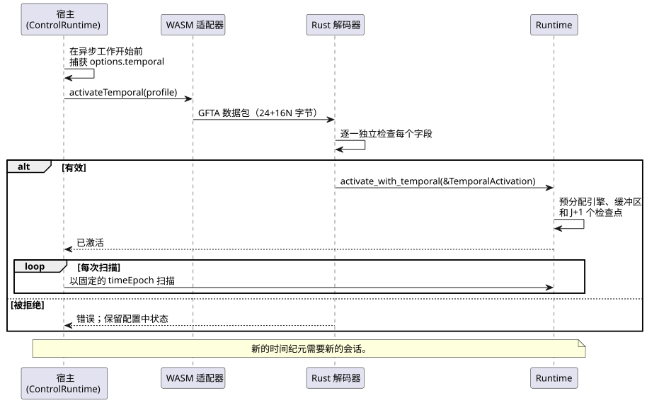
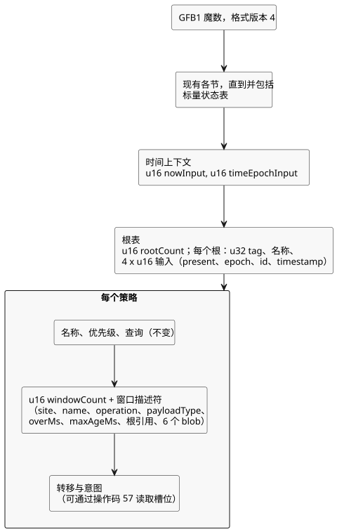
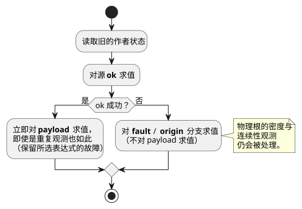

<!-- translation-source: tasks/window-gfb4-design.md -->
[英文原文](window-gfb4-design.md)

# GFB4 窗口集成契约

> **状态：** 本文是一份实现计划，并不声称语言或运行时已完全支持窗口。
>
> 配套文档：[窗口证据设计](window-evidence-design.zh.md)。

本文内容：

- **宿主激活接口**：宿主（host）如何提供时间 profile 以及精确的 `GFTA`
  激活数据包。
- **已验证的模块布局**：GFB 格式 4 的二进制布局与操作码 57。
- **编译器内部形式**：编译器降级（lower）所得到的内部编码形式。
- **执行与激活契约**：清单（manifest）、来源（provenance）以及运行时事务规则。
- **已接受的 Runtime API 设计**：Rust `Runtime` API 与 `windowTrace` 记录结构。
- **集成验收**：哪些已经实现，哪些仍待完成。

全文使用的术语：

- **窗口（window）** 是针对带时间戳的观测进行的时间聚合（平均值、最小值、最大值或变化率）。
- **物理根（physical root）** 是一个传感器来源，拥有自己的标签（tag）和身份标识输入。
- **时间纪元（time epoch）** 标识时钟域。同一会话中的所有时间戳都属于同一个纪元。

## 宿主激活接口

两个底层 WASM 适配器都暴露 `activateTemporal(profile)`，并接受同一个显式 profile：

`{timeEpoch, rootDensity: [{sourceTag, maxObservations,
intervalMs}], budget: {maxRetainedSamples, maxBytes}}`

ControlRuntime 通过 `options.temporal` 接收该 profile。它在任何异步工作开始之前捕获该 profile，并在每次扫描时提供固定的纪元。

- 新的时间纪元需要新的会话。
- 不会根据传感器节奏或源窗口的持续时间推断任何 profile。

下面的时序图展示了激活从宿主流向运行时的过程，以及数据包被拒绝时会发生什么。



有界激活数据包采用小端字节序。其字段依次为：

| 部分 | 字段 |
|---|---|
| 头部 | `GFTA` 魔数、u16 版本 1、u16 根数量、u64 纪元、u32 样本预算、u32 字节预算 |
| 每个根 | u32 标签、u32 最大观测数、u64 间隔毫秒数 |

数据包规则：

- 精确大小为 24+16N 字节。
- N 为 1..31。这是现有的 128 个输入上限减去两个时钟，再除以每个根的四个输入。
- 纪元和间隔都是精确的 JS 安全整数。
- 间隔、密度和预算均为正数。
- 标签为正数、唯一且升序排列。
- Rust 解码器独立检查每个字段。
- 激活被拒绝时，保留配置中的状态。

宿主清单校验会检查窗口描述符的域、槽位、源绑定以及格式配对。它**不**检查规范源描述符与名义描述符是否等价；这由工具链和签名包验证器负责。仅凭字节码摘要匹配，并不能认证调用方提供的清单。

## 已验证的模块布局

包含窗口的模块使用现有的 GFB1 魔数，格式版本为 4。不含窗口的模块保持其现有的格式选择。

现有预算保持不变：

| 预算 | 上限 |
|---|---|
| 模块 | 1 MiB |
| 表达式/查询 | 4,096 字节 |
| 栈 | 128 |
| 输入 | 128 |
| 策略 | 32 |
| 标量状态 | 现有预算 |

对每个策略而言，标量状态数加上窗口数不得超过 128。

下图概括了新增各节在 GFB4 模块中的位置，详细规则见其后。



在现有的标量状态表之后编码：

- `u16 nowInput`、`u16 timeEpochInput`；它们分别绑定名为 `__gf_now_ms` 和
  `__gf_time_epoch` 的 Number 输入。
- `u16 rootCount`，然后是每个根：`u32 tag`、字符串名称、四个 `u16` 输入索引，
  依次对应 present（Bool）、epoch、id 和 timestamp（Number）。
- 各根的名称互不相同，标签为严格递增的正数，输入绑定互不相同，并且与两个时钟输入也相互分离。

每个策略保留其现有的名称、优先级和查询。随后添加 `u16
windowCount` 以及下列描述符，置于转移与意图之前：

1. `u32 site`、字符串名称（每个策略内 site 唯一且非零，名称唯一）。
2. `u8 operation`：0 平均值，1 最小值，2 最大值，3 变化率。
3. `u8 payloadType`：现有的 Number/Int 机器类型。平均值和变化率使用
   Number；平均值会将 Int 源值显式转换为 Number。
4. `u64 overMs`、`u64 maxAgeMs`，两者都在 1..2^53-1 范围内（含端点）。
5. `u16 rootRefCount` 以及严格递增且唯一的 `u16` 根表索引。
6. 六个现有的带长度前缀的表达式 blob，依次为：ok（Bool）、payload
   （payloadType）、fault、origin、quality 和 sourceTag（后四者均为 Number）。

模块级规则：

- GFB4 模块在所有策略中至少有一个根和至少一个窗口。
- 源 blob 不能读取下一状态，但可以引用之前的窗口槽位。
- 转移和意图可以读取其所属策略中的所有槽位。
- 格式 4 包含现有格式 3 的表达式操作。

操作码 57 读取一个窗口槽位。其编码为 `[57, u16 slot, u8 field]`：

| 字段 | 含义 | 类型 |
|---|---|---|
| 0 | ok | Bool |
| 1 | value | payloadType |
| 2 | fault | Number |
| 3 | origin | Number |
| 4 | admissionRevision | Number |
| 5 | newestTimestamp | Number |
| 6 | count | Number |
| 7 | quality | Number |

成功的聚合质量为 3，而不是物理测量质量 1。不可用时质量为 0。格式 1–3 以及设备查询都会拒绝此操作码。

## 编译器内部形式

以下是内部编码形式，**不是**额外的作者可写语言语法：

```text
(temporal-context __gf_now_ms __gf_time_epoch)
(temporal-root TAG NAME PRESENT_INPUT EPOCH_INPUT ID_INPUT TIMESTAMP_INPUT)
(strategy NAME PRIORITY
  (device QUERY)
  (window SITE NAME OPERATION PAYLOAD_TYPE OVER_MS MAX_AGE_MS
    (roots TAG ...)
    (source OK PAYLOAD FAULT ORIGIN QUALITY SOURCE_TAG))
  (next ...)
  (intent ...))
(window-read SLOT FIELD)
```

允许的值：

- OPERATION 为 `average`、`min`、`max` 或 `rate`。
- PAYLOAD_TYPE 为 `number` 或 `int`。
- FIELD 为 `ok`、`value`、`fault`、`origin`、`revision`、`timestamp`、
  `count` 或 `quality`。

顺序规则：

- 窗口位于转移/意图之前。
- 根声明和根引用已经按标签升序排列。拒绝任何非规范的顺序。

## 执行与激活契约

### 源清单与来源

使用现有的清单封装。窗口声明是一个 `signals` 条目，包含以下字段：

- `kind: "window"`、`name`、`site`、从零开始的 `slot`
- `operation`（`average|min|max|rate`）、`payloadType`
- `errorType: "SensorFault"`、`quality: "measured"`
- `overMs`、`maxAgeMs`
- `clockInput: "__gf_now_ms"`、`timeEpochInput: "__gf_time_epoch"`
- `sources: [{name, tag}, ...]`：源表达式所使用的、已排序的物理根。

载荷与格式规则：

- Rate 载荷写作 `Rate<Q>`，其中 Q 取自 Reference 白名单。其他载荷类型使用现有的规范类型名。
- 清单中不写入任何密度或目标预算。
- 窗口模块使用 `GhostFlow/control-v4`。宿主契约和包契约必须显式允许它与 GFB 格式 4 配对。

降级后的聚合 Result 携带单独的派生证据描述符。不得在现有的物理 `sample` 结构中伪造物理样本 ID。

生成的时间输入以及前导（prelude）源表达式计入现有的编译器输入、状态和表达式/栈上限。仅凭源编译成功，并不能证明激活、宿主校验或包验收成功。

### 运行时事务

加载时会验证各项要求，但不会自行编造密度、预算或时间纪元。因此，时间模块需要提供这些事实的显式激活。普通激活和热替换都会拒绝它们；热替换迁移尚未完成。

前导求值遵循以下规则：

- 使用旧的作者状态。
- 首先对源 ok 求值。
- 成功时，立即对 payload 求值，即使是重复观测也如此。这样可以保留所选表达式引发的故障。
- 源失败时，对 fault/origin 分支求值，不对 payload 求值。
- 即使所选源处于故障状态，物理根的密度/连续性观测仍会被处理。



激活提供密度事实、样本预算和字节预算，以及一个时间纪元。现有的运行时单调时钟契约继续有效。更改时间纪元需要显式的新执行会话。在时钟域被替换后，绝不能静默重置作者状态或复用时间历史。

窗口的提交/回滚、独立的 TickRecord 来源、有界的检查点历史、倒带和重放必须一起集成。内存核算必须包括：

- 两个窗口存储区（bank），
- J+1 个保留的检查点，
- 记录中的贡献者（contributor），以及
- 重放的临时内存。

窗口引擎本身不进行内存分配，但这并不意味着任何全局的分配保证。

嵌套聚合源需要三样东西：派生身份标识、贡献者所有权，以及保守的累计回看容量证明。仅凭物理根的线路格式和解码器并不能建立这种支持。应将其保留为必需的工作；不要修改 Reference 的预期来永久排除它。

## 已接受的 Runtime API 设计

- `Runtime::activate_with_temporal(&TemporalActivation)` 接受
  `root_density: Vec<RootDensity>`、`budget: TargetBudget` 和 `time_epoch: u64`。
  密度事实必须与所选策略的物理根并集完全一致。
- `Runtime::temporal_memory_bytes()` 报告已核算的时间存储量。
  - `max_retained_samples` 限制各窗口逻辑容量之和。
  - 字节上限还计入检查点和追踪贡献者列表中的重复存储。
- 在更改激活状态之前，分配所有引擎、根/投影缓冲区以及 J+1 个检查点。为 J 条保留记录外加一条候选/临时记录限定独立追踪证据的上界。
  - 此仅针对时间的上限所涵盖的：窗口内存区、历史和追踪数组。
  - 不涵盖的：分配器簿记开销、现有的标量映射、JSON 字符串以及调用方持有的克隆。
- `Runtime::replay_with_temporal(module, caps, count, &activation,
  max_peak_temporal_bytes)` 将保留的实时运行时与临时执行一并核算。
  - 从最早保留输入之前紧邻的检查点为临时执行提供初始状态。
  - 移动返回的记录，而不是对其进行深拷贝。
  - 对于时间执行，普通的 `replay` 需要这一显式预算。
- Rust TickRecord 拥有其窗口追踪条目及其贡献者。
  - 对于时间记录，JSON 包含 `windowTrace`。非时间 JSON 不会多出一个空字段。
  - 在校验 framed 适配器的峰值时，也必须计入该适配器持有的追踪副本，不得将其静默视为调用方克隆。
- 在迁移完成之前，普通的时间热替换仍会被拒绝。重复激活不能静默重置时间历史。这一限制是实现上的缺口，而不是被收窄的最终 Reference 要求。

每个 `windowTrace` 条目携带以下字段，条目按槽位顺序排列：

| 字段 | 内容 |
|---|---|
| `site` | 窗口 site |
| `payloadType` | 机器载荷类型（`number\|int`） |
| `operation` | 聚合操作 |
| `value` | Number 或 null |
| `quality` | 3 或 0 |
| `count` | 贡献者数量 |
| `admissionRevision` | 准入修订版 |
| `timeEpoch` | 时间纪元 |
| `nowMs` | 以毫秒计的当前时间 |
| `first`、`last` | 一个贡献者或 null |
| `contributors` | 贡献者列表 |
| `upstreamFault` | null 或 `{origin, faultCode}` |

- 贡献者为 `{sourceTag, epoch, id, timestampMs, value}`。
- `faultCode` 是语言中的序号（Disconnected=0、Stale=1、Invalid=2、
  NotReady=3），而不是 Rust 枚举的判别值。
- 在 Runtime 被释放后，该记录仍可独立读取。

## 集成验收

- 已实现：规范源编译器以及名义 Rate 比较；所有未改动的 Reference 窗口验收用例，外加独立的运行时判定基准（oracle）。
- 已实现：共享核心中的激活、回滚、追踪、日志（journal）轮转、倒带和重放。
- 已实现：旧版/framed WASM 以及虚拟原生 CLI 都携带显式的密度/预算/纪元。
- 已实现：宿主清单校验能识别窗口信号和生成的时间纪元；任何宿主都不计算聚合，也不选择准入。
- 已实现：源观测将 Rust 窗口追踪映射到精确的源节点/贡献者。规范恢复会验证生成的窗口描述符及依赖。
- JS 签名包验证会校验源/清单/字节码之间的窗口绑定；拒绝测试会对被篡改的载荷重新签名，以便触达语义防护。原生签名包集成以及 framed 原生 CLI profile 仍**待完成**。
- 持久迁移、嵌套聚合证据和估计质量证据各自保留**单独的验收工作**。GFB4 加载器测试不认证其中任何一项。

源追踪集成同时涵盖观测和依赖：

- **绑定。** 规范的 windowSites 表绑定已解析的信号 site 与描述符。
- **依赖。** 包括源表达式、根身份标识、两个时钟以及下游的窗口读取。
- **恢复。** 恢复时，将窗口条目和使用方依赖都与一次全新的降级结果进行比较。
- **观测。** 观测检查有符号 i32 值、身份标识的唯一性与顺序、左开区间的保留边界，以及可用结果的证据/新鲜度。它不在 JavaScript 中重新计算聚合。

有关聚焦的测试证据以及当前集成的局限，请参阅 `window-evidence-design.md`。
