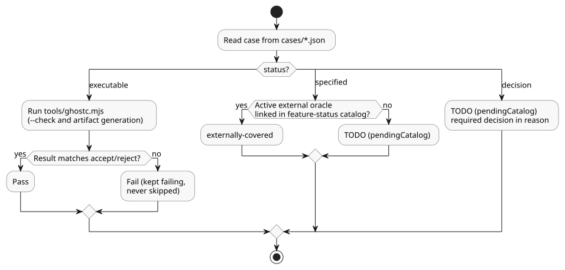

<!-- translation-source: tests/reference/README.md -->

[Korean original](README.md)

# Language Reference acceptance tests (per case)

This directory holds individual acceptance tests for the GhostFlow Language Reference.
Each test pins one behavior that the Reference promises.

Two ground rules apply:

- **Pin the Reference first.** Decide what the Reference says the behavior is, and write that down as the expectation. Fixing the compiler is separate work.
- **Do not copy the compiler.** Never change the expectation for valid source to `reject` just because the current compiler rejects it.

Related records:

| File | What it records |
|---|---|
| [BASELINE.md](BASELINE.md) | Results of the first run, and failures that were deliberately left failing. |
| [DECISIONS.md](DECISIONS.md) | Where each of the original 49 pending decisions was settled, and how it is verified. |
| [EDGE-CASES.md](EDGE-CASES.md) | Added edge cases and boundary values, and defects they newly exposed. |

## Running

Run the tests from the root of the `ghostflow-language` repository with Node.js 22 or later.

```sh
npm run test:reference

# 특정 계약만 실행
node --test --test-name-pattern=REF-01-001 tests/reference-cli.test.mjs
```

The second command runs only one contract (here, `REF-01-001`).

**What the runner checks**

The runner calls the real `tools/ghostc.mjs` in a separate process.
For every executable case it checks two paths: `--check` mode and artifact generation.

- It runs artifact generation even when check mode fails. It records the failures and diagnostics of both modes together.
- **Valid source** must exit with code 0 and produce nonempty artifacts.
- For successful artifacts, the runner also checks the public source map. The source map must bind the canonical original text to the source and bytecode digests.
- **Invalid source** must exit with code 1. A CLI usage error (exit code 2), a crash, or a timeout does **not** count as a valid rejection.

**How fixtures are written**

- Every fixture is written in its own temporary directory.
- Fixtures are canonical `.ghost.md` documents. Only negative cases that test that contract (for example, a wrong file extension) intentionally break it.
- Import cases put the complete dependency `.ghost.md` originals in `files`. The root document's import pins the exact SHA-256 of each original. Dependencies are written to the same temporary directory.

**Result file**

Detailed results are saved to `build/reference-tests.json`. Read its fields carefully, because only some of them are execution results:

| Field | Meaning |
|---|---|
| `results`, `summary` | Only the compilation cases that were actually executed. |
| `externallyCoveredCatalog` | The exact active test selectors linked in the [`feature-status` catalog](../../contracts/feature-status/catalog.json). This does **not** mean this CLI ran those external oracles. Evidence of execution is a passing run of the full language gate. |
| `pendingCatalog` | Only `specified`/`decision` cases that have no external oracle either. |
| `catalogCounts`, frozen core counts | Link counts over the complete catalog, independent of any filter. They are not execution results. |
| `catalogValidation` | `not-run` if a filter excluded the catalog validation itself. |

Do not use results from a name-filtered run as the complete acceptance result.

## Case status

Every case has one of three statuses:

| Status | Meaning | Execution reporting |
|---|---|---|
| `executable` | Compilation acceptance/rejection cases for settled syntax | Actual CLI calls; failures when results differ from expectations |
| `specified` | Runtime/environment/Driver/UI/tool contracts with inputs, behavior, and expected results | `externally-covered` with an active external oracle link; otherwise TODO. Neither counts as a CLI execution pass |
| `decision` | Cases with expected meaning or a decision boundary that need settled syntax/policy | Record required decisions in reason; TODO, not support evidence |

The diagram below shows how each status is reported.



Compilation success alone cannot verify every language item.
Some behavior must be observed at its own boundary while running:

- how much time a timer actually lets pass,
- how outputs are applied and fed back,
- what is restored after a restart,
- how the UI behaves.

This work writes down the conditions and expected results for those cases. Runtime and Driver adapters are separate work.

The 2026-09-22 syntax policy decisions are first reflected in the Reference, then pinned as compilation accept/reject expectations.
Concrete operating-policy values are arguments that the author states explicitly. They are not classified as pending global language decisions.

If a settled compilation requirement currently fails, keep it failing.
Do not move it to `specified` or `decision`, and do not hide it with a skip or an expected failure.

## Organization and traceability

- `cases/00-principles.json`: the Reference's ten design principles.
- `cases/01-source-types.json`: Reference Chapters 1–2.
- `cases/02-time-control.json`: Reference Chapters 3–4.
- `cases/03-settings-boundaries.json`: Reference Chapters 5–8.
- `../reference-cli.test.mjs`: the runner, which reads only explicitly listed case files, and the catalog validation.

Every case has:

- a stable ID,
- the specific rule it tests,
- a link to the Reference section,
- the responsible layer.

Executable cases also have their own source and an `accept`/`reject` expectation.
Nonexecutable cases state `given`, `when`, `then`, and `reason` separately.

Issue links for unverified cases:

- Each unverified nonexecutable case records the full URL of its own GitHub issue in `issue`.
- The issue body links back to the original case JSON, and the case keeps its link to the issue.
- Keep the link after the case is verified.
- An issue link by itself is not execution evidence. A case leaves the pending classification only when a real oracle is connected and verified.

Coverage rules:

- Every numbered Reference section must be traced by at least one case.
- A case that cites a nested section also links to its parent section.

Section links check document traceability only. They do not mean that every behavior in the section was verified.
Review the individual valid, error, and boundary cases together with the nonexecutable contracts.
The existence of compiler artifacts alone does not establish execution semantics or acceptance on a real device.

## Criteria for changing expectations

- Base every change on an explicit Reference rule. If a rule is ambiguous, record which decision is needed.
- Fix syntax mistakes in the test fixtures themselves, but never copy the compiler's current result as the right answer.
- Do not modify compiler or runtime source as part of this test-authoring work.
