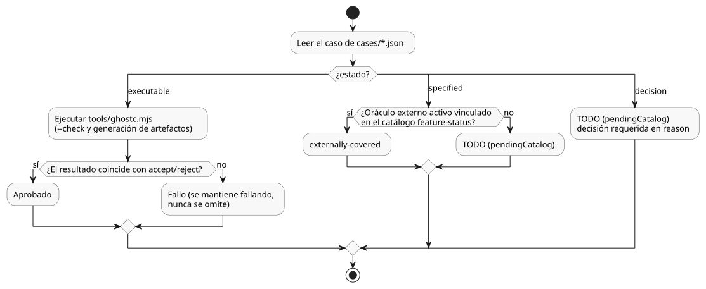

<!-- translation-source: tests/reference/README.en.md -->
[Original en inglés](README.en.md)

# Pruebas de aceptación de la Language Reference (por caso)

Este directorio contiene pruebas de aceptación individuales para la Language Reference (referencia del lenguaje) de GhostFlow.
Cada prueba fija un comportamiento que la Reference promete.

Se aplican dos reglas básicas:

- **Primero, fijar la Reference.** Decida qué comportamiento establece la Reference y escríbalo como la expectativa. Corregir el compilador es un trabajo aparte.
- **No copiar el compilador.** Nunca cambie la expectativa de un código fuente válido a `reject` solo porque el compilador actual lo rechaza.

Registros relacionados:

| Archivo | Qué registra |
|---|---|
| [BASELINE.md](BASELINE.es.md) | Resultados de la primera ejecución y los fallos que se dejaron fallando de forma deliberada. |
| [DECISIONS.md](DECISIONS.es.md) | Dónde se resolvió cada una de las 49 decisiones pendientes originales y cómo se verifica. |
| [EDGE-CASES.md](EDGE-CASES.es.md) | Casos límite y valores de frontera añadidos, y los defectos que expusieron por primera vez. |

## Ejecución

Ejecute las pruebas desde la raíz del repositorio `ghostflow-language` con Node.js 22 o posterior.

```sh
npm run test:reference

# 특정 계약만 실행
node --test --test-name-pattern=REF-01-001 tests/reference-cli.test.mjs
```

El segundo comando ejecuta solo un contrato (aquí, `REF-01-001`).

**Qué comprueba el ejecutor (runner)**

El ejecutor invoca el `tools/ghostc.mjs` real en un proceso aparte.
Para cada caso ejecutable comprueba dos rutas: el modo `--check` y la generación de artefactos.

- Ejecuta la generación de artefactos aunque el modo de comprobación falle. Registra juntos los fallos y los diagnósticos de ambos modos.
- Un **código fuente válido** debe terminar con código de salida 0 y producir artefactos no vacíos.
- Para los artefactos generados con éxito, el ejecutor también comprueba el mapa de origen (source map) público. El mapa de origen debe vincular el texto original canónico con los resúmenes criptográficos (digests) del código fuente y del bytecode.
- Un **código fuente no válido** debe terminar con código de salida 1. Un error de uso de la CLI (código de salida 2), un fallo abrupto (crash) o un tiempo de espera agotado **no** cuentan como un rechazo válido.

**Cómo se escriben los fixtures**

- Cada fixture se escribe en su propio directorio temporal.
- Los fixtures son documentos `.ghost.md` canónicos. Solo los casos negativos que prueban ese mismo contrato (por ejemplo, una extensión de archivo incorrecta) lo rompen de forma intencionada.
- Los casos de importación colocan en `files` los originales `.ghost.md` completos de las dependencias. La importación del documento raíz fija el SHA-256 exacto de cada original. Las dependencias se escriben en el mismo directorio temporal.

**Archivo de resultados**

Los resultados detallados se guardan en `build/reference-tests.json`. Lea sus campos con atención, porque solo algunos de ellos son resultados de ejecución:

| Campo | Significado |
|---|---|
| `results`, `summary` | Solo los casos de compilación que realmente se ejecutaron. |
| `externallyCoveredCatalog` | Los selectores de prueba activos exactos vinculados en el [catálogo `feature-status`](../../contracts/feature-status/catalog.json). Esto **no** significa que esta CLI haya ejecutado esos oráculos externos. La evidencia de ejecución es una ejecución satisfactoria de la compuerta completa del lenguaje. |
| `pendingCatalog` | Solo los casos `specified`/`decision` que tampoco tienen un oráculo externo. |
| `catalogCounts`, recuentos del núcleo congelado | Recuentos de vínculos sobre el catálogo completo, independientes de cualquier filtro. No son resultados de ejecución. |
| `catalogValidation` | `not-run` si un filtro excluyó la propia validación del catálogo. |

No use los resultados de una ejecución filtrada por nombre como el resultado de aceptación completo.

## Estado de los casos

Cada caso tiene uno de tres estados:

| Estado | Significado | Informe de ejecución |
|---|---|---|
| `executable` | Casos de aceptación/rechazo de compilación para sintaxis ya resuelta | Invocaciones reales de la CLI; fallos cuando los resultados difieren de lo esperado |
| `specified` | Contratos de runtime/entorno/Driver/UI/herramientas con entradas, comportamiento y resultados esperados | `externally-covered` con un vínculo activo a un oráculo externo; en caso contrario, TODO. Ninguno de los dos cuenta como una ejecución satisfactoria de la CLI |
| `decision` | Casos con un significado esperado o un límite de decisión que necesitan una sintaxis/política resuelta | Registrar en reason las decisiones requeridas; TODO, no constituye evidencia de soporte |

El siguiente diagrama muestra cómo se informa cada estado.



El éxito de la compilación por sí solo no puede verificar todos los elementos del lenguaje.
Algunos comportamientos deben observarse en su propio límite durante la ejecución:

- cuánto tiempo deja pasar realmente un temporizador,
- cómo se aplican las salidas y cómo se realimentan,
- qué se restaura tras un reinicio,
- cómo se comporta la UI.

Este trabajo deja por escrito las condiciones y los resultados esperados para esos casos. Los adaptadores de runtime y de Driver son un trabajo aparte.

Las decisiones de política de sintaxis del 2026-09-22 se reflejan primero en la Reference y luego se fijan como expectativas de aceptación/rechazo de compilación.
Los valores concretos de política operativa son argumentos que el autor declara explícitamente. No se clasifican como decisiones globales del lenguaje pendientes.

Si un requisito de compilación ya resuelto falla actualmente, manténgalo fallando.
No lo mueva a `specified` ni a `decision`, y no lo oculte con un skip ni con un fallo esperado.

## Organización y trazabilidad

- `cases/00-principles.json`: los diez principios de diseño de la Reference.
- `cases/01-source-types.json`: capítulos 1–2 de la Reference.
- `cases/02-time-control.json`: capítulos 3–4 de la Reference.
- `cases/03-settings-boundaries.json`: capítulos 5–8 de la Reference.
- `../reference-cli.test.mjs`: el ejecutor, que solo lee los archivos de casos enumerados explícitamente, y la validación del catálogo.

Cada caso tiene:

- un ID estable,
- la regla específica que prueba,
- un vínculo a la sección de la Reference,
- la capa responsable.

Los casos ejecutables también tienen su propio código fuente y una expectativa `accept`/`reject`.
Los casos no ejecutables declaran por separado `given`, `when`, `then` y `reason`.

Vínculos a issues para casos no verificados:

- Cada caso no ejecutable no verificado registra en `issue` la URL completa de su propio issue de GitHub.
- El cuerpo del issue enlaza de vuelta al JSON original del caso, y el caso conserva su vínculo al issue.
- Conserve el vínculo después de que el caso se verifique.
- Un vínculo a un issue por sí solo no es evidencia de ejecución. Un caso sale de la clasificación pendiente solo cuando se conecta y se verifica un oráculo real.

Reglas de cobertura:

- Cada sección numerada de la Reference debe estar trazada por al menos un caso.
- Un caso que cita una sección anidada también enlaza a su sección padre.

Los vínculos a secciones solo comprueban la trazabilidad del documento. No significan que se haya verificado todo el comportamiento de la sección.
Revise los casos individuales válidos, de error y de frontera junto con los contratos no ejecutables.
La existencia de artefactos del compilador por sí sola no establece la semántica de ejecución ni la aceptación en un dispositivo real.

## Criterios para cambiar expectativas

- Base cada cambio en una regla explícita de la Reference. Si una regla es ambigua, registre qué decisión se necesita.
- Corrija los errores de sintaxis en los propios fixtures de prueba, pero nunca copie el resultado actual del compilador como la respuesta correcta.
- No modifique el código fuente del compilador ni del runtime como parte de este trabajo de redacción de pruebas.
